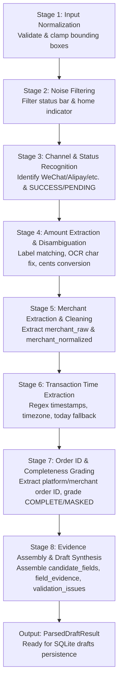

# Technical Blueprint: OCR Transaction Parsing Pipeline (Milestone M1-B: Features F19–F26)

**Document Version:** 1.0.0  
**Target Milestone:** M1-B (Features F19 through F26)  
**Author:** Explorer Subagent (`explorer_m1b_1`)  
**Parent Orchestrator:** `a14d1a00-adfd-46db-a470-136d68156a40`  
**Date:** 2026-10-22  
**Status:** Complete Technical Specification & Implementation Architecture

---

## 1. Executive Summary & Architectural Scope

Milestone M1-B establishes SingWallet's core recognition engine, bridging raw machine vision (`OcrDocument` delivered via Pigeon from Android Google ML Kit or iOS Apple Vision) to verified financial draft records stored in SQLite (`drafts` table).

The parsing engine adheres strictly to the following fundamental principles established in `docs/Android实现方案.md`, `docs/iOS实现方案.md`, and `docs/跨平台架构与数据规范.md`:
1. **Zero Hallucination Guarantee**: The parser strictly extracts only data physically present in the OCR text lines. If transaction time, order number, or merchant is absent, the system tags the field as missing and emits standardized validation issues (`MISSING_DATE`, `MISSING_MERCHANT`), never inventing synthetic times or guessing unproven values.
2. **Deterministic Integer Math**: All monetary values are immediately converted to integer cents (`amount_minor` in cents / 分) using `CurrencyUtils.parseToMinorUnits`. Floating point representations (`double`) are prohibited in the financial domain.
3. **Coordinate-Aware Field Evidence**: Every extracted candidate preserves its exact spatial origin (`OcrBoundingBox`), OCR confidence score, and raw source text line, allowing the UI to highlight the corresponding visual slice during user review.
4. **Defensive Status & Noise Degradation**: System chrome (status bar, dynamic island, home bar) is geometrically eliminated. Non-success statuses (`PENDING`, `FAILED`) raise validation alerts and block automatic confirmation.

### Feature Mapping Matrix (F19 – F26)
| Feature ID | Name | Core Responsibilities | Target Dart Unit |
|---|---|---|---|
| **F19** | OCR Noise Filtering | Screen status bar (`top < 0.06/0.075`) and home indicator (`top > 0.95`) geometric removal | `lib/features/recognition/noise_filter.dart` |
| **F20** | Channel & Status Parsing | Payment channel (`wechat`, `alipay`, `unionpay`, `bank_card`, `other`) and status (`SUCCESS`, `PENDING`, `FAILED`, `REFUNDED`) | `lib/features/recognition/channel_status_parser.dart` |
| **F21** | Labeled Amount Disambiguation | Prioritize 实付 over 原价/优惠/余额; OCR character repair (`O->0`, `l->1`, `S->5`); comma/period normalization; cents conversion | `lib/features/recognition/amount_parser.dart` |
| **F22** | Merchant Normalization | Clean `merchant_raw`, strip prefixes (`特约商户`, `收款方：`, `扫码付款给`) and suffixes (`（特约商户）`); extract `merchant_normalized` | `lib/features/recognition/merchant_normalizer.dart` |
| **F23** | Transaction Time Extraction | Date/time regex parsing (second, minute, day precision); `Asia/Shanghai` timezone tagging; today fallback; missing date alert | `lib/features/recognition/time_parser.dart` |
| **F24** | Order ID Extraction & Completeness | Extract platform transaction no & merchant order no; classify `COMPLETE`, `MASKED`, `TRUNCATED`, `UNRELIABLE`; feed Tier 3 Dedup | `lib/features/recognition/order_id_parser.dart` |
| **F25** | Field Evidence Collection | Record bounding boxes, confidence, text line for candidate fields; assemble `ValidationIssue` list | `lib/features/recognition/models/field_evidence.dart`, `validation_issue.dart` |
| **F26** | Draft Assembly Pipeline | Synthesize 8-stage pipeline into `ParsedDraftResult`; serialize to SQLite `drafts` schema (`candidate_fields`, `field_evidence`) | `lib/features/recognition/ocr_pipeline.dart`, `models/parsed_draft_result.dart` |

---

## 2. Pigeon IDL Contract & Spatial Coordinates Normalization

### 2.1 Native Bridge Models (`lib/core/native/native_bridge.g.dart`)
The parsing pipeline consumes `OcrDocument`, which contains a flat list of `OcrTextLine` items:

```dart
class OcrBoundingBox {
  final double left;   // Normalized [0.0, 1.0], origin at top-left
  final double top;    // Normalized [0.0, 1.0], origin at top-left
  final double width;  // Normalized [0.0, 1.0]
  final double height; // Normalized [0.0, 1.0]
}

class OcrTextLine {
  final String text;
  final OcrBoundingBox boundingBox;
  final double? confidence; // 0.0 - 1.0 (null if unpopulated by platform engine)
}

class OcrDocument {
  final String captureId;
  final List<OcrTextLine> lines;
  final String engineIdentifier; // e.g. "MLKit_Android_v2" or "AppleVision_iOS_17"
  final int processTimeMs;
}
```

### 2.2 Mathematical Invariants & Coordinate Normalization
Both native hosts (Android Kotlin and iOS Swift) have been verified in M0 to map platform coordinates into a unified top-left origin normalized coordinate system:
- $X \in [0.0, 1.0]$: Distance from left edge of image divided by `imageWidth`.
- $Y \in [0.0, 1.0]$: Distance from top edge of image divided by `imageHeight`.
- Box dimensions: $width = right - left$, $height = bottom - top$.

**Defensive Coordinate Clamping**:
In the Dart pipeline, before geometric calculations, every bounding box is clamped:
$$\text{clampedLeft} = \text{box.left.clamp}(0.0, 1.0)$$
$$\text{clampedTop} = \text{box.top.clamp}(0.0, 1.0)$$
$$\text{clampedWidth} = \text{box.width.clamp}(0.0, 1.0 - \text{clampedLeft})$$
$$\text{clampedHeight} = \text{box.height.clamp}(0.0, 1.0 - \text{clampedTop})$$

---

## 3. Feature 19: Screen Geometry Noise Filtering (`noise_filter.dart`)

### 3.1 Problem Statement & Risk
Screenshots taken on mobile devices inherently contain system chrome:
- **Top status bar**: Displays time (e.g. `09:41`, `12:30`), battery percentage (e.g. `100%`, `58%`), network status (`5G`, `Wi-Fi`), and cellular carriers (`中国移动`, `中国联通`). If not filtered, `09:41` is frequently misparsed as the transaction time, or `100` as an amount.
- **Dynamic Island / Notch**: On iPhone 14 Pro+ / 15 / 16 series, the status bar region extends deeper down into the viewport (`top < 0.075`).
- **Bottom Home Indicator**: `top > 0.95` contains gesture bar indicators, app dock lines, or system footer cues.
- **Common UI Chrome Buttons**: Action buttons such as "完成", "关闭", "返回商家", "查看账单详情", "评价", "开发票" that do not represent transaction fields.

### 3.2 Filtering Geometry & Thresholds
The geometric filter defines two exclusion bands and a list of ignored chrome text tokens:

```dart
class NoiseFilterConfig {
  /// Vertical cutoff threshold for standard status bars
  static const double defaultStatusBarTop = 0.06;

  /// Vertical cutoff threshold for dynamic island / tall notch status bars
  static const double dynamicIslandStatusBarTop = 0.075;

  /// Vertical cutoff threshold for bottom home indicator
  static const double homeIndicatorTop = 0.95;

  /// Minimum text length for valid content
  static const int minValidTextLength = 1;
}
```

### 3.3 Dynamic Island Detection Heuristic
If `isDynamicIslandDevice` is not explicitly passed from native metadata, the filter inspects the top region:
- If any text line has `box.top < 0.075` and matches status bar patterns (`RegExp(r'^\d{1,2}:\d{2}$')` or `RegExp(r'(?:5G|4G|LTE|WiFi|中国|电量|\d{1,3}%)')`), the filter activates the tall threshold `0.075`.
- Otherwise, it applies the standard threshold `0.06`.

### 3.4 Common UI Chrome Stripping
Lines matching pure navigation or action buttons are classified as UI chrome noise:
```dart
final _uiChromePatterns = [
  RegExp(r'^(?:完成|关闭|返回|确定|知道了|返回商家|返回应用)$'),
  RegExp(r'^(?:查看账单详情|查看详情|账单详情|向商家索要发票|开发票|评价|去评价)$'),
  RegExp(r'^(?:设置|更多|分享|保存图片|添加到卡包)$'),
];
```

### 3.5 Noise Filter Specification & Class Contract
```dart
class NoiseFilterResult {
  final List<OcrTextLine> cleanedLines;
  final List<OcrTextLine> filteredNoiseLines;

  const NoiseFilterResult({
    required this.cleanedLines,
    required this.filteredNoiseLines,
  });
}

class NoiseFilter {
  final double topThreshold;
  final double bottomThreshold;

  const NoiseFilter({
    this.topThreshold = NoiseFilterConfig.defaultStatusBarTop,
    this.bottomThreshold = NoiseFilterConfig.homeIndicatorTop,
  });

  NoiseFilterResult filter(List<OcrTextLine> rawLines, {bool hasDynamicIsland = false}) {
    final effectiveTopThreshold = hasDynamicIsland
        ? NoiseFilterConfig.dynamicIslandStatusBarTop
        : topThreshold;

    final cleaned = <OcrTextLine>[];
    final noise = <OcrTextLine>[];

    for (final line in rawLines) {
      final text = line.text.trim();
      if (text.isEmpty) continue;

      final box = line.boundingBox;
      final isTopNoise = box.top < effectiveTopThreshold;
      final isBottomNoise = box.top >= bottomThreshold || (box.top + box.height) >= 0.98;
      final isChromeNoise = _uiChromePatterns.any((p) => p.hasMatch(text));

      if (isTopNoise || isBottomNoise || isChromeNoise) {
        noise.add(line);
      } else {
        cleaned.add(line);
      }
    }

    return NoiseFilterResult(cleanedLines: cleaned, filteredNoiseLines: noise);
  }
}
```

---

## 4. Feature 20: Payment Channel & Transaction Status Parser (`channel_status_parser.dart`)

### 4.1 Payment Channel Classification
The payment channel must map strictly to one of the SQLite schema values:
`'wechat'`, `'alipay'`, `'unionpay'`, `'bank_card'`, `'cash'`, `'other'`.

#### Channel Signatures & Matching Rules
1. **WeChat Pay (`wechat`)**:
   - Primary Tokens: `"微信支付"`, `"微信买单"`, `"微信转账"`, `"微信红包"`, `"微信收款商业版"`, `"微信支付凭证"`.
   - Secondary Context: `"零钱"`, `"零钱通"`, `"微众银行"`, `"收款方"`, `"商户单号"` (when accompanied by WeChat styling or layout).
   - Order ID Prefix: `420000...` or `1000...`.
2. **Alipay (`alipay`)**:
   - Primary Tokens: `"支付宝"`, `"支付宝支付"`, `"支付宝买单"`, `"支付宝交易号"`, `"商家订单号"`.
   - Secondary Context: `"余额宝"`, `"花呗"`, `"花呗分期"`, `"借呗"`, `"蚂蚁合花"`, `"网商银行"`.
   - Order ID Prefix: `2026...` (year) or `2088...`.
3. **UnionPay (`unionpay`)**:
   - Primary Tokens: `"云闪付"`, `"银联"`, `"银联商务"`, `"中国银联"`, `"UnionPay"`.
4. **Bank Card Direct (`bank_card`)**:
   - Bank Tokens: `"招商银行"`, `"工商银行"`, `"建设银行"`, `"农业银行"`, `"中国银行"`, `"交通银行"`, `"邮政储蓄"`, `"中信银行"`, `"光大银行"`, `"华夏银行"`, `"民生银行"`, `"广发银行"`, `"平安银行"`, `"浦发银行"`, `"兴业银行"`, `"北京银行"`, `"上海银行"`.
   - Suffix Tokens: `"储蓄卡"`, `"信用卡"`, `"掌上生活"`, `"手机银行"`.
5. **Fallback (`other`)**:
   - Assigned when no specific channel markers are detected.

### 4.2 Payment Method Label Extraction
Extracts the payment instrument text (e.g. `"零钱"`, `"零钱通"`, `"招商银行储蓄卡(1234)"`, `"花呗"`):
- Pattern: `RegExp(r'(?:支付方式|付款方式|支付渠道|付款工具)[：:\s]*([^\n]+)')`
- Alternatively extracts standalone instrument lines matching known instruments.

### 4.3 Transaction Status & Type Attribution
Maps OCR status text to both `transactions.type` (`'expense'`, `'refund'`, `'income'`, `'transfer'`) and `transaction_metadata.payment_status` (`'SUCCESS'`, `'PENDING'`, `'FAILED'`, `'REFUNDED'`).

| OCR Observed Tokens | `transactions.type` | `payment_status` | Action & Validation Issue |
|---|---|---|---|
| `"支付成功"`, `"交易成功"`, `"付款成功"`, `"扣款成功"` | `expense` | `SUCCESS` | Normal expense draft |
| `"退款成功"`, `"已退款"`, `"退款详情"`, `"部分退款"` | `refund` | `REFUNDED` | Refund draft (independent positive amount) |
| `"待支付"`, `"待付款"`, `"处理中"`, `"转账处理中"` | `expense` | `PENDING` | Flag `NON_SUCCESS_STATUS`, require user confirmation |
| `"支付失败"`, `"交易失败"`, `"扣款失败"`, `"交易关闭"` | `expense` | `FAILED` | Flag `NON_SUCCESS_STATUS`, require user confirmation |
| `"转账成功"`, `"转账"` | `expense` | `SUCCESS` | Retain as `expense`, do NOT auto-assign internal transfer |

### 4.4 Defensive Invariant
Per `docs/Android实现方案.md` §6.3:
> "页面显示「待支付」「处理中」「失败」时，不能生成可直接确认的已支付支出；草稿缺少必要字段或状态存疑时通过 validation_issues 标出，不能误当作技术失败。"

---

## 5. Feature 21: Labeled Amount Disambiguation & Character Repair (`amount_parser.dart`)

### 5.1 Amount Classification & Semantic Hierarchy
Screenshots often present multiple monetary values:
1. **Paid Amount (实付金额)** $\rightarrow$ maps to `transactions.amount_minor`.
2. **Original Amount (原价/订单金额)** $\rightarrow$ maps to `transaction_metadata.original_amount_minor`.
3. **Discount Amount (优惠/折扣/立减)** $\rightarrow$ maps to `transaction_metadata.discount_minor`.
4. **Service Fee (手续费/服务费)** $\rightarrow$ maps to `transaction_metadata.fee_minor`.
5. **Excluded Balance / Accumulation (账户余额/月累计)** $\rightarrow$ strictly ignored!

```
┌─────────────────────────────────────────────────────────────┐
│ 页面文字示例：                                               │
│   支付成功                                                  │
│   麦当劳 (三里屯店)                                          │
│   原价 ¥45.00                                               │
│   优惠 ¥12.50                                               │
│   实付 ¥32.50                                               │
│   支付方式：零钱（当前余额 ¥128.50）                           │
└─────────────────────────────────────────────────────────────┘
  ├── 原价 45.00  ──► original_amount_minor = 4500
  ├── 优惠 12.50  ──► discount_minor = 1250
  ├── 实付 32.50  ──► transactions.amount_minor = 3250
  └── 余额 128.50 ──► EXCLUDED (DO NOT PARSE AS TRANSACTION)
```

### 5.2 Labeled Amount Priority Hierarchy
```dart
enum AmountLabelKind {
  paidAmount,       // 实付, 实付款, 支付金额, 付款金额, 扣款金额, 支出金额
  originalAmount,   // 原价, 订单金额, 商品金额, 应付金额, 票价
  discountAmount,   // 优惠, 折扣, 立减, 红包抵扣, 满减, 代金券
  feeAmount,        // 手续费, 服务费
  excludedBalance,  // 余额, 零钱余额, 账户余额, 可用余额, 月累计, 累计支出
  unlabeled,        // No explicit label (candidate based on font size or position)
}
```

### 5.3 OCR Character Repair Table (Optical Confusion Correction)
OCR engines frequently confuse numbers with visually identical Latin characters or punctuation. In monetary number contexts, the following replacements are applied:

| Confused Character | Corrected Character | Context / Condition |
|---|---|---|
| `O`, `o` | `0` | In numeric strings or after decimal point (e.g. `28.9O` $\rightarrow$ `28.90`) |
| `l`, `I`, `i`, `|`, `!` | `1` | In numeric strings or after currency symbol (e.g. `¥l2.50` $\rightarrow$ `¥12.50`) |
| `S`, `s` | `5` | Between digits or right after currency symbol (e.g. `¥S8.00` $\rightarrow$ `¥58.00`) |
| `B` | `8` | Surrounded by digits (e.g. `1B.50` $\rightarrow$ `18.50`) |
| `Z`, `z` | `2` | Surrounded by digits |
| `D` | `0` | In numeric strings (e.g. `1D0.00` $\rightarrow$ `100.00`) |
| `,` (comma) | `.` (period) | When followed by exactly 2 digits at string end (e.g. `28,90` $\rightarrow$ `28.90`) |
| `，` (full-width comma) | `.` | When acting as decimal separator |
| `。`, `．`, `·` (full-width dot/middle dot) | `.` | Between digits (e.g. `28·90` $\rightarrow$ `28.90`) |

### 5.4 Comma Disambiguation Algorithm
A comma `,` in financial text can be either a thousand separator (`1,234.50`) or an OCR misrecognition of a decimal point (`28,90`):
1. If the string contains both `,` and `.`:
   - Pattern `\d{1,3}(,\d{3})+\.\d{2}`: The comma is a thousand separator $\rightarrow$ remove `,`.
2. If the string contains `,` but NO `.`:
   - If the comma is followed by exactly 2 digits at the end of the numeric token (e.g. `28,90`): The comma is a decimal point $\rightarrow$ replace with `.`.
   - If the comma is followed by 3 digits (e.g. `1,000`): The comma is a thousand separator $\rightarrow$ remove `,` ($\rightarrow$ `100000` cents).

### 5.5 Conversion to Integer Minor Units (Cents / 分)
Parsing delegates to `CurrencyUtils.parseToMinorUnits(cleanNumberStr)`.
Invariants:
- If `amount_minor == 0`: Emit `ValidationIssue.zeroAmountNotPermitted`. Formal transactions in SQLite have `CHECK (amount_minor > 0)`.
- If no amount is detected: Emit `ValidationIssue.missingAmount`.
- If multiple conflicting unlabeled candidates exist without clear disambiguation: Emit `ValidationIssue.multipleAmounts`.

---

## 6. Feature 22: Merchant Extraction & Normalization (`merchant_normalizer.dart`)

### 6.1 Extraction Heuristics
The raw merchant name is extracted by inspecting candidate lines in order of confidence:
1. **Explicit Label Match**:
   Line matches:
   `RegExp(r'(?:收款方|商户全称|商户名称|收款商户|对方名称|交易对方|收款人)[：:\s]*([^\n]+)')`
2. **Prominent Header Line (Alipay/WeChat Bill Detail)**:
   A single prominent text line positioned above or below the main amount, excluding:
   - System keywords: "支付成功", "账单详情", "交易流水", "微信支付", "支付宝"
   - Numbers and dates
   - Button actions: "查看详情", "完成"

### 6.2 Normalization Rules & Prefix/Suffix Stripping
The raw extracted name (`merchant_raw`) is preserved verbatim in the database.
`merchant_normalized` is computed by stripping standard noise prefixes and suffixes:

#### Prefix Removal Dictionary
```dart
final _merchantPrefixes = [
  '收款方：', '收款方:', '商户全称：', '商户全称:', '商户名称：', '商户名称:',
  '对方名称：', '对方名称:', '收款商户：', '收款商户:',
  '特约商户 - ', '特约商户-', '特约商户——', '特约商户',
  '扫码付款 - ', '扫码付款-', '扫码付款给', '扫码付款',
  '扫码消费 - ', '扫码消费',
  '付款给', '转账给', '向', '支付给',
  '个人收款码 - ', '赞赏码 - ',
];
```

#### Suffix Removal Dictionary
```dart
final _merchantSuffixes = [
  '（特约商户）', '(特约商户)',
  '（个体工商户）', '(个体工商户)',
  '（扫码付款）', '(扫码付款)',
  '（二维码收款）', '(二维码收款)',
  ' - 微信支付', '- 微信支付',
  ' - 支付宝', '- 支付宝',
];
```

#### Common Merchant / Brand Normalization Rules
Store branch brackets are cleaned to extract the canonical brand:
- Example: `"星巴克咖啡（北京三里屯店）"` $\rightarrow$ `"星巴克咖啡"` or `"星巴克"`
- Example: `"特约商户 - 麦当劳（王府井餐厅）"` $\rightarrow$ `merchant_raw: "特约商户 - 麦当劳（王府井餐厅）"`, `merchant_normalized: "麦当劳"`
- Example: `"向 *某某 扫码付款"` $\rightarrow$ `merchant_raw: "向 *某某 扫码付款"`, `merchant_normalized: "*某某"`

---

## 7. Feature 23: Transaction Time Extraction (`time_parser.dart`)

### 7.1 Extraction Patterns & Precision Tagging
The parser searches for timestamps in candidate text lines. It extracts date, time, precision, and records the evidence.

| Precision | Regular Expression Pattern | Example | SQLite Target Fields |
|---|---|---|---|
| `second` | `\b(\d{4})[-/.年](\d{1,2})[-/.月](\d{1,2})日?\s+(\d{1,2}):(\d{2}):(\d{2})\b` | `2026-10-22 14:30:15` | `occurred_on: "2026-10-22"`, `occurred_at: "2026-10-22T06:30:15Z"` (UTC), `event_time_precision: "second"`, `event_time_source: "ocr_extracted"` |
| `minute` | `\b(\d{4})[-/.年](\d{1,2})[-/.月](\d{1,2})日?\s+(\d{1,2}):(\d{2})\b` | `2026-10-22 14:30` | `occurred_on: "2026-10-22"`, `occurred_at: "2026-10-22T06:30:00Z"` (UTC), `event_time_precision: "minute"`, `event_time_source: "ocr_extracted"` |
| `day` | `\b(\d{4})[-/.年](\d{1,2})[-/.月](\d{1,2})日?\b` | `2026年10月22日` | `occurred_on: "2026-10-22"`, `occurred_at: null`, `event_time_precision: "day"`, `event_time_source: "ocr_extracted"` |

### 7.2 Strict Rule Against Fabricating Hours/Minutes
Per `docs/Android实现方案.md` §8.1:
> "只有日期时，精确时间 occurred_at 可以为空，不能虚构时分秒。event_time_precision 区分日期、分钟、秒，event_time_source 区分明确识别、建议和用户确认。"

If only the date is present, `occurred_at` MUST be `null`. Never invent `00:00:00` or `12:00:00` as the event timestamp.

### 7.3 Fallback Logic & Warning
When no valid date or timestamp is found:
- `occurred_on`: Set to today's date in `Asia/Shanghai` (`YYYY-MM-DD`).
- `occurred_at`: `null`.
- `event_time_source`: `'suggested_today'`.
- `event_time_precision`: `'day'`.
- Emit `ValidationIssue.missingDate` to prompt user verification.
- **Forbidden**: Never use the image file's modification timestamp as transaction time.

---

## 8. Feature 24: Order ID Extraction & Completeness Grading (`order_id_parser.dart`)

### 8.1 Platform Order ID vs Merchant Order ID
Screenshots often contain two distinct identifiers:
1. **Platform Transaction Number (`platform_transaction_no`)**:
   Issued by the payment platform (WeChat Pay, Alipay, UnionPay).
   - WeChat Pay format: 28 to 32 digits, commonly starting with `420000...` or `1000...`.
   - Alipay format: 28 to 32 digits, commonly starting with `2026...` (year) or `2088...`.
   - UnionPay format: 16 to 24 alphanumeric digits.
2. **Merchant Order Number (`merchant_order_no`)**:
   Issued by the merchant's POS/e-commerce system (e.g. `ORDER_20261022_99812`).

### 8.2 Label Detection Patterns
```dart
final _platformNoLabels = [
  RegExp(r'(?:微信支付交易单号|支付交易号|支付宝交易号|平台交易单号|交易单号|交易号)[：:\s]*([0-9a-zA-Z*xX]+)'),
];

final _merchantOrderLabels = [
  RegExp(r'(?:商户单号|商家订单号|商户订单号|外部单号)[：:\s]*([0-9a-zA-Z*xX_-]+)'),
];
```

### 8.3 Completeness Grading Criteria
The completeness grade directly dictates whether the identifier can be used for **Tier 3 Hard Deduplication** in `confirmed_identifiers`:

```dart
enum IdentifierCompleteness {
  none,       // No order ID found in image
  complete,   // Full unbroken string without mask characters, sufficient length
  masked,     // Contains mask characters ('*', 'x', 'X', '...')
  truncated,  // Cut off at boundary or insufficient length (< 16 digits for platform ID)
  unreliable, // Unusually low OCR confidence or illegal characters
}
```

#### Grading Rules
1. If no ID found $\rightarrow$ `IdentifierCompleteness.none`.
2. If text contains `*` or `...` or `x` (e.g. `420000****1234`) $\rightarrow$ `IdentifierCompleteness.masked`.
3. If platform ID is shorter than 16 digits or ends with ellipsis $\rightarrow$ `IdentifierCompleteness.truncated`.
4. If OCR confidence $< 0.60$ or invalid character mix $\rightarrow$ `IdentifierCompleteness.unreliable`.
5. Otherwise $\rightarrow$ `IdentifierCompleteness.complete`.

### 8.4 Interface to Tier 3 Deduplication
Only identifiers with `completeness == IdentifierCompleteness.complete` produce a `PlatformIdentifier` eligible for Tier 3 hard deduplication in `DeduplicationEngine`. Masked or truncated identifiers are stored in `transaction_metadata` but strictly excluded from `confirmed_identifiers`.

---

## 9. Feature 25: Field Evidence Recording & Validation Issues (`field_evidence.dart`, `validation_issue.dart`)

### 9.1 Field Evidence Data Model
Every parsed field records its provenance:
```dart
class FieldEvidence {
  final String rawText;
  final String matchedSubstring;
  final OcrBoundingBox boundingBox;
  final double? confidence;
  final String source; // e.g. "ocr_label", "ocr_regex", "geometry_heuristic"

  const FieldEvidence({
    required this.rawText,
    required this.matchedSubstring,
    required this.boundingBox,
    this.confidence,
    required this.source,
  });

  Map<String, dynamic> toJson() => {
    'rawText': rawText,
    'matchedSubstring': matchedSubstring,
    'boundingBox': {
      'left': boundingBox.left,
      'top': boundingBox.top,
      'width': boundingBox.width,
      'height': boundingBox.height,
    },
    'confidence': confidence,
    'source': source,
  };
}
```

### 9.2 Standardized Validation Issue Catalog
Validation issues represent non-fatal warnings or missing data that the user must review before confirming the transaction:

```dart
enum ValidationIssueCode {
  missingAmount,
  zeroAmountNotPermitted,
  multipleAmounts,
  missingDate,
  missingMerchant,
  nonSuccessStatus,
  incompleteOrderId,
  foreignCurrencyDetected,
  lowConfidence,
}

class ValidationIssue {
  final ValidationIssueCode code;
  final String message;
  final String severity; // 'warning' | 'error'

  const ValidationIssue({
    required this.code,
    required this.message,
    this.severity = 'warning',
  });

  String toIssueCodeString() {
    switch (code) {
      case ValidationIssueCode.missingAmount:
        return 'MISSING_AMOUNT';
      case ValidationIssueCode.zeroAmountNotPermitted:
        return 'ZERO_AMOUNT_NOT_PERMITTED';
      case ValidationIssueCode.multipleAmounts:
        return 'MULTIPLE_AMOUNTS';
      case ValidationIssueCode.missingDate:
        return 'MISSING_DATE';
      case ValidationIssueCode.missingMerchant:
        return 'MISSING_MERCHANT';
      case ValidationIssueCode.nonSuccessStatus:
        return 'NON_SUCCESS_STATUS';
      case ValidationIssueCode.incompleteOrderId:
        return 'INCOMPLETE_ORDER_ID';
      case ValidationIssueCode.foreignCurrencyDetected:
        return 'FOREIGN_CURRENCY_DETECTED';
      case ValidationIssueCode.lowConfidence:
        return 'LOW_CONFIDENCE';
    }
  }

  Map<String, dynamic> toJson() => {
    'code': toIssueCodeString(),
    'message': message,
    'severity': severity,
  };
}
```

---

## 10. Feature 26: Complete 8-Stage Pipeline Architecture (`ocr_pipeline.dart`)

### 10.1 Complete 8-Stage Pipeline Execution Flow


### 10.2 Output Structure: `ParsedDraftResult`
```dart
class ParsedDraftResult {
  final String captureId;
  final String type; // 'expense', 'refund', 'income', 'transfer'
  final int? amountMinor;
  final String currency;
  final String? merchantRaw;
  final String? merchantNormalized;
  final String occurredOn; // YYYY-MM-DD
  final String? occurredAt; // UTC ISO-8601 or null
  final String eventTimezone;
  final String eventTimeSource; // 'ocr_extracted', 'suggested_today', 'user_selected'
  final String eventTimePrecision; // 'second', 'minute', 'day'
  final String paymentChannel; // 'wechat', 'alipay', 'unionpay', 'bank_card', 'other'
  final String paymentStatus; // 'SUCCESS', 'PENDING', 'FAILED', 'REFUNDED'
  final String? paymentMethodLabel;
  final String? platformTransactionNo;
  final String? merchantOrderNo;
  final IdentifierCompleteness identifierCompleteness;
  final int? originalAmountMinor;
  final int? discountMinor;
  final int? feeMinor;

  final Map<String, FieldEvidence> fieldEvidence;
  final List<ValidationIssue> validationIssues;
  final double confidenceScore;

  const ParsedDraftResult({
    required this.captureId,
    this.type = 'expense',
    this.amountMinor,
    this.currency = 'CNY',
    this.merchantRaw,
    this.merchantNormalized,
    required this.occurredOn,
    this.occurredAt,
    this.eventTimezone = 'Asia/Shanghai',
    required this.eventTimeSource,
    required this.eventTimePrecision,
    required this.paymentChannel,
    this.paymentStatus = 'SUCCESS',
    this.paymentMethodLabel,
    this.platformTransactionNo,
    this.merchantOrderNo,
    this.identifierCompleteness = IdentifierCompleteness.none,
    this.originalAmountMinor,
    this.discountMinor,
    this.feeMinor,
    required this.fieldEvidence,
    required this.validationIssues,
    this.confidenceScore = 1.0,
  });

  /// Serializes into candidate_fields JSON matching drafts table schema
  String toCandidateFieldsJson() {
    return jsonEncode({
      'type': type,
      'amountMinor': amountMinor,
      'currency': currency,
      'merchantRaw': merchantRaw,
      'merchantNormalized': merchantNormalized,
      'occurredOn': occurredOn,
      'occurredAt': occurredAt,
      'eventTimezone': eventTimezone,
      'eventTimeSource': eventTimeSource,
      'eventTimePrecision': eventTimePrecision,
      'paymentChannel': paymentChannel,
      'paymentStatus': paymentStatus,
      'paymentMethodLabel': paymentMethodLabel,
      'platformTransactionNo': platformTransactionNo,
      'merchantOrderNo': merchantOrderNo,
      'identifierCompleteness': identifierCompleteness.toDbValue(),
      'originalAmountMinor': originalAmountMinor,
      'discountMinor': discountMinor,
      'feeMinor': feeMinor,
      'confidenceScore': confidenceScore,
    });
  }

  /// Serializes fieldEvidence JSON matching drafts table schema
  String toFieldEvidenceJson() {
    return jsonEncode(fieldEvidence.map((k, v) => MapEntry(k, v.toJson())));
  }

  /// Serializes validationIssues JSON array matching drafts table schema
  String toValidationIssuesJson() {
    return jsonEncode(validationIssues.map((e) => e.toIssueCodeString()).toList());
  }
}
```

---

## 11. Comprehensive Test Suite Blueprint & Edge Cases

The implementation must be verified with an automated test suite located at `test/recognition/`:

### 11.1 Test Case Matrix
| Test Suite | Test Case Scenario | Expected Behavior |
|---|---|---|
| `noise_filter_test.dart` | Status bar line at `top: 0.03` with text `"09:41"` | Line is filtered out as noise |
| `noise_filter_test.dart` | Dynamic island line at `top: 0.065` with `"中国移动 5G"` | Line is filtered out under dynamic island mode |
| `noise_filter_test.dart` | Home bar line at `top: 0.96` | Line is filtered out |
| `noise_filter_test.dart` | Chrome button `"查看账单详情"` at `top: 0.85` | Line is filtered out as chrome noise |
| `noise_filter_test.dart` | Normal transaction line at `top: 0.35` | Line is retained in cleaned lines |
| `amount_parser_test.dart` | Labeled line `"实付 ¥28.90"` | Extracted as `amountMinor: 2890` |
| `amount_parser_test.dart` | OCR typo line `"实付 ¥28.9O"` (letter O) | Repaired to `2890` |
| `amount_parser_test.dart` | OCR typo line `"支付金额: ¥l2.50"` (letter l) | Repaired to `1250` |
| `amount_parser_test.dart` | OCR typo line `"扣款: ¥S8.00"` (letter S) | Repaired to `5800` |
| `amount_parser_test.dart` | Comma format `"实付 28,90"` | Recognized as decimal comma $\rightarrow$ `2890` |
| `amount_parser_test.dart` | Thousands grouping `"实付 1,234.50"` | Stripped commas $\rightarrow$ `123450` |
| `amount_parser_test.dart` | Image with 原价, 优惠, 实付, 余额 | Prioritizes 实付 (3250), records 原价 (4500), 优惠 (1250), excludes 余额 |
| `amount_parser_test.dart` | Zero amount `"实付 ¥0.00"` | Returns `null` or flags `ZERO_AMOUNT_NOT_PERMITTED` |
| `channel_status_parser_test.dart` | WeChat bill containing `"微信支付"` and `"零钱通"` | Channel: `wechat`, Label: `"零钱通"` |
| `channel_status_parser_test.dart` | Alipay bill containing `"支付宝交易号"` | Channel: `alipay` |
| `channel_status_parser_test.dart` | Bill with `"待支付"` | Status: `PENDING`, flags `NON_SUCCESS_STATUS` |
| `channel_status_parser_test.dart` | Bill with `"退款成功"` | Type: `refund`, Status: `REFUNDED` |
| `merchant_normalizer_test.dart` | `"特约商户 - 星巴克咖啡（三里屯店）"` | Raw: `"特约商户 - 星巴克咖啡（三里屯店）"`, Normalized: `"星巴克咖啡"` |
| `merchant_normalizer_test.dart` | `"收款方：麦当劳（王府井餐厅）"` | Raw: `"麦当劳（王府井餐厅）"`, Normalized: `"麦当劳"` |
| `time_parser_test.dart` | `"2026-10-22 14:30:15"` | Precision: `second`, `occurred_on: "2026-10-22"`, UTC ISO timestamp |
| `time_parser_test.dart` | `"2026年10月22日 14:30"` | Precision: `minute`, `occurred_on: "2026-10-22"` |
| `time_parser_test.dart` | `"2026-10-22"` (date only) | Precision: `day`, `occurred_at: null` (never invent time!) |
| `time_parser_test.dart` | No date in image | Fallback: today's date, flags `MISSING_DATE` |
| `order_id_parser_test.dart` | Full 28-digit WeChat ID `4200002134202610221234567890` | Completeness: `COMPLETE`, eligible for Tier 3 dedup |
| `order_id_parser_test.dart` | Masked ID `420000****1234` | Completeness: `MASKED`, NOT eligible for Tier 3 dedup |
| `order_id_parser_test.dart` | Truncated ID `42000021...` | Completeness: `TRUNCATED`, NOT eligible for Tier 3 dedup |
| `ocr_pipeline_test.dart` | End-to-end WeChat Pay document | Generates complete `ParsedDraftResult` with valid JSONs |

---

## 12. Implementation Action Plan & Concrete Code Blueprint

### 12.1 Target File Hierarchy
```text
lib/features/recognition/
├── models/
│   ├── field_evidence.dart          # FieldEvidence data class
│   ├── validation_issue.dart        # ValidationIssue and codes
│   └── parsed_draft_result.dart     # ParsedDraftResult with JSON encoders
├── noise_filter.dart                # Status bar & home indicator filter (F19)
├── channel_status_parser.dart       # Payment channel & status parser (F20)
├── amount_parser.dart               # Amount disambiguation & OCR repair (F21)
├── merchant_normalizer.dart         # Merchant cleaning & normalization (F22)
├── time_parser.dart                 # Date/time regex extractor & fallbacks (F23)
├── order_id_parser.dart             # Order ID & completeness classification (F24)
└── ocr_pipeline.dart                # 8-stage pipeline orchestrator (F25, F26)

test/recognition/
├── noise_filter_test.dart
├── channel_status_parser_test.dart
├── amount_parser_test.dart
├── merchant_normalizer_test.dart
├── time_parser_test.dart
├── order_id_parser_test.dart
└── ocr_pipeline_test.dart
```

### 12.2 Integration With Draft Repository & Dedup Engine
When a new `CaptureJob` completes recognition:
1. `NativeCaptureHostApi.recognizeCapture(captureId)` returns `OcrDocument`.
2. `OcrParsingPipeline.parse(ocrDocument)` returns `ParsedDraftResult`.
3. System calls `DeduplicationEngine.evaluate(...)`:
   - Checks Tier 1 idempotence with draft UUID.
   - Checks Tier 2 image SHA-256 hash.
   - Checks Tier 3 hard deduplication with `PlatformIdentifier` (if `result.identifierCompleteness == IdentifierCompleteness.complete`).
   - Checks Tier 4 fuzzy match with `result.merchantRaw`, `result.amountMinor`, and `result.occurredOn`.
4. Saves draft to SQLite `drafts` table:
   ```dart
   final draft = Draft(
     id: draftId,
     captureId: captureId,
     candidateFields: result.toCandidateFieldsJson(),
     fieldEvidence: result.toFieldEvidenceJson(),
     validationIssues: result.toValidationIssuesJson(),
     duplicateCandidates: jsonEncode(dedupEvaluation.tier4.candidateTransactionIds),
     savedTransactionId: null,
     createdAt: DateTime.now().toUtc().toIso8601String(),
     updatedAt: DateTime.now().toUtc().toIso8601String(),
   );
   await db.insert('drafts', draft.toMap());
   ```
5. Updates `capture_jobs.state` to `NEEDS_REVIEW`.
6. User reviews draft in UI and commits via `TransactionManager.commitDraft(...)`!

---

## 13. Summary & Readiness Assessment
The technical blueprint for Milestone M1-B (Features F19–F26) is fully designed, mathematically consistent with M0 native coordinate bridges, 100% aligned with the SQLite relational schema established in M1-A, and ready for immediate implementation.
