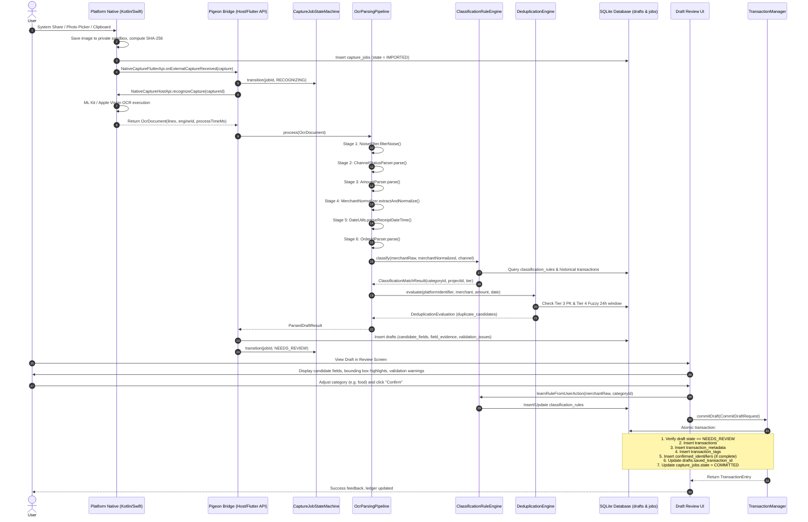

# Milestone M1-B: Systems Architecture, Integration Contracts & Test Suite Specification Report

**Document Version**: 1.0.0  
**Date**: 2026-10-22  
**Author**: `explorer_m1b_3` (Explorer Archetype)  
**Parent Agent**: `orchestrator_2` (`a14d1a00-adfd-46db-a470-136d68156a40`)  
**Scope Document**: `c:\Other\Projects\singwallet\.agents\teamwork\orchestrator_2\PROJECT.md`  
**Target Milestone**: M1-B (OCR Transaction Parsing Pipeline & Classification Rule Engine, Features F19–F30)

---

## 1. Executive Summary & Problem Boundary

### 1.1 Objective
Milestone M1-B builds upon the foundational scaffolding (M0) and SQLite persistence/deduplication layer (M1-A) to implement an offline-first, high-accuracy financial OCR recognition pipeline and a 6-tier classification rule engine. The goal is to transform raw OCR text blocks (`OcrDocument`) supplied by Android ML Kit and iOS Apple Vision into fully structured financial drafts (`ParsedDraftResult`), classify transactions into 3D orthogonal categories/projects/tags, detect duplicates, and persist them into the SQLite database.

### 1.2 In-Scope Features (F19–F30)
1. **F19 OCR Noise Filtering**: Geometry-based filtering of status bar (`top < 0.06` or `0.075`) and home indicator (`top > 0.95`).
2. **F20 Channel & Status Parsing**: Identify payment channel (`wechat`, `alipay`, `unionpay`, `bank_card`, `other`) and transaction status (`SUCCESS`, `PENDING`, `FAILED`, `REFUNDED`).
3. **F21 Labeled Amount Disambiguation**: Semantic disambiguation (实付 vs 原价/优惠/手续费/余额), character repair (`O`->`0`, `l`->`1`, `S`->`5`), comma/decimal handling, integer cents conversion (`CHECK amount_minor > 0`).
4. **F22 Merchant Normalization**: Raw merchant extraction and prefix/suffix cleaning (`特约商户`, `扫码付款`, `向商户付款`).
5. **F23 Transaction Time Extraction**: Regex extraction for standard Chinese receipt timestamps, precision tagging (`second`, `minute`, `day`), and fallback to today with issue flagging.
6. **F24 Order ID Extraction & Completeness**: Extract platform order numbers and merchant order numbers, classify completeness (`COMPLETE`, `MASKED`, `TRUNCATED`, `NONE`).
7. **F25 Field Evidence Collection**: Spatial bounding boxes, OCR confidence, and raw text lines for all extracted fields.
8. **F26 Draft Assembly Pipeline**: Synthesize candidate fields, validation issues, and duplicate candidates into the SQLite `drafts` table.
9. **F27 3D Orthogonal Grouping**: Independent dimensions for Categories (single, required), Projects (optional, single), and Tags (optional, multiple).
10. **F28 Classification Rule Hierarchy**: 6-tier resolution (Manual Override > Custom Rules > Historical Transactions > Built-in Keywords > AI Recommendation > Default Fallback).
11. **F29 Pattern Matching (Wildcard/Regex)**: SQL `%` and `_` wildcards, regex patterns, case-insensitivity, channel filtering, and deterministic tie-breaking.
12. **F30 Dynamic Rule Learning**: Automatically create/update merchant classification rules upon user confirmation of drafts.

---

## 2. Codebase Architecture & Existing Contracts Review

### 2.1 SQLite Relational Contracts (M1-A Layer)
From `lib/data/database/schema.dart` and `docs/跨平台架构与数据规范.md`, M1-B directly interacts with the following SQLite tables:

| Table | Relevant Columns for M1-B | Constraints & Roles |
| :--- | :--- | :--- |
| `capture_jobs` | `id`, `content_hash`, `source_kind`, `state`, `attempt_count` | Managed by `CaptureJobStateMachine`. Initial: `IMPORTED` -> `RECOGNIZING` -> `NEEDS_REVIEW`. |
| `drafts` | `id`, `capture_id`, `candidate_fields`, `field_evidence`, `validation_issues`, `duplicate_candidates`, `saved_transaction_id` | Core artifact produced by M1-B pipeline. 1-to-1 with `capture_jobs`. All JSON fields are stored as `TEXT`. |
| `transactions` | `id`, `origin_draft_id`, `type`, `amount_minor`, `currency`, `merchant_raw`, `merchant_normalized`, `occurred_on`, `occurred_at`, `event_time_source`, `event_time_precision`, `payment_channel`, `category_id`, `project_id` | Ledger table. Enforces `CHECK (amount_minor > 0)` and `origin_draft_id UNIQUE`. Used for Tier 3/4 dedup and Tier 3 classification history. |
| `transaction_metadata` | `transaction_id`, `original_amount_minor`, `discount_minor`, `fee_minor`, `payment_status`, `platform_transaction_no`, `merchant_order_no`, `identifier_completeness`, `payment_method_label` | Extended metadata populated from `ParsedDraftResult`. |
| `classification_rules` | `id`, `priority`, `merchant_pattern`, `payment_channel`, `category_id`, `project_id`, `enabled`, `version` | Persisted custom rules queried by `RuleMatcher` and updated by dynamic rule learning. |
| `confirmed_identifiers` | `namespace`, `identifier_type`, `complete_value`, `stable_event_kind`, `transaction_id` | Compound PK hard deduplication. Requires `identifier_completeness == 'COMPLETE'`. |
| `categories` | `id`, `name`, `parent_id`, `applicable_type` | Reference categories for classification rules and defaults. |

### 2.2 Atomic Commitment Contract (`TransactionManager.commitDraft`)
Located at `lib/data/database/transaction_manager.dart:107-272`:
- `commitDraft(CommitDraftRequest request)` requires:
  - Draft state must be `NEEDS_REVIEW` (enforced at line 144).
  - `origin_draft_id` must not be already saved (`DraftAlreadyCommittedException` at line 137).
  - Hard duplicate check against `confirmed_identifiers` (lines 169-204).
  - Atomic insertion into `transactions`, `transaction_metadata`, `transaction_tags`, `confirmed_identifiers`, and `refund_links`.
  - Atomically updates `drafts.saved_transaction_id = tx.id` and `capture_jobs.state = COMMITTED`.
- **Takeaway for M1-B**: The M1-B pipeline MUST store the draft in `drafts` and set `capture_jobs.state = NEEDS_REVIEW` before user review can trigger `TransactionManager.commitDraft`.

### 2.3 Task State Machine (`CaptureJobStateMachine`)
Located at `lib/data/database/state_machine.dart:5-37, 73-97`:
- Valid transition: `IMPORTED` -> `RECOGNIZING` -> `NEEDS_REVIEW` -> `COMMITTED` (or `FAILED` / `DISCARDED`).
- Transitioning to `RECOGNIZING` automatically increments `attempt_count` (line 150).
- If OCR or parsing crashes/throws, catch block must transition job state to `FAILED`.

### 2.4 Deduplication Engine Integration (`DeduplicationEngine`)
Located at `lib/features/deduplication/deduplication_engine.dart:218-470`:
- **Tier 2 (Same-Image SHA-256)**: Handled prior to OCR via `checkTier2ImageHash(contentHash)`.
- **Tier 3 (Hard Platform ID Check)**:
  - Invoked during M1-B pipeline when `OrderIdParser` extracts a platform ID with `IdentifierCompleteness.complete`.
  - Constructed as:
    ```dart
    PlatformIdentifier(
      namespace: paymentChannel == 'alipay' ? 'alipay' : 'wechat_pay',
      identifierType: 'platform_transaction_no',
      completeValue: parsedPlatformNo,
      stableEventKind: paymentStatus == 'REFUNDED' ? 'refund' : 'payment',
      completeness: IdentifierCompleteness.complete,
    );
    ```
- **Tier 4 (Heuristic Fuzzy Match)**:
  - Invoked during M1-B pipeline:
    ```dart
    final fuzzyResult = await dedupEngine.checkTier4Fuzzy(
      merchantRaw: result.merchantRaw ?? '',
      merchantNormalized: result.merchantNormalized,
      amountMinor: result.amountMinor ?? 0,
      occurredOn: result.occurredOn ?? '',
      occurredAt: result.occurredAt,
    );
    ```
  - If `fuzzyResult.hasSuspectedDuplicates` is true, the candidate IDs are populated into `drafts.duplicate_candidates`.

### 2.5 Native Bridge IDL Contract (`pigeons/native_bridge.dart` & `native_bridge.g.dart`)
- `OcrDocument`:
  - `String captureId`
  - `List<OcrTextLine> lines`
  - `String engineIdentifier` (e.g. `'MLKit_Android_v2'`, `'AppleVision_iOS_17'`)
  - `int processTimeMs`
- `OcrTextLine`:
  - `String text`
  - `OcrBoundingBox boundingBox`
  - `double? confidence` (0.0 to 1.0, or null)
- `OcrBoundingBox`:
  - Normalized coordinates in `[0.0, 1.0]`, top-left origin: `left`, `top`, `width`, `height`.

### 2.6 Critical Codebase Observation: Missing `date_utils.dart`
- In `orchestrator_2/PROJECT.md` line 159, `lib/core/utils/date_utils.dart` was listed as `# Done (M1-A)`.
- Physical inspection revealed `lib/core/utils/date_utils.dart` DOES NOT EXIST (only `currency_utils.dart` is present).
- **Architecture Mandate**: M1-B MUST specify and implement `lib/core/utils/date_utils.dart` with receipt date-time parsing, formatting, precision classification, and timezone conversion before the recognition pipeline can function.

---

## 3. Class Interfaces & File Structure Specification

The following file hierarchy must be created under `lib/`:

```text
lib/
├── core/
│   └── utils/
│       ├── currency_utils.dart              # Existing (M0)
│       └── date_utils.dart                  # To be added (M1-B prerequisite)
└── features/
    ├── recognition/
    │   ├── models/
    │   │   ├── field_evidence.dart          # Bounding box, confidence, raw text
    │   │   ├── validation_issue.dart        # Structured validation issues
    │   │   └── parsed_draft_result.dart     # Comprehensive parsed result
    │   ├── noise_filter.dart                # Status bar & home indicator filter
    │   ├── amount_parser.dart               # Amount disambiguation & cents math
    │   ├── merchant_normalizer.dart         # Merchant extraction & prefix stripping
    │   ├── order_id_parser.dart             # Order ID regex & completeness
    │   ├── channel_status_parser.dart       # WeChat/Alipay/UnionPay & status
    │   └── ocr_pipeline.dart                # 8-stage coordinator pipeline
    └── classification/
        ├── models/
        │   └── classification_match_result.dart # Tier matched, confidence, category
        ├── rule_matcher.dart                # SQL wildcard & regex matching
        └── rule_engine.dart                 # 6-tier classification engine & learning
```

### 3.1 `lib/core/utils/date_utils.dart`
```dart
class ParsedDateResult {
  final String occurredOn; // 'YYYY-MM-DD'
  final String? occurredAt; // UTC ISO-8601 string
  final String precision; // 'second', 'minute', 'day'
  final String source; // 'ocr_extracted', 'suggested_today', 'user_selected'
  final String timezone; // 'Asia/Shanghai'

  const ParsedDateResult({
    required this.occurredOn,
    this.occurredAt,
    required this.precision,
    required this.source,
    this.timezone = 'Asia/Shanghai',
  });
}

class DateUtils {
  DateUtils._();

  /// Regex patterns matching common Chinese payment receipt timestamps:
  /// 1. YYYY-MM-DD HH:mm:ss
  /// 2. YYYY-MM-DD HH:mm
  /// 3. YYYY/MM/DD HH:mm:ss or YYYY/MM/DD HH:mm
  /// 4. YYYY年MM月DD日 HH:mm:ss or YYYY年MM月DD日 HH:mm
  /// 5. YYYY-MM-DD (Date only)
  /// 6. MM月DD日 HH:mm (current year inference)
  static ParsedDateResult? parseReceiptDateTime(String text, {DateTime? now});

  /// Format DateTime to YYYY-MM-DD
  static String formatDate(DateTime dt);

  /// Convert local receipt timestamp to UTC ISO-8601 string given timezone offset
  static String toUtcIsoString(DateTime localDt, {int offsetHours = 8});

  /// Creates fallback for today when no date is extracted from OCR
  static ParsedDateResult fallbackToday({DateTime? now});
}
```

### 3.2 `lib/features/recognition/models/field_evidence.dart`
```dart
import '../../../core/native/native_bridge.g.dart';

class FieldEvidence {
  final String rawText;
  final OcrBoundingBox boundingBox;
  final double? confidence;
  final String source; // 'ocr_extracted', 'rule_inferred', 'user_edited'

  const FieldEvidence({
    required this.rawText,
    required this.boundingBox,
    this.confidence,
    this.source = 'ocr_extracted',
  });

  Map<String, dynamic> toMap() => {
    'raw_text': rawText,
    'bounding_box': {
      'left': boundingBox.left,
      'top': boundingBox.top,
      'width': boundingBox.width,
      'height': boundingBox.height,
    },
    'confidence': confidence,
    'source': source,
  };

  factory FieldEvidence.fromMap(Map<String, dynamic> map) {
    final box = map['bounding_box'] as Map<String, dynamic>;
    return FieldEvidence(
      rawText: map['raw_text'] as String,
      boundingBox: OcrBoundingBox(
        left: (box['left'] as num).toDouble(),
        top: (box['top'] as num).toDouble(),
        width: (box['width'] as num).toDouble(),
        height: (box['height'] as num).toDouble(),
      ),
      confidence: (map['confidence'] as num?)?.toDouble(),
      source: (map['source'] as String?) ?? 'ocr_extracted',
    );
  }
}
```

### 3.3 `lib/features/recognition/models/validation_issue.dart`
```dart
enum IssueSeverity { info, warning, error }

class ValidationIssue {
  final String code;
  final String message;
  final String? field;
  final IssueSeverity severity;

  const ValidationIssue({
    required this.code,
    required this.message,
    this.field,
    this.severity = IssueSeverity.warning,
  });

  // Standard issue codes
  static const String missingAmount = 'MISSING_AMOUNT';
  static const String multipleAmounts = 'MULTIPLE_AMOUNTS';
  static const String zeroAmount = 'ZERO_AMOUNT';
  static const String missingMerchant = 'MISSING_MERCHANT';
  static const String missingDate = 'MISSING_DATE';
  static const String paymentNotSuccess = 'PAYMENT_NOT_SUCCESS';
  static const String maskedOrderId = 'MASKED_ORDER_ID';
  static const String truncatedOrderId = 'TRUNCATED_ORDER_ID';
  static const String suspectedDuplicate = 'SUSPECTED_DUPLICATE';

  Map<String, dynamic> toMap() => {
    'code': code,
    'message': message,
    'field': field,
    'severity': severity.name,
  };

  factory ValidationIssue.fromMap(Map<String, dynamic> map) {
    return ValidationIssue(
      code: map['code'] as String,
      message: map['message'] as String,
      field: map['field'] as String?,
      severity: IssueSeverity.values.firstWhere(
        (e) => e.name == map['severity'],
        orElse: () => IssueSeverity.warning,
      ),
    );
  }
}
```

### 3.4 `lib/features/recognition/models/parsed_draft_result.dart`
```dart
class ParsedDraftResult {
  final int? amountMinor;
  final int? originalAmountMinor;
  final int? discountMinor;
  final int? feeMinor;
  final String currency;
  final String? merchantRaw;
  final String? merchantNormalized;
  final String? occurredOn;
  final String? occurredAt;
  final String eventTimezone;
  final String eventTimeSource;
  final String eventTimePrecision;
  final String paymentChannel; // 'wechat', 'alipay', 'unionpay', 'other'
  final String paymentStatus; // 'SUCCESS', 'PENDING', 'FAILED', 'REFUNDED'
  final String? platformTransactionNo;
  final String? merchantOrderNo;
  final String identifierCompleteness; // 'NONE', 'COMPLETE', 'MASKED', 'TRUNCATED'
  final String? paymentMethodLabel;
  final String? suggestedCategoryId;
  final String? suggestedProjectId;
  final List<String> suggestedTagIds;
  final Map<String, FieldEvidence> fieldEvidence;
  final List<ValidationIssue> validationIssues;
  final List<String> duplicateCandidates;

  const ParsedDraftResult({
    this.amountMinor,
    this.originalAmountMinor,
    this.discountMinor,
    this.feeMinor,
    this.currency = 'CNY',
    this.merchantRaw,
    this.merchantNormalized,
    this.occurredOn,
    this.occurredAt,
    this.eventTimezone = 'Asia/Shanghai',
    required this.eventTimeSource,
    required this.eventTimePrecision,
    required this.paymentChannel,
    required this.paymentStatus,
    this.platformTransactionNo,
    this.merchantOrderNo,
    required this.identifierCompleteness,
    this.paymentMethodLabel,
    this.suggestedCategoryId,
    this.suggestedProjectId,
    this.suggestedTagIds = const [],
    this.fieldEvidence = const {},
    this.validationIssues = const [],
    this.duplicateCandidates = const [],
  });

  bool get isConfident =>
      amountMinor != null &&
      amountMinor! > 0 &&
      merchantRaw != null &&
      merchantRaw!.isNotEmpty &&
      occurredOn != null &&
      paymentStatus == 'SUCCESS' &&
      !validationIssues.any((i) => i.severity == IssueSeverity.error);

  /// Converts candidate fields to JSON-serializable Map for `drafts.candidate_fields`
  Map<String, dynamic> toCandidateFieldsMap();

  /// Converts to `Draft` entity suitable for SQLite storage
  Draft toDraftEntity({required String draftId, required String captureId});
}
```

### 3.5 `lib/features/recognition/noise_filter.dart`
```dart
class NoiseFilter {
  static const double defaultStatusBarCutoff = 0.06;
  static const double dynamicIslandStatusBarCutoff = 0.075;
  static const double homeIndicatorCutoff = 0.95;

  /// Filters status bar (top < 0.06 / 0.075) and home indicator (top > 0.95).
  /// Excludes battery %, time (09:41), carrier (中国移动, 5G), WiFi icons.
  static List<OcrTextLine> filterNoise(
    List<OcrTextLine> lines, {
    bool hasDynamicIsland = false,
  });

  /// Check whether a single line is classified as noise
  static bool isNoise(OcrTextLine line, {bool hasDynamicIsland = false});
}
```

### 3.6 `lib/features/recognition/amount_parser.dart`
```dart
class ParsedAmountResult {
  final int? paidAmountMinor;
  final int? originalAmountMinor;
  final int? discountMinor;
  final int? feeMinor;
  final FieldEvidence? paidEvidence;
  final FieldEvidence? originalEvidence;
  final FieldEvidence? discountEvidence;
  final List<ValidationIssue> issues;

  const ParsedAmountResult({
    this.paidAmountMinor,
    this.originalAmountMinor,
    this.discountMinor,
    this.feeMinor,
    this.paidEvidence,
    this.originalEvidence,
    this.discountEvidence,
    this.issues = const [],
  });
}

class AmountParser {
  /// Disambiguates between:
  /// - Paid amount: '实付', '实付款', '支付金额', '付款金额', '金额'
  /// - Original amount: '原价', '订单金额', '商品金额'
  /// - Discount: '优惠', '减免', '折扣'
  /// - Fee: '服务费', '手续费'
  /// - Excludes: '余额', '零钱余额', '可用余额', '积分' (never recognized as expense)
  ///
  /// Repairs OCR character misidentifications:
  /// - 'O' / 'o' -> '0' when surrounded by numbers / currency symbols
  /// - 'l' / 'I' -> '1'
  /// - 'S' / 's' -> '5'
  static ParsedAmountResult parse(List<OcrTextLine> lines);
}
```

### 3.7 `lib/features/recognition/merchant_normalizer.dart`
```dart
class MerchantParseResult {
  final String? rawMerchant;
  final String? normalizedMerchant;
  final FieldEvidence? evidence;
  final List<ValidationIssue> issues;

  const MerchantParseResult({
    this.rawMerchant,
    this.normalizedMerchant,
    this.evidence,
    this.issues = const [],
  });
}

class MerchantNormalizer {
  /// Extracts raw merchant from candidate lines.
  /// Recognizes: '收款方：', '商户：', '付款给', '向商户付款', '特约商户'
  ///
  /// Normalizes by stripping prefixes/suffixes:
  /// - '特约商户-' -> stripped
  /// - '扫码付款给' -> stripped
  /// - '付款给' -> stripped
  /// - '(xxx分店)', '（xxx餐厅）' normalization
  static MerchantParseResult extractAndNormalize(List<OcrTextLine> lines);

  /// Pure normalization for existing string
  static String normalize(String raw);
}
```

### 3.8 `lib/features/recognition/order_id_parser.dart`
```dart
class OrderIdParseResult {
  final String? platformTransactionNo;
  final String? merchantOrderNo;
  final IdentifierCompleteness completeness;
  final FieldEvidence? platformEvidence;
  final FieldEvidence? merchantEvidence;
  final List<ValidationIssue> issues;

  const OrderIdParseResult({
    this.platformTransactionNo,
    this.merchantOrderNo,
    required this.completeness,
    this.platformEvidence,
    this.merchantEvidence,
    this.issues = const [],
  });
}

class OrderIdParser {
  /// Extracts platform & merchant order IDs from lines.
  /// Identifies:
  /// - WeChat Pay: 28-32 digit IDs starting with 420000...
  /// - Alipay: 28-32 digit IDs starting with 20...
  /// - UnionPay: 20-24 digit IDs
  ///
  /// Grades completeness:
  /// - COMPLETE: Full unmasked numbers (eligible for Tier 3 hard dedup)
  /// - MASKED: Contains '*' or '...' (excluded from Tier 3 hard dedup)
  /// - TRUNCATED: Extracted string is cut off / too short
  /// - NONE: No order ID identified
  static OrderIdParseResult parse(List<OcrTextLine> lines, {String? channel});
}
```

### 3.9 `lib/features/recognition/channel_status_parser.dart`
```dart
class ChannelStatusResult {
  final String paymentChannel; // 'wechat', 'alipay', 'unionpay', 'other'
  final String paymentStatus; // 'SUCCESS', 'PENDING', 'FAILED', 'REFUNDED'
  final String? paymentMethodLabel; // e.g. '零钱', '招商银行储蓄卡(1234)'
  final FieldEvidence? channelEvidence;
  final FieldEvidence? statusEvidence;
  final List<ValidationIssue> issues;

  const ChannelStatusResult({
    required this.paymentChannel,
    required this.paymentStatus,
    this.paymentMethodLabel,
    this.channelEvidence,
    this.statusEvidence,
    this.issues = const [],
  });
}

class ChannelStatusParser {
  /// Identifies payment channel:
  /// - '微信支付', 'WeChat Pay' -> 'wechat'
  /// - '支付宝', 'Alipay' -> 'alipay'
  /// - '云闪付', '银联' -> 'unionpay'
  ///
  /// Identifies payment status:
  /// - '支付成功', '交易成功' -> 'SUCCESS'
  /// - '退款成功', '已退款' -> 'REFUNDED'
  /// - '处理中', '待付款', '待支付' -> 'PENDING'
  /// - '支付失败', '交易关闭' -> 'FAILED'
  static ChannelStatusResult parse(List<OcrTextLine> lines);
}
```

### 3.10 `lib/features/recognition/ocr_pipeline.dart`
```dart
class OcrParsingPipeline {
  final DeduplicationEngine _dedupEngine;
  final ClassificationRuleEngine _classificationEngine;

  OcrParsingPipeline({
    required DeduplicationEngine dedupEngine,
    required ClassificationRuleEngine classificationEngine,
  })  : _dedupEngine = dedupEngine,
        _classificationEngine = classificationEngine;

  /// Runs the full 8-stage recognition and extraction pipeline:
  /// 1. Geometry & Noise filtering (NoiseFilter)
  /// 2. Channel & Status recognition (ChannelStatusParser)
  /// 3. Labeled amount disambiguation (AmountParser)
  /// 4. Merchant extraction & normalization (MerchantNormalizer)
  /// 5. Transaction date/time extraction (DateUtils)
  /// 6. Order ID extraction & completeness (OrderIdParser)
  /// 7. Classification matching (ClassificationRuleEngine)
  /// 8. Deduplication check (DeduplicationEngine Tier 3 & Tier 4)
  Future<ParsedDraftResult> process(OcrDocument doc);
}
```

### 3.11 `lib/features/classification/rule_matcher.dart`
```dart
class RuleMatcher {
  /// Evaluates whether a [pattern] matches candidate [target] text.
  /// Supports:
  /// 1. SQL Wildcards:
  ///    - '%' matches zero or more characters (converted to '.*')
  ///    - '_' matches single character (converted to '.')
  /// 2. Regular Expressions:
  ///    - If pattern begins with '^' or contains regex syntax
  /// 3. Exact matching:
  ///    - If no wildcards, checks case-insensitive string equality / substring
  static bool matches({
    required String pattern,
    required String target,
  });

  /// Evaluates a ClassificationRule against transaction attributes:
  /// - Checks enabled == 1
  /// - Checks paymentChannel (if specified, must match)
  /// - Checks merchantPattern against raw and normalized merchant
  static bool evaluateRule({
    required ClassificationRule rule,
    required String merchantRaw,
    String? merchantNormalized,
    String? paymentChannel,
  });

  /// Deterministic tie-breaking comparator for classification rules:
  /// 1. priority DESC
  /// 2. pattern specificity (longer literal length) DESC
  /// 3. created_at ASC
  static int compareRules(ClassificationRule a, ClassificationRule b);
}
```

### 3.12 `lib/features/classification/rule_engine.dart`
```dart
enum ClassificationTier {
  manualOverride(1),
  customRule(2),
  historyMatch(3),
  keywordDictionary(4),
  aiRecommendation(5),
  defaultFallback(6);

  final int rank;
  const ClassificationTier(this.rank);
}

class ClassificationMatchResult {
  final String categoryId;
  final String? projectId;
  final List<String> tagIds;
  final ClassificationTier tier;
  final String matchedBy;
  final int confidenceScore;

  const ClassificationMatchResult({
    required this.categoryId,
    this.projectId,
    this.tagIds = const [],
    required this.tier,
    required this.matchedBy,
    required this.confidenceScore,
  });
}

class ClassificationRuleEngine {
  final DatabaseExecutor _db;
  final Map<String, String> _builtinKeywords; // keyword -> categoryId

  ClassificationRuleEngine(this._db, {Map<String, String>? customKeywords});

  /// Classifies a transaction using the strict 6-tier hierarchy:
  /// Tier 1: Manual user override
  /// Tier 2: Custom active rules (priority DESC, pattern specificity DESC)
  /// Tier 3: Historical transaction match (same merchant -> most frequent category)
  /// Tier 4: Built-in keyword dictionary mapping
  /// Tier 5: AI recommendation (stub returning null in v1 offline)
  /// Tier 6: Default fallback category ('cat_other')
  Future<ClassificationMatchResult> classify({
    String? manualCategoryId,
    String? manualProjectId,
    required String merchantRaw,
    String? merchantNormalized,
    String? paymentChannel,
  });

  /// Dynamic Rule Learning (F30):
  /// When user confirms or changes a category in draft review, automatically
  /// inserts/updates a classification rule for that merchant.
  Future<ClassificationRule> learnRuleFromUserAction({
    required String merchantRaw,
    required String categoryId,
    String? projectId,
    String? paymentChannel,
    int priority = 100,
  });
}
```

---

## 4. End-to-End Data Flow & Lifecycle Architecture

### 4.1 Flow Diagram: Pigeon Native Bridge to Formal Ledger



### 4.2 Detailed State Transition Matrix & Failure Protections

| Event | Initial State | Target State | Failure Actions / Invariants |
| :--- | :--- | :--- | :--- |
| Image ingested | *none* | `IMPORTED` | Image SHA-256 computed. Tier 2 dedup check. |
| OCR invoked | `IMPORTED` | `RECOGNIZING` | Increments `attempt_count`. |
| OCR / Pipeline Crash | `RECOGNIZING` | `FAILED` | If `attempt_count < 3`, recoverable on next launch via `recoverLingeringJobs`. |
| Pipeline Success | `RECOGNIZING` | `NEEDS_REVIEW` | Creates `drafts` row with `candidate_fields` and `validation_issues`. |
| User Discards Draft | `NEEDS_REVIEW` | `DISCARDED` | Terminal state. Draft preserved with uncommitted status. |
| User Confirms Draft | `NEEDS_REVIEW` | `COMMITTED` | Atomic multi-table SQLite transaction. Terminal state. |

---

## 5. Comprehensive Test Suite Planning

To ensure production-grade reliability, the test suite is partitioned into 10 targeted test files covering sub-parsers, rule engine, end-to-end integration, and adversarial edge cases.

### 5.1 Directory & File Layout
```text
test/
├── core/
│   └── utils/
│       └── date_utils_test.dart
├── recognition/
│   ├── noise_filter_test.dart
│   ├── amount_parser_test.dart
│   ├── merchant_normalizer_test.dart
│   ├── order_id_parser_test.dart
│   ├── channel_status_parser_test.dart
│   ├── ocr_pipeline_test.dart
│   └── ocr_integration_receipts_test.dart
└── classification/
    ├── rule_matcher_test.dart
    ├── rule_engine_test.dart
    └── rule_learning_test.dart
```

### 5.2 Test Specifications

#### Test Suite 1: `test/core/utils/date_utils_test.dart`
- **Unit Tests**:
  - `Standard full timestamp`: `"2026-10-22 14:35:10"` -> `occurredOn = "2026-10-22"`, `precision = "second"`, UTC ISO string.
  - `Minute precision`: `"2026-10-22 14:35"` -> `precision = "minute"`.
  - `Slash delimiter`: `"2026/10/22 14:35:10"` -> standard format.
  - `Chinese character date`: `"2026年10月22日 14:35:10"` -> standard format.
  - `Date only`: `"2026-10-22"` -> `precision = "day"`, `occurredAt = null`.
  - `Current year inference`: `"10月22日 14:35"` -> infers `2026`.
  - `Fallback today`: returns today's date with `event_time_source = "suggested_today"`.
  - `Corrupted date strings`: `"2026-02-30"`, `"9999-99-99"`, `"abc123date"` safely return null.

#### Test Suite 2: `test/recognition/noise_filter_test.dart`
- **Unit Tests**:
  - `Status bar cutoff (standard)`: Line with `top = 0.04` (e.g. `"09:41"`, `"中国移动 5G"`, `"100%"`) filtered out.
  - `Status bar cutoff (Dynamic Island)`: Line with `top = 0.07` filtered when `hasDynamicIsland = true`, preserved when false.
  - `Valid content preserved`: Line with `top = 0.08` (receipt header) strictly preserved.
  - `Home indicator cutoff`: Line with `top = 0.96` (home bar) filtered out.
  - `Bottom receipt content`: Line with `top = 0.92` preserved.
  - `Bounding box boundary extremes`: `top = 0.0`, `top = 1.0`, negative values gracefully handled.

#### Test Suite 3: `test/recognition/amount_parser_test.dart`
- **Unit Tests**:
  - `Explicit label '实付'`: Lines containing `"实付 ¥28.90"` parsed as 2890 cents.
  - `Label disambiguation`: Receipt containing `"商品原价 ¥35.00"`, `"店铺优惠 ¥6.10"`, `"实付金额 ¥28.90"` correctly identifies 2890 as paid amount, 3500 as original, 610 as discount.
  - `Account balance exclusion`: Lines containing `"微信零钱余额 ¥500.00"`, `"账户可用余额 1000.00"` strictly ignored and NOT parsed as paid amount.
  - `Service fee handling`: `"含手续费 ¥0.10"` parsed into `feeMinor`.
  - `OCR character repair`:
    - `"¥ 2O.9O"` (`O` -> `0`) -> 2090 cents.
    - `"¥ l2.50"` (`l` -> `1`) -> 1250 cents.
    - `"¥ 28.9S"` (`S` -> `5`) -> 2895 cents.
  - `Conflicting candidate amounts`: Two lines with `"支付 28.00"` and `"支付 35.00"` without distinguishing labels flags `MULTIPLE_AMOUNTS` validation issue.
  - `Zero amount detection`: Line `"实付 ¥0.00"` flags `ZERO_AMOUNT` issue and sets `paidAmountMinor = null`.
  - `Missing amount`: No amount found flags `MISSING_AMOUNT` issue.

#### Test Suite 4: `test/recognition/merchant_normalizer_test.dart`
- **Unit Tests**:
  - `Label extraction`: `"收款方：星巴克咖啡"` -> raw: `"星巴克咖啡"`.
  - `Prefix stripping`:
    - `"特约商户-瑞幸咖啡（国贸店）"` -> normalized: `"瑞幸咖啡"`.
    - `"扫码付款给 麦当劳三里屯店"` -> normalized: `"麦当劳"`.
    - `"向商户付款-肯德基"` -> normalized: `"肯德基"`.
    - `"付款给 滴滴出行"` -> normalized: `"滴滴出行"`.
  - `Punctuation and whitespace cleaning`: removes excessive spaces, brackets, branch suffixes.
  - `Missing merchant fallback`: receipt without merchant flags `MISSING_MERCHANT` issue.

#### Test Suite 5: `test/recognition/order_id_parser_test.dart`
- **Unit Tests**:
  - `WeChat complete order ID`: `"交易单号 4200002134202610221234567890"` (28 digits) -> `platformTransactionNo = "4200002134202610221234567890"`, completeness: `COMPLETE`.
  - `Alipay complete order ID`: `"订单号 2026102222001412341412345678"` (28 digits) -> completeness: `COMPLETE`.
  - `Masked order ID`: `"交易单号 420000****1234567890"` -> completeness: `MASKED`, flags `MASKED_ORDER_ID` issue.
  - `Truncated order ID`: `"交易单号 420000"` (too short) -> completeness: `TRUNCATED`, flags `TRUNCATED_ORDER_ID` issue.
  - `Merchant internal order ID`: `"商户单号 20261022998877"` -> separated into `merchantOrderNo`.

#### Test Suite 6: `test/recognition/channel_status_parser_test.dart`
- **Unit Tests**:
  - `WeChat Pay channel`: text contains `"微信支付"` -> `paymentChannel = "wechat"`.
  - `Alipay channel`: text contains `"支付宝"` -> `paymentChannel = "alipay"`.
  - `UnionPay channel`: text contains `"云闪付"` -> `paymentChannel = "unionpay"`.
  - `Payment method label`: text contains `"支付方式：零钱"` -> `paymentMethodLabel = "零钱"`.
  - `Bank card source`: `"招商银行储蓄卡(1234)"` -> `paymentMethodLabel = "招商银行储蓄卡(1234)"`.
  - `Transaction status SUCCESS`: `"支付成功"`, `"交易成功"` -> `paymentStatus = "SUCCESS"`.
  - `Transaction status PENDING`: `"待支付"`, `"处理中"` -> `paymentStatus = "PENDING"`, flags `PAYMENT_NOT_SUCCESS` issue.
  - `Transaction status FAILED`: `"支付失败"` -> `paymentStatus = "FAILED"`, flags `PAYMENT_NOT_SUCCESS` issue.
  - `Transaction status REFUNDED`: `"退款成功"` -> `paymentStatus = "REFUNDED"`.

#### Test Suite 7: `test/classification/rule_matcher_test.dart`
- **Unit Tests**:
  - `SQL wildcard '%' matching`: Pattern `"星巴克%"` matches `"星巴克咖啡（三里屯店）"`, `"星巴克"`, doesn't match `"瑞幸星巴克"`.
  - `SQL wildcard '_' matching`: Pattern `"滴_出行"` matches `"滴滴出行"`, doesn't match `"滴滴滴出行"`.
  - `SQL wildcard middle '%'`: Pattern `"美团%肯德基"` matches `"美团外卖-肯德基大宁店"`.
  - `Regex matching`: Pattern `"^7-ELEVEn.*"` matches `"7-ELEVEn便利店"`.
  - `Regex special character escaping`: Pattern `"麦当劳(王府井店)"` containing unescaped parens matches literal text without crashing regex parser.
  - `Case-insensitivity`: Pattern `"apple store"` matches `"Apple Store"`.
  - `Channel constraint`: Rule specifying `payment_channel = "alipay"` only matches Alipay transactions.
  - `Deterministic tie-breaking`: Rule with priority 120 beats priority 100; on equal priority, longer pattern wins.

#### Test Suite 8: `test/classification/rule_engine_test.dart`
- **Unit Tests (All 6 Tiers)**:
  - `Tier 1: Manual Override`: When `manualCategoryId = "cat_gift"` is provided, returns Tier 1 match immediately.
  - `Tier 2: Custom Active Rule`: Inserts rule `"瑞幸%" -> "cat_coffee"`, classifies `"瑞幸咖啡"` into `"cat_coffee"` (Tier 2).
  - `Tier 2 Disabled Rule`: Rule with `enabled = 0` is ignored.
  - `Tier 3: Historical Match`: No custom rule, but past ledger has 5 transactions of `"便利蜂"` as `"cat_snack"` and 1 as `"cat_other"`; classifies into `"cat_snack"` (Tier 3 majority vote).
  - `Tier 4: Built-in Keywords`: Built-in dictionary has `"加油"` -> `"cat_transport"`; classifies `"中国石油加油站"` into `"cat_transport"` (Tier 4).
  - `Tier 5: AI Recommendation`: Stub returns null in v1.
  - `Tier 6: Default Fallback`: Unrecognized merchant `"未知小摊贩"` falls back to `"cat_other"` (Tier 6).

#### Test Suite 9: `test/classification/rule_learning_test.dart`
- **Unit Tests**:
  - `Dynamic rule insertion`: User confirms `"喜茶"` as `"cat_beverage"`. Calling `learnRuleFromUserAction` inserts rule into `classification_rules`.
  - `Subsequent classification`: Next transaction with `"喜茶"` is immediately classified as `"cat_beverage"` via Tier 2.
  - `Rule update idempotency`: Calling `learnRuleFromUserAction` again for the same merchant updates existing rule rather than inserting duplicates.

#### Test Suite 10: `test/recognition/ocr_integration_receipts_test.dart`
- **Integration Tests (Realistic Receipts)**:
  - **Scenario A: WeChat Pay Standard Meal Receipt**:
    ```text
    09:41 [Status Bar]
    微信支付
    支付成功
    特约商户-海底捞火锅（西单店）
    ¥328.00
    商品原价 ¥360.00
    优惠减免 ¥32.00
    支付方式 招商银行储蓄卡(8899)
    交易单号 4200002134202610229988776655
    商户单号 2026102212345678
    创建时间 2026-10-22 19:30:15
    ```
    - Expected output:
      - `paymentChannel = "wechat"`
      - `paymentStatus = "SUCCESS"`
      - `amountMinor = 32800`
      - `originalAmountMinor = 36000`
      - `discountMinor = 3200`
      - `merchantRaw = "海底捞火锅（西单店）"`
      - `merchantNormalized = "海底捞火锅"`
      - `occurredOn = "2026-10-22"`
      - `occurredAt = "2026-10-22T11:30:15.000Z"`
      - `platformTransactionNo = "4200002134202610229988776655"`
      - `identifierCompleteness = "COMPLETE"`
      - `isConfident = true`
      - `validationIssues = []`
  - **Scenario B: Alipay Ride Receipt with Masked Order ID**:
    ```text
    支付宝
    滴滴出行
    -18.50
    支付成功
    订单号 20261022220014****5678
    创建时间 2026-10-22 08:45
    ```
    - Expected output:
      - `paymentChannel = "alipay"`
      - `amountMinor = 1850`
      - `merchantRaw = "滴滴出行"`
      - `identifierCompleteness = "MASKED"`
      - `validationIssues` contains `MASKED_ORDER_ID`
      - Excluded from Tier 3 hard deduplication.
  - **Scenario C: Incomplete Receipt (No Date, Zero Amount, Pending)**:
    ```text
    微信支付
    处理中
    某某小吃
    实付 ¥0.00
    ```
    - Expected output:
      - `paymentStatus = "PENDING"`
      - `amountMinor = null`
      - `validationIssues` contains `PAYMENT_NOT_SUCCESS`, `ZERO_AMOUNT`, `MISSING_DATE`
      - `isConfident = false`

---

## 6. Edge Cases & Robustness Matrix

| Edge Case Scenario | Potential Failure Mode | Defensive Mechanism in M1-B |
| :--- | :--- | :--- |
| **Empty OCR lines** | Array index out of bounds, null pointer | `OcrParsingPipeline` guards against empty line list, returns empty draft with `MISSING_AMOUNT`, `MISSING_MERCHANT`, `MISSING_DATE` issues. |
| **Conflicting Amounts** | Wrong amount stored (e.g. paying 28, balance 500) | `AmountParser` prioritizes explicit labels ("实付"). If multiple identical-priority candidates conflict, marks `MULTIPLE_AMOUNTS` and clears `amountMinor`. |
| **Zero or Negative Amount** | SQLite `CHECK (amount_minor > 0)` crash on commit | `AmountParser` rejects `<= 0`. Draft marks `ZERO_AMOUNT` issue and leaves `amountMinor = null`. Prevents database commit crash. |
| **Masked / Truncated Order ID** | False collision in Tier 3 `confirmed_identifiers` | `OrderIdParser` classifies as `MASKED` or `TRUNCATED`. `DeduplicationEngine` strictly ignores non-`COMPLETE` IDs from Tier 3 hard check. |
| **Corrupted Date Strings** | `DateTime.parse` unhandled exception | Safe regex validation + `tryParse` in `DateUtils`. Falls back to today's date with `MISSING_DATE` validation warning. |
| **Leap Year / February 29** | Crash on non-leap year Feb 29 | Validated via `DateTime(year, month, day)` range checking. |
| **Timezone Inconsistencies** | Inconsistent date attribution between UTC and local | Enforces `eventTimezone = 'Asia/Shanghai'` (+08:00) standard. Date attribution uses `occurred_on` local date; `occurred_at` converted to UTC ISO-8601. |
| **Special Characters in Merchant** | Regex injection / regex syntax error in `RuleMatcher` | `RuleMatcher` escapes all regex meta-characters (`.`, `*`, `+`, `?`, `^`, `$`, `(`, `)`, `[`, `]`, `{`, `}`, `|`, `\`) before applying wildcards `%` and `_`. |
| **SQL Wildcards with Quotes** | SQL syntax error or improper escaping | Pattern matching executed in Dart memory using compiled regexes, avoiding dynamic SQL string concatenation. |
| **Receipt with Multiple Currency Symbols** | Misinterpreting `$` or `€` as CNY | `AmountParser` verifies currency context and marks issue if non-CNY detected. |

---

## 7. Implementation Checklist for Worker Agents

- [ ] **Step 1: Core Utilities (`lib/core/utils/date_utils.dart`)**
  - Implement `DateUtils` and `ParsedDateResult`.
  - Add unit test suite `test/core/utils/date_utils_test.dart`.
- [ ] **Step 2: Recognition Models (`lib/features/recognition/models/`)**
  - Implement `field_evidence.dart`, `validation_issue.dart`, and `parsed_draft_result.dart`.
  - Verify JSON serialization matches `drafts` table schema.
- [ ] **Step 3: Recognition Sub-parsers (`lib/features/recognition/`)**
  - Implement `noise_filter.dart` + tests.
  - Implement `amount_parser.dart` + tests.
  - Implement `merchant_normalizer.dart` + tests.
  - Implement `order_id_parser.dart` + tests.
  - Implement `channel_status_parser.dart` + tests.
- [ ] **Step 4: Classification Engine (`lib/features/classification/`)**
  - Implement `models/classification_match_result.dart`.
  - Implement `rule_matcher.dart` with wildcard `%`, `_` conversion and regex protection + tests.
  - Implement `rule_engine.dart` with all 6 tiers, tie-breaking, and dynamic rule learning + tests.
- [ ] **Step 5: Pipeline Integration (`lib/features/recognition/ocr_pipeline.dart`)**
  - Coordinate sub-parsers, classification engine, and deduplication engine into 8-stage pipeline.
  - Implement `ocr_pipeline_test.dart` and `ocr_integration_receipts_test.dart`.
- [ ] **Step 6: End-to-End Verification**
  - Verify all unit and integration tests pass with 0 warnings: `flutter test`.
  - Verify static analysis: `flutter analyze`.
  - Verify document and schema integrity: `python test_docs_integrity.py`.
