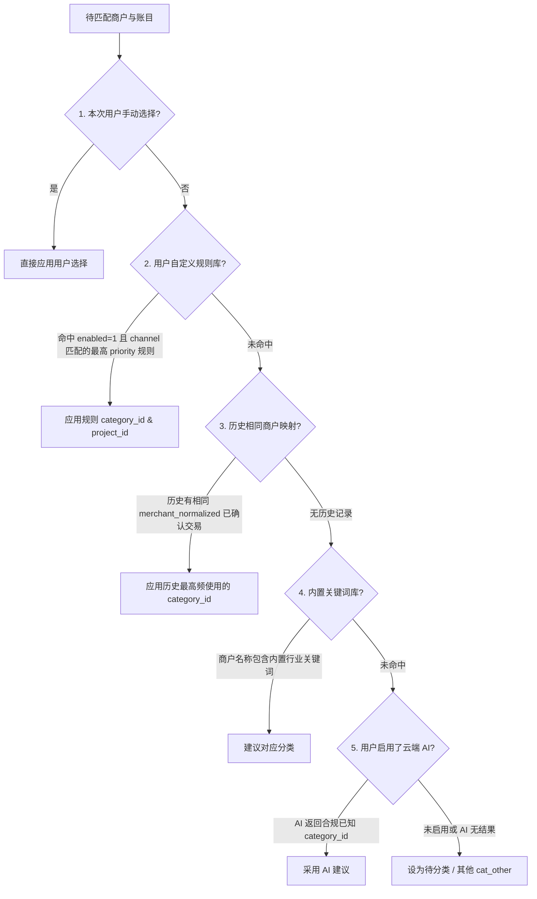

# Specification Mining Report: R3 交易识别解析与分类规则引擎 & R4 自动化测试套件与持续验证

- **Author**: spec_miner_survey_3
- **Date**: 2026-10-22
- **Milestone Scope**: M1 (核心数据层、识别解析引擎与自动化测试)
- **Authoritative Sources**:
  - `ORIGINAL_REQUEST.md`
  - `docs/跨平台架构与数据规范.md`
  - `docs/Android实现方案.md`
  - `docs/iOS实现方案.md`
  - `pigeons/native_bridge.dart`
  - `test_docs_integrity.py`

---

## 1. Executive Summary

This report maps the specifications, algorithms, pipelines, edge cases, and automated test acceptance criteria for:
- **R3. 交易识别解析与分类规则引擎（M1）**: Pure Dart pipeline parsing raw OCR output into structured draft transactions with evidence tracking, disambiguation, merchant normalization, and a 6-tier classification rule engine.
- **R4. 自动化测试套件与持续验证（M1）**: Test runner requirements, test matrix (DDL & cascades, Pigeon codecs, integer cents precision, 4-tier deduplication, state machine transitions, parsing/rule engines), and acceptance criteria defined by `test_docs_integrity.py`.

---

## 2. Features Discovered

| # | Category | Feature | Description | Inputs | Outputs | Error Behavior | Discovered Via |
|---|----------|---------|-------------|--------|---------|----------------|----------------|
| 1 | OCR Pipeline | 坐标归一化与统一原点 | 将 Android ML Kit (左上角像素坐标) 与 iOS Apple Vision (左下角归一化坐标) 统一转换为以图片左上角为原点的 `[0.0, 1.0]` 归一化矩形 | `imageWidth`, `imageHeight`, 原生 BoundingBox | `OcrBoundingBox(left, top, width, height)` | 坐标超出 `[0.0, 1.0]` 时强制 `coerceIn` 钳制 | `test_docs_integrity.py`, Android/iOS 方案 |
| 2 | OCR Pipeline | 系统状态栏与动态岛过滤 | 剔除 iOS/Android 屏幕顶部状态栏（时间如 09:41、电量、网络）和灵动岛区域，防止时间或电量被误解析为交易数据 | `OcrTextLine.boundingBox.top < 0.06` (或灵动岛 `< 0.075`) | 过滤后的有效文本行集合 | 标记为系统状态栏区域，不参与金额/时间提取 | `iOS实现方案.md` §6.1 |
| 3 | OCR Pipeline | 底部 Home Indicator 过滤 | 剔除屏幕最下方 Home 条（`top > 0.95`）干扰文字 | `OcrTextLine.boundingBox.top > 0.95` | 过滤后的有效文本行集合 | 忽略该行 | `iOS实现方案.md` §6.1 |
| 4 | OCR Pipeline | 支付渠道与凭证页面识别 | 识别凭证归属渠道（微信支付、支付宝、云闪付等） | OCR 文本行内容（如“微信支付”、“支付宝”、“账单详情”） | `payment_channel` 枚举字符串 (`wechat`, `alipay`, `unionpay`, `other`) | 无法识别时置为 `other` 并提示用户手动核实 | `跨平台架构与数据规范.md` §3 |
| 5 | OCR Pipeline | 交易状态与类型判别 | 判别支付结果状态（成功、待付款、处理中、退款、失败）并映射为交易类型 | OCR 文本关键词（“支付成功”、“退款成功”、“待支付”等） | `payment_status` (`SUCCESS`, `PENDING`, `FAILED`, `REFUNDED`), `type` (`expense`, `income`, `refund`, `transfer`) | `PENDING`/`FAILED` 页面禁止生成已确认支出，标红提示异常并记录 issue | `Android实现方案.md` §6.3, `iOS实现方案.md` §6.3 |
| 6 | OCR Pipeline | 实付金额提取与消歧 | 优先提取明确标注的实付金额，结合前后标签与字号包围盒加权，杜绝误抓原价、余额或月累计 | OCR 文本行集合与包围盒高度 | `amount_minor` (整数分), `original_amount_minor`, `discount_minor`, `fee_minor` | 金额 <= 0 拦截；多候选无法消歧时记录 `MULTIPLE_AMOUNTS` issue 进草稿 | `Android实现方案.md` §6.3, `跨平台架构与数据规范.md` §3 |
| 7 | OCR Pipeline | 字符混淆校正 (OCR Disambiguation) | 纠正 OCR 常见混淆，如数字 `0` 与字母 `O`、小数点 `.` 与冒号 `:` 或逗号 `,` | 候选金额字符串 | 标准化纯数字与小数点金额字符串 | 格式校验不匹配正则抛弃该候选 | `Android实现方案.md` §13.3, `iOS实现方案.md` §6.2 |
| 8 | OCR Pipeline | 商户名称提取与规范化 | 提取收款方/商户原文 `merchant_raw` 并清洗生成 `merchant_normalized` | 抬头文本行、商户标签邻近文本 | `merchant_raw`, `merchant_normalized` | 若未能提取，置为空并记录校验问题，禁止入库为空 | `跨平台架构与数据规范.md` §3, `Android实现方案.md` §6.2 |
| 9 | OCR Pipeline | 交易时间提取与缺失兜底 | 提取交易发生的年月日时分秒，记录时间源与精度；缺失时建议今天但标记待核对 | 时间正则匹配文本行 | `occurred_on` (YYYY-MM-DD), `occurred_at` (UTC), `event_time_precision`, `event_time_source` | 无日期时记录 `MISSING_DATE` issue，建议今天并等待用户明确确认 | `Android实现方案.md` §6.2, §8.1 |
| 10 | OCR Pipeline | 平台交易单号与商户订单号提取 | 提取微信/支付宝官方交易单号及商户订单号，判定完整性（完整/打码/截断） | 单号正则匹配文本行 | `platform_transaction_no`, `merchant_order_no`, `identifier_completeness` | 打码或截断单号标为 `MASKED`/`TRUNCATED`，禁止存入强去重索引 | `跨平台架构与数据规范.md` §3, `Android实现方案.md` §8.2 |
| 11 | OCR Pipeline | 资金渠道与账户标签解析 | 提取资金来源标签文字（如“零钱”、“招商银行储蓄卡(1234)”） | 支付方式/扣款方式相关文本 | `payment_method_label`, `account_id` (可选映射) | 无法自动映射到本地账户时 `account_id` 置 NULL，留由用户关联 | `Android实现方案.md` §6.2 |
| 12 | OCR Pipeline | 字段证据收集 (Field Evidence) | 记录每个字段的抽取来源文本行、归一化坐标包围盒和置信度 | 字段提取匹配结果与原 `OcrTextLine` | `field_evidence` JSON 字符串 (包含 bounding box, text, confidence) | 缺失依据时置空，由用户手工录入时标注 `user_confirmed` | `跨平台架构与数据规范.md` §3, `Android实现方案.md` §6.4 |
| 13 | OCR Pipeline | 草稿数据结构装配 | 将提取的所有候选字段、证据、校验问题汇总为待审核草稿 | 任务 ID、提取字段、校验异常列表 | `drafts` 表记录（`candidate_fields`, `field_evidence`, `validation_issues`） | 缺少必要字段仍保留为草稿，供用户核对补全 | `跨平台架构与数据规范.md` §3, `Android实现方案.md` §9 |
| 14 | Rule Engine | 三维正交分组体系 | 独立管理主分类（单选）、项目（可选单选）、标签（可选多选），各维度统计正交互不影响 | 分类 ID, 项目 ID, 标签 ID 列表 | 账目关联主分类、项目及 `transaction_tags` 多对多关系 | 不因金额相同将账目归入特定项目；不相加各维度计算总额 | `Android实现方案.md` §7, `iOS实现方案.md` §7 |
| 15 | Rule Engine | 商户分类规则实体与优先级排序 | 基于 `priority` 数值（大者优先）、商户模式、支付渠道进行匹配规则检索 | `classification_rules` (priority, merchant_pattern, payment_channel, category_id, project_id, enabled) | 匹配的规则建议分类与建议项目 | 停用规则 (`enabled=0`) 忽略；同一优先级按创建时间最新匹配 | `跨平台架构与数据规范.md` §3, `Android实现方案.md` §7 |
| 16 | Rule Engine | 6 级决策分类算法 | 依优先级匹配分类：本次手动 > 用户自定义规则 > 历史相同商户映射 > 内置关键词库 > 可选 AI 建议 > 待分类 | 商户名、渠道、历史交易记录、规则库、关键词库 | 建议 `category_id` 及推荐依据来源 | 若无法判断则保持待分类，严禁为了覆盖率硬猜 | `Android实现方案.md` §7, `iOS实现方案.md` §7 |
| 17 | Rule Engine | 商户模式匹配 (Wildcard & Regex) | 支持 SQL 通配符 (`%`, `_`) 及正则表达式匹配商户名称 | `merchant_pattern`, `merchant_raw`/`merchant_normalized` | 布尔匹配结果 | 正则语法错误捕获降级为普通子串匹配 | `跨平台架构与数据规范.md` §3 |
| 18 | Rule Engine | 规则动态自学习机制 | 用户在确认页修改分类并勾选“以后默认此分类”时，自动生成商户规则 | 用户确认动作、商户名称、选定分类 | 插入新 `classification_rules` 记录 | 仅对未来账目生效，严禁篡改历史已入账记录 | `Android实现方案.md` §7, `iOS实现方案.md` §7 |
| 19 | Dedup Engine | 第 1 层：技术幂等性防重 | 同一 `origin_draft_id` 多次保存或重复提交只产生一条正式交易 | `origin_draft_id` | 数据库 `origin_draft_id UNIQUE` 约束拒绝，返回已有流水 | 抛出唯一性约束冲突，事务安全回退并定向到已有交易 | `跨平台架构与数据规范.md` §3, §4.2 |
| 20 | Dedup Engine | 第 2 层：同图 SHA-256 哈希防重 | 相同截图原图重新导入时，识别已有任务并直接展示对应草稿/账目 | `content_hash` (SHA-256) | 既有 `capture_jobs` 记录与账目 | 避免重复发起 OCR 识别流水线 | `跨平台架构与数据规范.md` §4.2 |
| 21 | Dedup Engine | 第 3 层：官方完整交易单号硬防重 | 基于 `confirmed_identifiers` 复合主键判定该笔官方支付是否已入账 | `(namespace, identifier_type, complete_value, stable_event_kind)` | 拦截重复入账，返回已有交易 | 主键冲突拒绝并发插入；展示已有交易流水 | `跨平台架构与数据规范.md` §3, §4.2, `test_docs_integrity.py` |
| 22 | Dedup Engine | 第 4 层：启发式模糊比对与同店连续支付 | 同商户 + 同金额 + 24小时内比对；仅提示疑似重复，允许用户确认是另一笔交易入账 | `merchant_raw`, `amount_minor`, `occurred_on`/`occurred_at` | 填入 `drafts.duplicate_candidates` 候选列表 | 仅作为警告展示，不强行拦截合法“同店连续两笔消费” | `跨平台架构与数据规范.md` §4.2, `Android实现方案.md` §8.2 |
| 23 | Ledger Core | 整数分金额存储与禁止浮点 | 所有金额字段严格采用 `INTEGER` 存储最小货币单位（分），杜绝浮点数精度截断 | 外部金额输入 (String / Decimal) | 存储 `amount_minor` 整数 | 浮点数直接拒绝；`amount_minor <= 0` 触发 CHECK 约束失败 | `跨平台架构与数据规范.md` §3, §4.1, `test_docs_integrity.py` |
| 24 | Ledger Core | 退款跨月冲抵与账簿归属口径 | 退款独立记录且金额为正，月报严格按 `occurred_on` 计算（净支出 = 支出 - 退款），退款不重算历史月报 | `type`, `amount_minor`, `occurred_on`, `deleted_at` | 本月总支出、本月总退款、本月净支出 | 内部转账 (`transfer`) 不计入收支 | `跨平台架构与数据规范.md` §4.1 |
| 25 | Ledger Core | 退款关联与原消费彻底删除解绑 | 原消费删除时，`refund_links` 级联删除解绑，但退款账目自身保持完好 | `original_expense_id` 删除动作 | `refund_links` 行被删除，退款交易记录保留 | 绝不级联删除退款交易 | `跨平台架构与数据规范.md` §3, `test_docs_integrity.py` |
| 26 | Ledger Core | 30 天回收站与假删除 | 正式账目删除采用 `deleted_at` 软删除，完整编号索引保留以防重复导入；彻底删除时解绑退款和清除去重索引 | `transactions.id`, `deleted_at` | 统计查询自动排除 `deleted_at IS NOT NULL` | 再次导入被删除账目时提示从回收站恢复原记录 | `Android实现方案.md` §8.2 |
| 27 | State Machine | 导入任务生命周期流转 | 控制任务从 `IMPORTED` 到 `RECOGNIZING`、`NEEDS_REVIEW`、`COMMITTED`、`FAILED`、`DISCARDED` | 状态变更动作与尝试计数 | 更新 `capture_jobs.state`, `attempt_count` | 异常终止自愈：下次启动将挂起的 `RECOGNIZING` 置回可重试状态 | `Android实现方案.md` §9, `iOS实现方案.md` §9 |
| 28 | Security/Export | CSV 公式注入防护 (Formula Injection) | 导出 CSV 时，对以 `=`, `+`, `-`, `@`, `\t`, `\r` 开头的字段强制前置单引号 `'` | 导出明细各文本字段 | 转义后的安全 CSV 单元格文本 | 防止 Excel / Numbers 触发外部命令宏攻击 | `跨平台架构与数据规范.md` §6, `test_docs_integrity.py` |
| 29 | Security/Export | SWBK v1 跨端加密备份与恢复 | 基于 PBKDF2-HMAC-SHA256 (100,000 次) 与 AES-256-GCM (带 6 字节 AAD) 的统一备份标准 | 备份数据 JSON、用户口令、随机 Salt、随机 IV | 46 字节 Header + 密文 + 16 字节 Auth Tag 的 `.swbk` 容器 | 密码错误或密文篡改导致 Auth Tag 验证失败抛出异常 | `跨平台架构与数据规范.md` §5, `test_docs_integrity.py` |
| 30 | Architecture | 平台通道与大图传输隔离 | 严禁通过 Pigeon 通道反复传递位图原始字节，通道仅传递元数据、任务 ID、归一化 OCR 结果 | `CaptureResult`, `OcrDocument` 结构体 | 跨平台强类型安全通道传输 | 大图由原生层持久化并采样识别，避免通道内存溢出 | `跨平台架构与数据规范.md` §2, `Android实现方案.md` §4.3 |

---

## 3. Edge Cases & Boundary Conditions

| # | Feature | Input | Observed / Required Behavior |
|---|---------|-------|------------------------------|
| 1 | Amount Extraction | 截图中同时出现原价 ¥35.00、优惠 ¥6.10、实付 ¥28.90、零钱余额 ¥120.50 | 规则引擎优先提取实付金额 2890 分；原价 3500 分与优惠 610 分存入扩展元数据；零钱余额 120.50 被否定词表命中并严格剔除，不得将最大数字 120.50 作为支付金额。 |
| 2 | Amount Constraint | 页面显示金额为 ¥0.00（如全额优惠免单或识别异常为零） | 数据库 `CHECK (amount_minor > 0)` 会拒绝写入；草稿层将 0 元判定为 `ZERO_AMOUNT` 校验问题，禁止直接确认入账，提示用户手动修改金额或放弃。 |
| 3 | Amount OCR Glitch | OCR 将金额数字中的 `0` 识别为大写字母 `O`（如 `¥28.9O`） | 金额数字清洗管道进行字符替换（`O` -> `0`, `o` -> `0`），结合严格的小数正则验证；若仍无法组成合法金额格式则报错存入候选歧义列表。 |
| 4 | Amount Ambiguity | 页面同时出现两个无标签的前置大号金额且数值不同，无法通过规则消歧 | 记录所有可能候选至 `candidate_fields`，并在 `validation_issues` 中加入 `MULTIPLE_AMOUNTS`，在确认页弹出选择器强制用户点选。 |
| 5 | Status Detection | 页面文字包含“待付款”或“支付遇到问题/扣款失败” | 状态被识别为 `PENDING` 或 `FAILED`；禁止生成可直接确认的已支付账目；在草稿页标红警告，若用户执意保存必须显式更改为手工记账状态。 |
| 6 | Date Missing | 截图中未包含任何交易时间或日期文本行 | `occurred_at` 保持为 NULL，`validation_issues` 记录 `MISSING_DATE`；`occurred_on` 暂建议今天日期（`suggested_today`），在确认页高亮提示“未识别交易日期，请核对是否按今天记录”。 |
| 7 | Date Only | 截图中仅展示日期 `2026-10-22`，无时分秒 | `occurred_on` 记录为 `2026-10-22`，`event_time_precision` 标为 `day`，`occurred_at` 允许留空 NULL，严禁虚构 `00:00:00` 时分秒。 |
| 8 | Order ID Masking | 平台交易单号展示为截断打码形态（如 `420000****1234`） | 标识完整性标为 `identifier_completeness = 'MASKED'`；禁止存入 `confirmed_identifiers` 强去重表；仅可作为第 4 层启发式模糊提示参考。 |
| 9 | Duplicate Submissions | 用户在草稿确认页连续快速双击“确认记账”按钮 | 第 1 次提交成功生成正式账目并登记 `origin_draft_id`；第 2 次提交由于 `origin_draft_id UNIQUE` 约束拦截，直接返回第 1 次生成的流水 ID，绝不重复生成第二笔账。 |
| 10 | Consecutive Payments | 用户在同一商户、相同金额、2 分钟内连续支付两笔（合法双付） | 触发第 4 层启发式疑似重复警告；草稿列出上一笔交易并提示“疑似重复”；用户点击“确认这是另一笔交易”，系统正常入账，不强行阻止。 |
| 11 | Refund vs Payment ID | 退款截图引用了原支付的订单号，且具备退款特有单号 | `confirmed_identifiers` 的主键包含 `stable_event_kind`（`payment` 与 `refund`）；退款记录不会与原支付记录发生主键冲突，确保退款能顺利登记入账。 |
| 12 | Original Expense Delete | 用户在账本中永久彻底删除了原消费交易记录 | `refund_links` 中外键 `ON DELETE CASCADE` 触发，删除该关联记录；但退款交易本身在 `transactions` 中完好无损，仅变为未关联退款，避免账目不平。 |
| 13 | Project Deletion Cascade | 用户删除了一个已关联在分类规则中的项目 | `classification_rules.project_id` 外键配置为 `ON DELETE SET NULL`；项目删除后，规则的 `project_id` 自动重置为 NULL，规则继续有效匹配分类，不被级联误删。 |
| 14 | Category Deletion Restrict | 用户尝试删除一个已有正式交易记录关联的主分类 | `transactions.category_id` 外键配置为 `ON DELETE RESTRICT`；SQLite 引擎直接阻止删除该分类，强制要求用户先归档或迁移账目分类。 |
| 15 | System Status Bar Collision | 截屏顶部显示系统时间 `09:41`，电池电量 `100%`，WiFi 标志 | 坐标裁剪规则发现 `boundingBox.top < 0.06`，该行被标记为状态栏忽略，数字 `09:41` 绝不被误当作交易时间或金额 `9.41`。 |
| 16 | CSV Injection Attack | 商户名被恶意输入为 `=cmd\|'/C calc'!A0` 或 `+12345` | 导出时前置单引号 `'`，输出为 `'=cmd\|'/C calc'!A0` 和 `'+12345`，彻底阻止表格软件执行命令。 |
| 17 | Float Drift Prevention | 金额累加计算（如多笔 0.1 元、0.2 元合并） | 所有金额使用分存储为整数（10 + 20 = 30 分）；完全杜绝 IEEE 754 浮点误差（`0.1 + 0.2 = 0.30000000000000004`）。 |
| 18 | Process Crash in Recognizing | OCR 识别或规则解析过程中系统杀进程 | 重启后主 App 扫描 `capture_jobs`，将处于 `RECOGNIZING` 且未完成的任务恢复为 `IMPORTED` 或重试状态，重试次数递增，达到上限后置为 `FAILED`，绝不丢失图片或卡死队列。 |

---

## 4. Deep Analysis: OCR Transaction Parsing Pipeline (R3)

```text
┌────────────────────────────────────────────────────────────────────────┐
│                        OcrDocument (Pigeon 强类型)                      │
│ - lines: List<OcrTextLine> (text, boundingBox[0..1, 0..1], confidence) │
└───────────────────────────────────┬────────────────────────────────────┘
                                    │
                                    ▼
┌────────────────────────────────────────────────────────────────────────┐
│ Stage 1: 文本预处理与系统噪音清洗                                       │
│ - 状态栏过滤 (top < 0.06 / 0.075)                                      │
│ - Home 条过滤 (top > 0.95)                                             │
│ - 全半角规范化、空白符号清除、常见混淆字符预处理                         │
└───────────────────────────────────┬────────────────────────────────────┘
                                    │
                                    ▼
┌────────────────────────────────────────────────────────────────────────┐
│ Stage 2: 支付平台与交易状态判别                                         │
│ - 渠道判断: wechat / alipay / unionpay / other                         │
│ - 状态判别: SUCCESS / PENDING / FAILED / REFUNDED                      │
│ - 类型映射: expense / refund / income / transfer                       │
└───────────────────────────────────┬────────────────────────────────────┘
                                    │
                                    ▼
┌────────────────────────────────────────────────────────────────────────┐
│ Stage 3: 核心字段抽取流水线 (金额、商户、时间、单号、支付方式)            │
│ - 实付金额优先提取 (带标签加权、字号加权、剔除原价/优惠/余额)           │
│ - 商户名称提取与规范化 (merchant_raw 与 merchant_normalized)           │
│ - 时间正则匹配 (年月日时分秒与精度标定，缺失时给出建议)                  │
│ - 单号识别与完整度评定 (COMPLETE / MASKED / TRUNCATED)                 │
│ - 支付方式与账户标签识别 (如“零钱”、“储蓄卡(1234)”)                    │
└───────────────────────────────────┬────────────────────────────────────┘
                                    │
                                    ▼
┌────────────────────────────────────────────────────────────────────────┐
│ Stage 4: 歧义消歧、校验问题检查与证据组装                               │
│ - 检查是否有缺失日期 (MISSING_DATE)、零金额 (ZERO_AMOUNT)、多金额冲突   │
│ - 组装 candidate_fields JSON 与 field_evidence JSON 坐标依据            │
└───────────────────────────────────┬────────────────────────────────────┘
                                    │
                                    ▼
┌────────────────────────────────────────────────────────────────────────┐
│ Stage 5: 驱动分类规则引擎 (6 级优先级匹配建议分类与项目)                 │
└───────────────────────────────────┬────────────────────────────────────┘
                                    │
                                    ▼
┌────────────────────────────────────────────────────────────────────────┐
│ Stage 6: 驱动四层防重检测 (匹配 confirmed_identifiers 与 24h 疑似比对)  │
└───────────────────────────────────┬────────────────────────────────────┘
                                    │
                                    ▼
                      生成待用户确认的结构化草稿 (DraftEntity)
```

### 4.1 详细步骤与正则表达式规范

#### 1. 文本预处理与干扰清除
- **iOS 状态栏过滤**:
  ```dart
  bool isSystemNoise(OcrBoundingBox box, {bool isDynamicIsland = false}) {
    final topLimit = isDynamicIsland ? 0.075 : 0.06;
    if (box.top < topLimit) return true; // 状态栏
    if (box.top > 0.95) return true;     // 底部条
    return false;
  }
  ```
- **文字清洗**:
  - 清除零宽空格 `\u200B`、`\uFEFF` 等。
  - 全角字符转半角：`￥` -> `¥`，`：` -> `:`，全角数字转半角。

#### 2. 金额提取与正则模式
- **金额核心正则匹配**:
  - 带货币符号金额：`(?:¥|￥|CNY|\$)?\s*(\d{1,8}(?:\.\d{1,2})?)`
  - 标签引导金额：`(?:实付|付款金额|支付金额|扣款|实付款|金额)[：:\s]*(?:¥|￥)?\s*(\d+(?:\.\d{1,2})?)`
  - 原价引导：`(?:原价|商品金额|订单金额)[：:\s]*(?:¥|￥)?\s*(\d+(?:\.\d{1,2})?)`
  - 优惠减免引导：`(?:优惠|减免|立减|折扣)[：:\s]*(?:¥|￥)?\s*(\d+(?:\.\d{1,2})?)`
  - 否定关键字（命中则禁止作为实付）：`余额`, `零钱余额`, `可用余额`, `理财`, `月累计`, `积分`, `额度`
- **无浮点金额转换算法**:
  ```dart
  int parseToMinorUnits(String amountStr) {
    // 严禁使用 double.parse(s) * 100 造成的精度损失!
    final clean = amountStr.replaceAll(RegExp(r'[^\d.]'), '');
    final parts = clean.split('.');
    final major = int.parse(parts[0]);
    var minor = 0;
    if (parts.length > 1) {
      final dec = parts[1].padRight(2, '0').substring(0, 2);
      minor = int.parse(dec);
    }
    return major * 100 + minor;
  }
  ```

#### 3. 商户名称提取与规范化
- **商户特征识别**:
  - 微信支付常见布局：位于大号实付金额正上方的居中文字行，或者带有“商户全称”、“收款方”、“商品”标签的行。
  - 支付宝常见布局：位于头部卡片主标题，或“收款方：xxx”。
- **规范化处理**:
  - 去除首尾空格、无意义标点。
  - 去除括号店铺后缀：如 `麦当劳 (北京三里屯店)` -> `麦当劳`。
  - 去除渠道前缀：如 `微信支付-星巴克` -> `星巴克`。
  - 保留 `merchant_raw` 原始文本，`merchant_normalized` 保存清洗后的规范名称。

#### 4. 交易时间正则与时区
- **时间正则匹配**:
  - 日期时间：`(\d{4})(?:[-/年\.])(\d{1,2})(?:[-/月\.])(\d{1,2})日?\s+(\d{1,2}):(\d{2})(?::(\d{2}))?`
  - 仅日期：`(\d{4})(?:[-/年\.])(\d{1,2})(?:[-/月\.])(\d{1,2})日?`
  - 标签前缀：`支付时间|交易时间|创建时间|付款时间|成交时间`
- **口径策略**:
  - 精确到秒：`event_time_precision = 'second'`
  - 仅到分：`event_time_precision = 'minute'`
  - 仅日期：`event_time_precision = 'day'`，`occurred_at = null`
  - 未识别：`event_time_source = 'suggested_today'`，填入当前本地日期，并记录 `validation_issues: ["MISSING_DATE"]`。

#### 5. 单号与去重识别
- **单号识别模式**:
  - 微信单号（28~32位数字）：`420000\d{22,26}` 或前缀 `(交易单号|支付单号)[：:\s]*([0-9A-Za-z]+)`
  - 支付宝交易号（28~32位数字）：`202\d{25,29}` 或前缀 `(订单号|交易号|支付宝交易号)[：:\s]*([0-9A-Za-z]+)`
  - 商户订单号：`(商户单号|商家订单号)[：:\s]*([0-9A-Za-z_-]+)`
- **完整度标定**:
  - 含 `*` 或末尾省略号 `...` 标为 `MASKED` 或 `TRUNCATED`。
  - 无单号标为 `NONE`。
  - 格式完整且无遮挡标为 `COMPLETE`。

---

## 5. Deep Analysis: Classification Rule Engine (R3)

### 5.1 规则表结构与字段含义

```sql
CREATE TABLE IF NOT EXISTS classification_rules (
    id TEXT PRIMARY KEY NOT NULL,
    priority INTEGER NOT NULL DEFAULT 100,      -- 数值越大优先级越高
    merchant_pattern TEXT NOT NULL,             -- 商户名匹配模式（支持通配符或正则表达式）
    payment_channel TEXT,                       -- 可选限定渠道 (wechat/alipay)
    category_id TEXT NOT NULL,                  -- 匹配后赋予的分类 ID
    project_id TEXT,                            -- 可选关联项目 ID
    enabled INTEGER NOT NULL DEFAULT 1,         -- 1=启用, 0=停用
    version INTEGER NOT NULL DEFAULT 1,
    created_at TEXT NOT NULL,
    updated_at TEXT NOT NULL,
    FOREIGN KEY(category_id) REFERENCES categories(id) ON DELETE CASCADE,
    FOREIGN KEY(project_id) REFERENCES projects(id) ON DELETE SET NULL
);
```

### 5.2 6 级决策优先级算法与执行流程



### 5.3 内置关键词库标准（权威规范落地推荐）

| 分类标识 (`category_id`) | 默认分类名称 | 内置匹配关键词 |
|---|---|---|
| `cat_food` | 餐饮美食 | 餐厅, 饭店, 咖啡, 麦当劳, 肯德基, 星巴克, 奶茶, 喜茶, 奈雪, 美食, 外卖, 饿了么, 美团外卖, 面馆, 烘焙, 火锅, 料理, 烧烤, 酒家, 食堂, 简餐 |
| `cat_transport` | 交通出行 | 地铁, 公交, 出租车, 滴滴, 曹操出行, 高铁, 铁路12306, 飞机, 机票, 加油, 中国石化, 中国石油, 停车, 过路费, 高速公路, 顺风车, 哈啰, 美团单车 |
| `cat_shopping` | 日常购物 | 超市, 便利店, 7-ELEVEn, 罗森, 全家, 淘宝, 京东, 拼多多, 杂货, 百货, 商行, 专卖店, 服饰, 优衣库 |
| `cat_entertainment` | 休闲娱乐 | 影城, 电影, 剧场, 游戏, 蒸汽平台, Steam, 网易, 腾讯充值, KTV, 密室, 乐园, 演出, 门票 |
| `cat_medical` | 医疗健康 | 医院, 药房, 药店, 门诊, 诊所, 体检, 口腔, 大药房 |
| `cat_housing` | 居家生活 | 水费, 电费, 燃气, 物业, 电信, 联通, 移动, 宽带, 租房, 宽带缴费 |
| `cat_other` | 其他支出 | 兜底未匹配项 |

### 5.4 动态自学习与确认流转规则
1. 用户在草稿确认页更改了分类，勾选“以后该商户默认归为此类”。
2. 系统生成 `classification_rules` 记录：
   - `merchant_pattern`: 使用 `merchant_normalized`。
   - `category_id`: 用户新选分类。
   - `priority`: 默认 100（或已有最高优先级 + 10）。
   - `enabled`: 1。
3. **隔离保证**：新规则**仅对后续导入的任务生效**，绝对不自动回写、篡改已有历史正式账目的分类！

---

## 6. Deep Analysis: Automated Test Requirements (R4)

To guarantee production readiness for M1, the test suite must systematically cover 9 distinct testing dimensions.

### 6.1 M1 自动化测试矩阵

| 测试套件编号 | 测试套件名称 | 覆盖的核心类与规范 | 必测用例与断言目标 |
|---|---|---|---|
| **SUITE-01** | SQLite DDL, Foreign Keys & Cascades | `docs/跨平台架构与数据规范.md` §3 | 1. 验证 12 张表全部成功创建。<br>2. 验证 11 项性能索引全部存在。<br>3. `amount_minor > 0` 约束验证（插入 0 或负数抛出 `IntegrityError`）。<br>4. `origin_draft_id UNIQUE` 约束幂等验证。<br>5. `confirmed_identifiers` 复合主键硬防重验证。<br>6. `refund_links ON DELETE CASCADE`：原消费删除时解绑链接，退款交易本身不被级联删除。<br>7. `classification_rules.project_id ON DELETE SET NULL` 验证。<br>8. `transactions.category_id ON DELETE RESTRICT` 保护验证。 |
| **SUITE-02** | Pigeon Codec & IDL Serialization | `pigeons/native_bridge.dart` | 1. `ImageSourceKind` 5 种枚举序列化/反序列化。<br>2. `CaptureResult` 数据类跨端编解码。<br>3. `OcrBoundingBox`, `OcrTextLine`, `OcrDocument` 嵌套结构序列化精度（浮点坐标无漂移）。<br>4. Pigeon 接口签名一致性与错误传递。 |
| **SUITE-03** | Currency Integer Precision | `跨平台架构与数据规范.md` §4.1 | 1. 字符串到分整数无浮点转换（"28.90" -> 2890, "0.01" -> 1, "100" -> 10000）。<br>2. 分整数到展示格式化（2890 -> "28.90", 1 -> "0.01"）。<br>3. 累加计算验证（1000 次 0.1 元累加等于 10000 分，无 IEEE 754 精度漂移）。 |
| **SUITE-04** | 4-Tier Anti-Duplicate Engine | `跨平台架构与数据规范.md` §4.2 | 1. 第 1 层：同一草稿重复保存返回已有账目，不重复插入。<br>2. 第 2 层：相同图片 SHA-256 哈希定位已有任务，不发起重复 OCR。<br>3. 第 3 层：完整微信/支付宝交易号拦截重复入账；打码单号不进入强防重；退款单号不与支付单号冲突。<br>4. 第 4 层：同商户同金额 24h 内产生 `duplicate_candidates` 疑似警告；允许用户确认是另一笔交易入账。 |
| **SUITE-05** | State Machine Transitions & Crash Recovery | `Android方案.md` §9, `iOS方案.md` §9 | 1. 正向流转：`IMPORTED` -> `RECOGNIZING` -> `NEEDS_REVIEW` -> `COMMITTED`。<br>2. 识别失败流转：`RECOGNIZING` -> `FAILED`，重试次数累加，超限阻止。<br>3. 草稿放弃：`NEEDS_REVIEW` -> `DISCARDED`。<br>4. 强杀进程恢复：启动时自动将 `RECOGNIZING` 挂起任务复位回重试状态。 |
| **SUITE-06** | OCR Parsing Pipeline | `Android方案.md` §6, `iOS方案.md` §6 | 1. 微信典型支付截图文本解析（实付金额、某某餐厅、微信支付、交易时间）。<br>2. 支付宝典型支付截图文本解析。<br>3. 多金额干扰消歧（原价、优惠、实付、余额在同图）。<br>4. 交易状态识别（成功 vs 待付款 vs 扣款失败 vs 退款）。<br>5. 状态栏与 Home 条噪音过滤（top < 0.06 忽略时间）。<br>6. 缺失时间处理（标记 `MISSING_DATE` issue，建议今天）。 |
| **SUITE-07** | Classification Rule Engine | `Android方案.md` §7, `iOS方案.md` §7 | 1. 6 级优先级阶梯测试（手动 > 用户规则 > 历史映射 > 关键词 > AI > 兜底）。<br>2. 规则优先级数值排序（priority 200 优先于 priority 100）。<br>3. 停用规则（enabled = 0）跳过测试。<br>4. 通配符与正则匹配测试（如 `星巴克%`, `^滴滴(出行)?`）。<br>5. 动态学习规则仅影响未来交易，历史交易不变。 |
| **SUITE-08** | CSV Export Sanitization | `跨平台架构与数据规范.md` §6, `test_docs_integrity.py` | 1. 前缀注入防范（`=`, `+`, `-`, `@`, `\t`, `\r` 前置单引号 `'`）。<br>2. 包含逗号、双引号、换行文本的外层包裹与双引号转义。<br>3. 带 BOM UTF-8 输出测试。 |
| **SUITE-09** | SWBK v1 Backup Crypto | `跨平台架构与数据规范.md` §5, `test_docs_integrity.py` | 1. 46 字节 Header 格式大端序打包与解包。<br>2. PBKDF2-HMAC-SHA256 100,000 次密钥派生与 AES-256-GCM 加密解密 roundtrip。<br>3. 错误口令拒绝与认证标签 Tag 校验。 |

---

## 7. Deep Analysis: Test Runner & Execution Environment

### 7.1 测试执行架构选型

在 M1 核心数据层与引擎验证中，需要支持**无设备依赖（Headless）**的极速自动化测试：

1. **纯 Dart 逻辑层（Domain & Parsing）**:
   - OCR 解析引擎、金额转换器、规则引擎、防重启发式算法均不依赖 Flutter UI (`dart:ui`)，可作为纯 Dart 包运行。
   - 运行方式：`dart test` 或 `flutter test`，执行极速（毫秒级）。
2. **SQLite 数据层与 DDL 验证**:
   - 移动端生产环境使用 `sqflite` (Android/iOS 原生 SQLite API) 或 `sqflite_sqlcipher`。
   - 在开发与持续集成测试环境（Windows / macOS / Linux 桌面）：
     - 采用 **`sqflite_common_ffi`**：
       ```dart
       import 'package:flutter_test/flutter_test.dart';
       import 'package:sqflite_common_ffi/sqflite_ffi.dart';

       void main() {
         setUpAll(() {
           sqfliteFfiInit();
           databaseFactory = databaseFactoryFfi;
         });
         // 测试可直接在内存数据库 inMemoryDatabasePath 执行，无需启动真机或模拟器！
       }
       ```
     - 优势：完全与原生 SQLite 行为对齐，支持完整 PRAGMA、外键约束、CHECK 约束与内存数据库，测试运行速度是模拟器的 50 倍以上。

### 7.2 当前环境评估与前置准备
- 宿主系统：Windows 11 (PowerShell)。
- Python 环境：Python 3.13 可用，`python test_docs_integrity.py` 100% 运行通过。
- Flutter/Dart SDK：当前命令行 PATH 中未检测到 `flutter`/`dart`。
  - 后续工程构建与测试执行前，可通过系统包管理器（如 `winget install Google.Flutter`）或配置解压版 Flutter SDK PATH。

---

## 8. Deep Analysis: `test_docs_integrity.py` Acceptance & Audit Analysis

`test_docs_integrity.py` 是当前项目最核心的权威规范验证套件，包含 6 大套件：

1. **Markdown 文件与本地链接检查 (`test_markdown_files`)**:
   - 遍历工作区所有 `.md` 文件。
   - 必须满足代码块成对：`len(re.findall(r"(?m)^```", content)) % 2 == 0`。
   - 必须满足所有本地相对链接文件在磁盘上真实存在。
2. **Pigeon 契约与跨文档一致性 (`test_pigeon_contract_consistency`)**:
   - 确保 `pigeons/native_bridge.dart` 存在。
   - 严格检查类型完整性：`ImageSourceKind`, `CaptureResult`, `OcrBoundingBox`, `OcrTextLine`, `OcrDocument`, `NativeCaptureHostApi`, `NativeCaptureFlutterApi`。
   - 严格检查方法名完整性：`pickSingleImage`, `fetchPendingExternalCaptures`, `recognizeCapture`, `deleteCaptureImage`, `readImageFromClipboard`, `startOneShotScreenCapture`, `getOrCreateDatabaseKey`, `onExternalCaptureReceived`。
   - 确保 3 份核心文档均正确引用上述方法名。
3. **SQLite DDL、约束与级联验证 (`test_sqlite_ddl`)**:
   - 从 `跨平台架构与数据规范.md` 提取全部 SQL 并在 SQLite 内存库运行。
   - 验证 12 张核心表与 11 项索引。
   - 验证 `amount_minor > 0` 约束。
   - 验证 `origin_draft_id UNIQUE` 约束。
   - 验证 `confirmed_identifiers` 复合主键防重。
   - 验证 `refund_links ON DELETE CASCADE` 解绑且不删退款账目。
   - 验证 `classification_rules.project_id` ON DELETE SET NULL。
4. **SWBK v1 跨端加密备份与认证 (`test_swbk_container_crypto`)**:
   - 验证 46 字节 Header 结构与大端序打包。
   - 验证 AES-256-GCM + PBKDF2-HMAC-SHA256 加解密 round-trip。
   - 验证错误密码被 Auth Tag 拦截。
5. **CSV 公式注入防护 (`test_csv_injection_sanitization`)**:
   - 验证危险前缀（`=`, `+`, `-`, `@`, `\t`, `\r`）转义。
   - 验证特殊字符（逗号、双引号、换行）外包裹与转义。
6. **OCR 坐标系归一化转换数学验证 (`test_coordinate_normalization`)**:
   - 证明 Android ML Kit 与 iOS Apple Vision 经转换后数学坐标等价。

---

## 9. Recommendations & Implementation Blueprint for M1 Sub-Orchestrator

1. **代码分层严格解耦**:
   - 目录分层：
     - `lib/core/amounts/`: 金额处理与分单位转换（无浮点）。
     - `lib/features/recognition/`: OCR 文本清洗、字段抽取、状态判断、证据收集。
     - `lib/features/classification/`: 6 级规则引擎、关键词字典、学习流转。
     - `lib/features/dedup/`: 4 层去重逻辑与冲突提示。
     - `lib/data/`: SQLite 表创建、迁移器、Repository。
2. **测试驱动落地 (TDD)**:
   - 先行根据本报告的 9 项测试套件，在 `test/` 目录下编写对应单元测试用例。
   - 使用 `sqflite_common_ffi` 运行数据层测试，脱离模拟器实现秒级反馈。
3. **Markdown 规范防护**:
   - 任何由智能体生成或修改的 `.md` 文件，必须严格保证代码块（```）数量为偶数，且相对链接真实有效，确保 `python test_docs_integrity.py` 持续保持 100% 通过。
