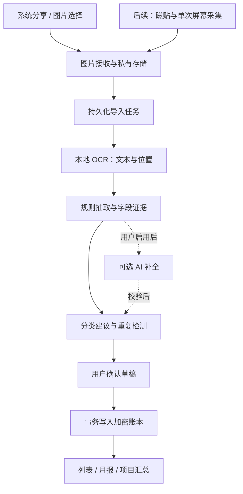

# SingWallet Android 个人记账 App 实现方案

版本：v1.0 · 编写日期：2026-10-22 · 状态：开发前方案，尚未进行真机验证。

本轮先实现 Android。考虑后续还需要 iPhone，应用界面和记账业务使用 Flutter，Android 系统入口、截图接收和 OCR 使用 Kotlin。本文只规划 Android 的实现与验收。跨平台协议与统一数据库规范详见 [跨平台架构与数据规范](跨平台架构与数据规范.md)，iOS 落地规划详见 [iOS 实现方案](iOS实现方案.md)。

## 1. 推荐落地方式

核心体验是：**付款成功后截图 → 分享到 SingWallet → 自动识别 → 检查草稿 → 确认入账。**

首版先把这条流程做可靠；之后增加「下拉快捷设置，点一下记账」的入口，通过用户授权的单次屏幕采集获取付款页面。内嵌 AI 可以帮助理解截图和建议分类，但不负责操作微信、支付宝或决定是否支付。

必须区分三件事：

1. **获取信息**：由用户分享截图、选择图片，或明确授权一次屏幕采集。
2. **理解信息**：本地 OCR 读取文字，规则提取金额、商户等；可选 AI 处理复杂表达。
3. **记入账本**：展示识别依据和不确定字段，用户确认后才产生正式账目。

支付成功页未必展示时间、订单号或付款银行卡。App 只能记录截图中实际出现的信息与用户补充的信息，不能保证每个字段都能自动获得。

### 1.1 首版范围

| 首版提供 | 后续增强 | 暂不纳入 |
| --- | --- | --- |
| 微信、支付宝常见支付结果截图导入 | 快捷设置磁贴 + 单次屏幕采集 | 静默监听所有付款 |
| 系统分享、选择图片、手工记账 | 用户主动启用的云端 AI 补全 | 读取支付 App 私有数据库 |
| 离线中文 OCR、规则抽取 | 商家模板维护、规则优化 | 自动点击支付 App 或自动付款 |
| 草稿确认、查重、编辑、删除 | 预算、定期账单、账单文件导入 | 多人共享账本、报销审批 |
| 收支、退款、自有账户转账 | 多币种及明确汇率口径 | 自动拆分混合支付和一单多分类 |
| 分类、项目、标签、账户与月报 | 云同步、跨设备恢复 | 自动读取完整银行卡余额 |
| 本地加密、CSV 导出、可恢复备份 | 后续 iOS 客户端 | 把完整 Agent 作为基础依赖 |

首版仅支持人民币，采用本地单用户、单账本，不要求注册或联网。退款和转账允许手工录入；截图能识别时提供相应草稿，不能识别时引导修改类型。

## 2. Android 入口与能力边界

### 2.1 各种入口的选择

| 入口 | 用户操作 | 能力与限制 | 优先级 |
| --- | --- | --- | --- |
| 系统截图后分享 | 在支付页截屏，点击分享，选择 SingWallet | 不需要屏幕录制授权；部分厂商的截图预览入口不同 | P0，首版主入口 |
| App 内选择图片 | 打开 App，通过系统选择器选择截图 | 适合补记和截图预览没有分享按钮的设备 | P0，稳定备用入口 |
| 桌面快捷方式 | 长按图标或添加「记一笔」快捷方式 | 快速手工记账、选择截图；不直接获得其他 App 的画面 | P0，低成本入口 |
| 下拉快捷设置磁贴 | 在支付页下拉，点击「识别记账」 | 磁贴只负责触发流程；仍须通过系统屏幕采集授权 | P1，先做真机验证 |
| 无障碍读取当前页面 | 用户手动开启服务，再主动触发 | 可能读取节点或截图；页面兼容性、权限说明和商店审核成本较高 | 实验项，非首版依赖 |
| 悬浮按钮 | 悬浮在支付 App 上方，用户点击 | 本身不提供截图权限，还增加悬浮窗授权与遮挡问题 | 首版不做 |

普通第三方 App 没有通用公开接口，可以在后台直接获得用户在其他商户的全部微信、支付宝付款结果。支付 SDK 的商户回调只适用于自身业务集成的交易，不能作为个人全量记账的数据源。[1][10]

### 2.2 必须遵守的系统限制

- Android 应用沙箱隔离其他 App 的数据；桌面快捷方式和磁贴不会额外授予读取权限。[2][3][10]
- `MediaProjection` 每次会话都需要用户同意。Android 14 起，同一授权 token 不能重复用于创建多个屏幕采集会话，不能承诺「授权一次，以后永久截屏」。[4]
- 以 Android 14 或更高版本为目标时，屏幕采集需要相应前台服务声明、服务类型和用户可感知的运行状态。[4]
- 支付应用若使用 `FLAG_SECURE` 等安全保护，截图或采集可能被阻止；此时提供手工记账，不尝试绕过。[6]
- 快捷采集是否能在授权后准确回到原支付页，需要按系统版本和厂商真机验证，不能仅凭 API 存在就承诺体验。[4]
- 不要求用户常驻开启录屏，不通过持续录屏来规避下一次授权。

## 3. 用户流程与页面

### 3.1 首次使用

1. 本地创建账本，选择默认币种人民币与账本时区，国内用户默认 `Asia/Shanghai`。
2. 提供默认分类，账户可以稍后补充。
3. 展示一次截图分享教程，用户可以使用内置的虚构支付示例体验识别。
4. 说明截图在本地处理，确认后默认删除 App 内临时原图；联网 AI 默认关闭。

不在首次启动索取相册全量访问、无障碍或悬浮窗权限。用户选择图片时使用系统选择器；需要某项增强能力时才解释并申请对应权限。

### 3.2 支付后记账

```text
微信 / 支付宝付款成功页
    ↓ 用户用系统截图
截图预览或相册中点击分享 → 选择 SingWallet
    ↓
图片保存到 App 私有空间 → 离线识别 → 生成草稿
    ↓
确认页展示：实付金额、商户、分类、日期、账户、项目、标签
    ↓ 用户必要时修改，点击「确认记账」
正式入账 → 显示结果，可继续编辑
```

正常情况下，进入确认页后只需检查并点一次保存；缺少交易日期、金额含糊或疑似重复时增加明确提示。系统截图、分享等操作次数随厂商界面变化，不承诺所有设备都能两步完成。支持三指下滑、背部敲击等系统截图手势的设备，可引导用户自行配置；这些能力由厂商和机型决定。

### 3.3 主要页面

| 页面 | 内容 |
| --- | --- |
| 首页 | 本月消费、退款、净支出、收入，最近账目，「记一笔」入口 |
| 识别确认页 | 金额放大显示；交易类型、商户、日期、分类、账户；项目和标签折叠展示 |
| 待处理 | 识别失败、用户暂未确认、疑似重复的草稿；可以重试或删除 |
| 账目列表 | 按月查看，按分类、项目、标签、账户、渠道筛选与搜索 |
| 统计 | 分类分布、月度趋势、项目汇总，明确消费与退款的计算口径 |
| 管理与设置 | 分类、项目、标签、账户、规则、备份、导出、隐私设置 |

确认页的关键交互：

- 将识别出的实付与截图中的对应位置关联，用户可展开查看依据。
- 金额、日期、类型存在歧义时显示具体原因，例如「发现两个可能的金额」。
- 截图没有日期时显示「未识别交易日期」；可提供「按今天记录」的快捷选项，由用户明确选择。
- 渠道和资金账户分开显示：「微信支付」不等于「微信零钱」。未识别账户时可留空。
- 分类可以用已有商户规则预选为「餐饮」等；用户手动更改始终优先。
- 保存失败保留草稿，防止用户因为重新操作而丢失信息或重复记账。

## 4. 技术架构与选型

### 4.1 技术选型

| 层 | 推荐方案 | 理由 |
| --- | --- | --- |
| UI 与业务 | Flutter / Dart，使用 Riverpod 管理状态 | 后续可复用到 iOS，业务与系统采集能力分离 |
| Android 能力层 | Kotlin、协程、Activity、TileService | 对接分享、图片 URI、前台服务和屏幕采集 |
| 跨层调用 | Pigeon 生成类型化接口 | 明确参数和错误类型，避免大量字符串协议 |
| 中文 OCR | ML Kit Text Recognition v2，随包分发的中文模型 | 首次运行可离线使用，减少对运行时 GMS 下载的依赖 |
| 字段抽取 | Dart 纯逻辑规则引擎 + 支付页面模板 | 可测试、可离线；优先保证金额正确 |
| 分类与分组 | 本地规则、商户映射、用户配置 | 可解释，用户修改能够持续生效 |
| 持久化 | SQLite + SQLCipher，业务通过 Repository 访问 | 本地查询与备份方便；具体 Flutter 绑定先完成兼容验证 |
| 密钥 | Android Keystore 保护数据库密钥和图片加密密钥 | 不把明文密钥写入配置或导出文件 |
| 后台维护 | WorkManager | 处理清理、允许延后的恢复任务，不用于常驻监控付款 |
| 可选云服务 | 小型 HTTPS API + 可替换的模型服务 | 仅用于用户明确启用的 AI 增强，首版不依赖后端 |

首版产品支持范围建议为 **Android 10 / API 29 起**，这是兼容性与测试成本的产品选择；并非 ML Kit 最低要求。ML Kit 当前 Android 文档正文要求 API 23 起。[8] `targetSdk` 按正式发布时目标商店的要求确定，依赖版本在技术验证后锁定，不使用浮动版本。

国内设备优先验证 `com.google.mlkit:text-recognition-chinese` 随包方案，在无 GMS、飞行模式、首次安装的条件下实测。随包模型会增加包体积；具体增量以最终构建为准。[8]

Flutter、加密数据库和其他原生依赖可能包含 `.so`。M0 同时核查最终依赖组合的 **16 KB 内存页大小兼容性**，检查原生库及打包对齐，并在对应环境验证最终 APK/AAB 的安装、启动、OCR 和加密数据库读写。[12]

### 4.2 模块与数据流



新增正式账目统一经过 `ConfirmDraft`。OCR、规则引擎和 AI 都只能创建或更新草稿，不能绕过确认直接新增正式账目；后续编辑、删除也统一经过账本业务层校验。

### 4.3 Kotlin 与 Flutter 接口 (Pigeon 强类型规范)

接口表达业务能力，统一遵循 `pigeons/native_bridge.dart` 规范契约，杜绝非类型化字符串通道，不把外部 URI 或大图原始字节在通道中反复传递：

```dart
// pigeons/native_bridge.dart 统一规范契约

enum ImageSourceKind {
  systemShare,       // 系统分享 (Android Send Intent)
  photoPicker,       // 应用内相册选择 (Photo Picker)
  shortcutsAction,   // 桌面快捷方式
  clipboard,         // 剪贴板提取
  quickSettingsTile, // 下拉快捷设置磁贴采集 (Android P1)
}

class CaptureResult {
  final String captureId;
  final String localFilePath;
  final int imageWidth;
  final int imageHeight;
  final String contentHash; // 图片 SHA-256
  final ImageSourceKind sourceKind;
}

class OcrBoundingBox {
  final double left;   // 归一化坐标 0.0 - 1.0 (原点位于图片左上角)
  final double top;
  final double width;
  final double height;
}

class OcrTextLine {
  final String text;
  final OcrBoundingBox boundingBox;
  final double? confidence; // 0.0 - 1.0
}

class OcrDocument {
  final String captureId;
  final List<OcrTextLine> lines;
  final String engineIdentifier; // 如 "MLKit_Android_v2"
  final int processTimeMs;
}

@HostApi()
abstract class NativeCaptureHostApi {
  // 从相册安全选择一张图片 (Photo Picker)
  @async
  CaptureResult? pickSingleImage();

  // 扫描离线暂存导入任务 (针对 ShareReceiverActivity 写入的私有清单)
  List<CaptureResult> fetchPendingExternalCaptures();

  // 调用 ML Kit 离线 OCR 进行识别
  @async
  OcrDocument recognizeCapture(String captureId);

  // 清除 App 私有暂存目录下的单张图片原件
  bool deleteCaptureImage(String captureId);

  // 从剪贴板读取图片（由用户明确触发）
  CaptureResult? readImageFromClipboard();

  // Android P1: 触发单次屏幕采集并截取一帧
  @async
  CaptureResult? startOneShotScreenCapture();

  // 从 Android Keystore 异步获取或初始化 256 位数据库加密主密钥
  @async
  Uint8List getOrCreateDatabaseKey();
}

@FlutterApi()
abstract class NativeCaptureFlutterApi {
  // 当应用处于运行状态时，原生宿主接收到外部新分享或快捷导入时的实时回调通知
  void onExternalCaptureReceived(CaptureResult capture);
}
```

- `captureId` 对应 App 私有文件，不允许调用方拼接任意磁盘路径。
- `OcrDocument` 包括文字块、行、位置、可取得的识别评分及引擎版本；引擎未提供的评分留空。
- 任务和账本由同一业务层管理；Kotlin 接收阶段先持久化图片和最小导入清单，Flutter 恢复后幂等登记任务，避免启动第二套业务数据库。
- 大图由原生层按目标尺寸读取与识别，通道仅传元数据、OCR 结果和受控的图片访问标识。
- 当主 App 处于前台或后台唤醒时，`ShareReceiverActivity` 持久化图片后通过 `NativeCaptureFlutterApi.onExternalCaptureReceived` 即时推送到 Flutter 业务队列。

## 5. Android 原生接入细节

### 5.1 分享截图接收：P0

通过独立的 `ShareReceiverActivity` 声明 `ACTION_SEND`、`CATEGORY_DEFAULT` 和 `image/*`，使 SingWallet 出现在系统分享面板。该 Activity 显式设置 `android:exported="true"`；其他组件分别确定是否导出，不能一并开放。首版只处理单张图片；多张分享明确提示逐张导入，后续再提供批量队列。[1][14]

处理顺序：

1. 检查 Intent、MIME、临时读取授权和实际图片格式；外部输入均视为不可信。
2. 通过 `ContentResolver` 尽快读取 `content://` URI，复制到私有暂存区，不依赖分享者持续保留访问权限。
3. 采用受限读取与采样解码，限制文件大小、像素数、解码内存；长图或超限图片提示裁剪，不无限放大资源消耗。
4. 计算原始图片 SHA-256，创建 `captureId`；图片及导入清单先写临时文件，再原子发布。
5. 在文件与清单持久化成功后打开主 App，路由到该任务；分别处理冷启动和 `onNewIntent` 的重复投递。
6. 主 App 登记任务后执行 OCR。若在交接阶段被系统终止，下次启动扫描未处理的清单恢复。

不要将截图保存到公共相册；不要根据 URI 推断真实文件路径；不要把外部传入的「来源包名」当作可信支付渠道。渠道最终根据页面内容和用户确认确定。

App 内选图使用系统 Photo Picker；不可用时退回系统文档/图片选择入口，仅访问用户选中的文件。[11] 主流程不申请广泛存储权限，也不扫描整个相册。

### 5.2 桌面快捷方式：P0

提供「手工记一笔」和「导入支付截图」两个图标快捷操作。固定到桌面需要 Launcher 支持和用户确认。快捷方式只打开相应功能，不能直接读取当前支付页。[3]

### 5.3 快捷设置磁贴与屏幕采集：P1

理想流程：

```text
停留支付结果页 → 下拉点「识别记账」
    → 系统弹出屏幕共享授权
    → 用户授权并按系统流程选择 / 恢复目标支付 App
    → 获取目标画面一帧并停止采集
    → 展示截图预览与识别草稿 → 确认
```

这条流程先做独立 POC，重点证明授权以后能采到正确支付页面，而不是记账 App、下拉面板或授权弹窗。若需要额外返回支付 App，必须在引导中如实说明。

实现要点：[2][4]

- 使用 `TileService`，声明系统要求的 `BIND_QUICK_SETTINGS_TILE` 绑定权限，由用户主动添加磁贴；屏幕采集前台服务设置 `exported=false`。Android 14 起使用 `startActivityAndCollapse(PendingIntent)` 等对应版本 API 启动授权页面。
- 通过 `MediaProjectionManager` 请求本次授权；授权取消则结束，不留下半启动的服务。
- 授权通过后按系统要求启动 `mediaProjection` 类型的前台服务，调用 `startForeground`，取得投影并注册停止回调，再创建 `VirtualDisplay`。
- Android 14 起允许用户仅共享某个 App；兼容不同版本的整屏采集路径。
- 使用 `ImageReader` 取得有效画面，生成一张静态截图；不生成视频，也不长期缓存连续帧。
- 成功、用户取消、锁屏、系统停止、超时和异常路径均释放投影、显示、ImageReader 与前台服务。
- 页面尺寸变化时调整现有采集资源，不能反复复用同一授权创建新的采集会话。
- 设定短超时，例如 10 秒内未能取得目标画面则停止，转入截图分享或手工输入。具体阈值在真机 POC 调整。

`FOREGROUND_SERVICE`、`FOREGROUND_SERVICE_MEDIA_PROJECTION` 及对应服务类型仅在该功能落地时加入。前台服务的系统提示必须保留；不把通知授权、屏幕采集授权、无障碍授权混为同一个权限。

### 5.4 无障碍读取：独立实验，不阻塞发布

无障碍服务可能通过窗口节点读取文字，也有对应版本的截图 API；但支付页是否暴露完整文字、能否截图、应用更新后是否仍可用，都需要逐个版本验证。[5][6]

如果未来探索该方向，应限定为「用户主动触发、只处理指定支付 App 的当前页面」，单独说明读取范围和用途，提供随时关闭开关。不能虚报自己是为残障人士服务的无障碍工具。

Google Play 并未一律禁止非无障碍工具使用该 API，但要求相应披露、同意、声明和审核；当前政策对利用无障碍 API 自主发起、规划并执行行动或决策的自动化存在明确限制。[7] 因此不设计让 Agent 自动浏览、点击、操作支付应用。国内各应用商店的要求需分别核查，不能直接套用 Google Play 结论。

## 6. 识别引擎：先确保账记对

### 6.1 处理流水线

1. **图片检查**：校验格式、方向、尺寸；适度缩放，保留金额区域的清晰度。
2. **OCR**：提取中文、数字、符号以及文本位置，保留原始行序和坐标。
3. **页面判断**：微信支付、支付宝、其他或未知；成功、处理中、失败、退款等状态分别判断。
4. **字段候选**：结合「实付」「付款金额」「收款方」「交易时间」等标签、邻近位置、字号和页面模板提取候选。
5. **校验**：金额格式、日期、币种、交易状态、订单号完整度和字段冲突。
6. **分类与查重**：应用用户规则，给出分类、项目和标签建议，匹配现有账目。
7. **草稿确认**：标出缺失与冲突；用户可以修改、保存、暂存或放弃。

页面模板是可版本化的解析规则，不仅依赖固定像素坐标。不同字体、深色模式、分辨率和支付 App 更新都可能改变布局。

### 6.1.1 ML Kit 坐标归一化转换

ML Kit 返回的 `boundingBox` 为绝对像素整数 `android.graphics.Rect`（左上角原点）。为与 iOS Vision 及 Flutter UI 保持绝对一致，Kotlin 适配层在组装 `OcrBoundingBox` 时，必须除以解码后的原图宽与高，转为 `[0.0, 1.0]` 的归一化浮点数：

```kotlin
val rect = textLine.boundingBox ?: Rect()
val flutterLeft = (rect.left.toDouble() / imageWidth).coerceIn(0.0, 1.0)
val flutterTop = (rect.top.toDouble() / imageHeight).coerceIn(0.0, 1.0)
val flutterWidth = (rect.width().toDouble() / imageWidth).coerceIn(0.0, 1.0)
val flutterHeight = (rect.height().toDouble() / imageHeight).coerceIn(0.0, 1.0)
```

### 6.2 建议识别的字段

| 字段 | 来源与处理 |
| --- | --- |
| 交易类型 | 支出、收入、退款、本人账户间转账；转给他人不自动判断为内部转账 |
| 实付金额与币种 | 优先支付结果明确标注的金额；人民币按分存储 |
| 原价、优惠、手续费 | 有明确标签时另存，不混入实付；未展示则留空 |
| 商户 / 对方名称 | 保留原始名称；规范化名称单独保存 |
| 交易时间 | 只从明确文字提取，或由用户选择；与导入时间分开 |
| 支付渠道 | 微信、支付宝、其他或未知 |
| 资金来源文字 | 如「零钱」「招商银行储蓄卡（1234）」；完整卡号不采集 |
| 资金账户关联 | 对应用户创建的账户；没有可靠映射时为空 |
| 平台交易号 / 商户订单号 | 分开保存，保留类型；截断或打码时标为不完整 |
| 商品 / 备注 | 截图实际出现时提取；不要求每次支付都有商品明细 |
| 分类、项目、标签 | 规则或 AI 的建议，允许用户修改 |
| 字段证据 | 来自哪一行 / 哪个区域、由 OCR / 规则 / 用户哪一方提供 |

### 6.3 金额和状态规则

- 不把字号最大的数字直接视为本笔支出；它也可能是余额、原价或累计金额。
- 「实付 / 支付金额」优先；原价、优惠、余额、积分、月累计分别识别。
- 多个金额候选无法消歧时，显示候选与对应文字，要求选择。
- 页面显示「待支付」「处理中」「失败」时，不能生成可直接确认的已支付支出；可手工另记，但需用户明确修改状态。
- 优惠不单独记为收入。实付已经包含手续费时，不再重复加上手续费；没有证据时不做代数补全。
- 首版仅支持人民币。币种不明或明确为外币时要求用户确认处理，不能仅因出现 `¥` 就断言是人民币。
- 首版允许无金额的识别结果留为待处理，但禁止将其保存为零元正式消费。

示例：

```text
页面文字：支付成功 / 某某餐厅 / 原价 ¥35.00 / 优惠 ¥6.10
          实付 ¥28.90 / 支付方式：零钱

支出金额：2890 分
原价：3500 分；优惠：610 分
商户：某某餐厅；支付渠道：根据页面判断并供用户确认
资金来源文字：零钱；资金账户：需用户已有映射或手动选择
分类建议：餐饮
交易时间：若页面未展示则为空，等待用户选择日期
```

### 6.4 置信状态与可选 Agent

每个字段记录 `recognized / suggested / missing / conflict / user_confirmed` 等状态，并保存证据。规则评分用于提示优先级，不把它宣传为经过校准的正确概率；模型自报的 confidence 不能作为自动入账依据。

首版的「智能」由 OCR、规则和用户纠正反馈实现。复杂页面需要语义理解时，再接入可选 AI：

```text
已授权的截图 → 本地 OCR → 敏感内容最小化
    → 用户已启用的 AI 服务 → 受约束 JSON
    → 本地格式 / 金额 / 字段证据校验 → 合并草稿 → 用户确认
```

约束如下：

- 首版不需要后端，不把 AI 可用性作为保存账目的前置条件。
- AI 默认仅接收完成最小化处理的必要 OCR 文本；这些文字仍可能包含财务隐私，启用前明确说明。
- 原图上传属于另一个显式动作，不能在本地识别失败后自动上传。
- 返回字段必须符合 Schema；分类只能从当前账本的有效分类 ID 中选择，未知则返回空值。
- 禁止补造交易时间、订单号、账户或支付状态。AI 输出与原始证据冲突时保留待确认状态。
- OCR 内容视为数据，不执行截图中的指令；AI 没有浏览、付款、发消息、删除账本等工具权限。
- 若使用云模型，密钥保存在后端，不打包到 APK；设置超时、调用上限与脱敏日志，失败时回到本地草稿。

## 7. 分类、分组与用户习惯

「分组」拆成三个彼此独立的维度，避免同一笔钱在汇总时重复计算：

| 维度 | 一笔账的关系 | 示例 |
| --- | --- | --- |
| 主分类 | 一个 | 餐饮、交通、购物、居家、医疗、娱乐、其他 |
| 项目 | 可选一个 | 国庆旅行、装修、搬家 |
| 标签 | 可选多个 | 工作日、可报销、与朋友聚餐 |

账户和支付渠道另行管理，不用分类代替账户。

规则优先级：**本次用户手动选择 > 用户明确建立的商户规则 > 已确认的历史商户映射 > 内置关键词 > 可选 AI 建议 > 其他 / 待分类。**

- 修改分类后可选择「以后该商户默认归到餐饮」，不因一次修改就静默改变所有历史记录。
- 规则支持商户名称、关键词、渠道等条件；提供规则列表与停用功能。
- 项目和标签默认只建议，不因金额相同就把账目归入某次旅行。
- 不足以辨别的商户保持待分类，不能为了分类覆盖率硬猜。
- 分类、项目、标签是不同统计视角；各视角总额不能相加后当作总支出。

## 8. 数据模型与账务口径

### 8.1 主要实体

| 实体 | 关键字段 (完整对齐跨平台 SQLite DDL) |
| --- | --- |
| `capture_jobs` | id、content_hash、source_kind、imported_at、private_image_ref、state、attempt_count、parser_version、created_at、updated_at |
| `drafts` | id、capture_id、candidate_fields、field_evidence、validation_issues、duplicate_candidates、saved_transaction_id、created_at、updated_at |
| `transactions` | id、origin_draft_id、type、amount_minor、currency、merchant_raw、merchant_normalized、occurred_on、occurred_at、event_timezone、event_time_source、event_time_precision、payment_channel、account_id、transfer_to_account_id、category_id、project_id、note、created_at、updated_at、deleted_at |
| `transaction_metadata` | transaction_id、original_amount_minor、discount_minor、fee_minor、payment_status、platform_transaction_no、merchant_order_no、identifier_completeness、payment_method_label |
| `accounts` | id、name、kind、card_last4、archived_at、created_at、updated_at |
| `categories` | id、name、parent_id、applicable_type、icon_key、sort_order、archived_at、created_at、updated_at |
| `projects` / `tags` | id、name、archived_at、created_at、updated_at |
| `transaction_tags` | transaction_id、tag_id |
| `refund_links` | refund_transaction_id、original_expense_id、created_at |
| `classification_rules` | id、priority、merchant_pattern、payment_channel、category_id、project_id、enabled、version、created_at、updated_at |
| `confirmed_identifiers` | namespace、identifier_type、complete_value、stable_event_kind、transaction_id；用于可信完整编号的唯一性约束 |

约束与口径：

- 金额一律使用整数最小货币单位，人民币为分；正式账目金额大于零，方向由类型表示，不使用浮点数计算。
- P0 正式账目必须有用户确认的记账日 `occurred_on`；只有日期时，精确时间 `occurred_at` 可以为空，不能虚构时分秒。`event_time_precision` 区分日期、分钟、秒，`event_time_source` 区分明确识别、建议和用户确认。
- `imported_at` 记录导入时刻，不称作截图拍摄时刻；导入旧截图时不能用文件修改时间假装交易时间。
- 精确时间以 UTC 存储，另存原事件时区；默认按账本时区换算并建议记账日，再由用户确认。只有日期的截图保留日期并提示核对。月报统一按已确认的 `occurred_on` 归属；变更账本时区仅影响后续默认换算，不静默改变历史记账日。
- 账户未知时可以为空。首版账户用于筛选和归属，不承诺由不完整支付截图还原准确账户余额。
- `account_id` 对支出表示转出账户，对收入和退款表示转入账户；内部转账另有 `transfer_to_account_id`，两端必须是用户自己的已选账户且不能相同。任一端未知时先留草稿，不把它保存成已确认内部转账。
- 分类、账户等被归档后，历史账目仍能展示原有归属；有关联时不直接级联删除正式账目。
- `origin_draft_id` 唯一；同一草稿连续点击或重试不能产生多笔账。
- 数据库迁移必须版本化并可恢复；文件清理由独立维护任务完成，不把删除文件当作数据库事务的一部分。

正式账目的简化示例：

```json
{
  "id": "uuid",
  "origin_draft_id": "draft-uuid",
  "type": "expense",
  "amount_minor": 2890,
  "currency": "CNY",
  "merchant_raw": "某某餐厅",
  "occurred_on": "2026-10-22",
  "occurred_at": "2026-10-22T04:30:00Z",
  "event_timezone": "Asia/Shanghai",
  "event_time_source": "user_confirmed",
  "event_time_precision": "minute",
  "payment_channel": "wechat",
  "account_id": null,
  "transfer_to_account_id": null,
  "category_id": "food",
  "project_id": null,
  "tag_ids": []
}
```

该示例表示用户确认在北京时间 2026-10-22 12:30 发生的一笔 28.90 元消费，不代表从每张截图都能识别出时间。

### 8.2 防止重复记账

分层判断，不能只比较金额和商户：

1. **技术幂等**：重复 Intent、任务重试、同一草稿多次保存都复用任务或已保存结果。
2. **同图检测**：原始图片 SHA-256 一致时，显示现有任务 / 账目；不同截图不能只依赖图片哈希判断。
3. **完整交易标识**：同平台、同编号类型的完整平台交易号，加上交易事件类型匹配时，提示已记账，并通过唯一约束防并发重复。
4. **疑似重复**：同商户、同金额、相近交易时间只给提示，由用户选择「查看已有记录」或「确实是另一笔」。

平台交易号的命名空间包含支付平台与编号类型；商户订单号还必须包含稳定商户标识，缺少该作用域时只做疑似重复。截断、打码、OCR 不确定的编号不能作为强唯一键。`stable_event_kind` 区分原支付与退款事件，不因用户修改收支类型或分类而改变；退款使用自己的退款事件标识，不能因为引用原支付订单就被误认为重复消费。

确认入账时在同一数据库事务里再次检查草稿状态、完整标识和重复情况。必须保留「同店同金额连续买两次」这种合法场景；只有日期、没有时分秒时不能按分钟级时间窗口判断。

删除采用 30 天回收站：`deleted_at` 标记后从正常统计排除，完整编号索引暂时保留。再次识别到该交易时提示恢复原记录，保留原 ID，并在草稿的 `saved_transaction_id` 记录结果，不另造一笔。用户永久删除或回收站到期清理时，一并清除关联编号、图片及去重信息；之后再导入按新记录处理，不承诺记住已永久删除的交易。

永久删除原消费时，已存在的退款账目保留并解除原消费关联，不级联删除退款。CSV 默认只导出未删除的正式账目；用户自行保存到 App 外的备份文件由用户管理，不因 App 内删除记录而自动改写。

### 8.3 退款、转账和月报

- 退款是一条独立的正金额退款记录，可以关联原消费，支持部分退款和多次退款，不直接修改原消费金额。
- 多次关联退款累计超过原消费时提示核对；无法找到原消费也允许手工确认退款，但标记未关联。
- 退款分类默认沿用已关联原消费分类，用户可以确认调整。
- 本人不同账户之间的转账不计入收入、消费和分类消费排行；信用卡还款通常属于此类。
- 给他人转账可能是消费、赠与或借款，不能仅看到「转账成功」就判断为本人账户间转账。
- 首版月报采用发生日口径：本月消费 = 本月支出合计；本月退款 = 本月退款合计；本月净支出 = 消费 − 退款。收入单列，内部转账排除。
- 例如 9 月消费 100 元、10 月退款 30 元：9 月消费仍为 100 元，10 月退款为 30 元，10 月净支出相应减少，不静默重算 9 月消费。

## 9. 任务状态、可靠性与失败降级

```text
IMPORTED → RECOGNIZING → NEEDS_REVIEW → COMMITTED
                    ↘ FAILED → 用户重试
NEEDS_REVIEW → DISCARDED / 用户暂存
```

- 识别完成只到 `NEEDS_REVIEW`，不产生正式账目。
- 草稿缺少必要字段仍属于待确认，通过 `validation_issues` 标出，不能误当作技术失败。
- 保存账目与将任务置为 `COMMITTED` 在同一数据库事务中完成。
- 重复图片、任务重试和进程恢复不重复生成草稿；解析器版本升级后的重识别需保留用户已修改的字段。
- OCR 失败可以重试、裁剪、手工填写或删除；网络失败不会影响本地识别与手工记账。
- 进程终止后，将未完成识别的任务恢复为可重试状态；识别尝试次数有限，避免无限后台循环。
- 仅因系统暂时无法提供图像时，明确说明原因，不默认上传，也不申请无关权限。
- 读取不到受保护页面时直接降级，不尝试 Root、Hook 或规避安全窗口。

## 10. 隐私、备份与数据安全

### 10.1 本地处理和截图生命周期

- 首版离线可用，主流程不包含第三方广告 SDK，不记录完整支付页面的行为分析数据。
- 数据库使用成熟加密实现；密钥由 Keystore 保护。截图及导入清单位于私有目录，敏感文件同样加密保存。
- 默认在确认入账或放弃草稿后清理 App 内截图；未处理截图设短期清理期限，例如 7 天，并提前在待处理页面提示。清理请求持久化，由启动时检查和 WorkManager 补偿执行；App 未运行时不保证精确到时删除，下次启动立即处理到期数据。图片过期的草稿仍可手工补全。
- 只保留必要的已确认字段和最小字段证据，不永久保存 OCR 全文。证据截图的长期保留是独立、默认关闭的设置。
- App 无法因此删除用户通过系统截图保存的原相册图片；说明中区分 App 缓存与相册原件。
- 日志只记录错误码、耗时、引擎版本等诊断信息，不记录截图、OCR 全文、金额、交易号、卡号或模型完整输入。
- 通过 Android 备份规则显式排除敏感数据库、密钥材料、截图及导入清单：Android 11 及以下适配 `fullBackupContent`，Android 12+ 目标 API 31+ 适配 `dataExtractionRules`，分别检查云备份与设备间迁移。不能仅依赖 `allowBackup=false` 推断所有厂商都不会迁移文件；恢复由明确的应用备份功能负责。[13]
- 账户末四位用于用户辨认，不采集支付密码、短信验证码或完整银行卡号。

### 10.2 导出和可恢复备份

首版同时提供两类导出：

| 类型 | 用途与约束 |
| --- | --- |
| CSV | 查看、分析与迁移；提示是明文，处理逗号、换行及以 `= + - @` 等开头的文本，防止表格公式注入 |
| 加密完整备份 | 包含账目、分类、账户、项目、标签、规则、退款关联、回收站状态、完整编号索引及版本号；使用成熟的口令派生和认证加密实现，默认不含截图 |

备份口令由用户掌握，无法恢复丢失的口令。备份基于一致性快照或逻辑事务导出，包含 WAL 中已提交的数据；不能仅复制数据库主文件就声称备份可用，因为可能遗漏提交且数据库密钥可能绑定原设备。

恢复时先校验版本、完整性和关联关系，在临时库验证成功后展示恢复摘要；覆盖现有账本前保留旧库备份并要求用户确认。必须测试换设备、无网、重新安装后的实际恢复，以及恢复后再次导入旧截图仍能查重。损坏备份、口令错误或恢复中断不能破坏原账本。

### 10.3 云端 AI 增强

后续若引入云 AI：提供明确开关和发送内容说明、传输加密、后端鉴权与频率限制。服务端默认不持久化原图和原始 OCR 文本，模型供应商的数据保留政策需在上线前核查并告知用户。无法满足约定的数据处理方式时，保持该功能关闭。

## 11. 建议工程结构

以下是后续创建 Flutter 工程时的目标结构，当前尚未生成这些代码：

```text
singwallet/
├─ README.md
├─ docs/
│  ├─ Android实现方案.md          # 本方案
│  ├─ iOS实现方案.md
│  └─ 跨平台架构与数据规范.md
├─ pigeons/
│  └─ native_bridge.dart         # Pigeon 跨端强类型通信契约
├─ lib/
│  ├─ app/                       # 路由、主题、依赖组装
│  ├─ core/                      # 金额、时间、错误、加密存储接口
│  ├─ features/
│  │  ├─ capture/                # 导入任务与恢复
│  │  ├─ recognition/            # 抽取、校验、字段证据
│  │  ├─ drafts/                 # 确认页面
│  │  ├─ ledger/                 # 账目与唯一写入入口
│  │  ├─ classification/         # 分类与商户规则
│  │  ├─ projects/               # 项目、标签
│  │  ├─ reports/                # 统计
│  │  └─ settings/               # 隐私、备份、导出
│  └─ data/                      # Repository、数据库、迁移
├─ pigeons/                      # 原生接口定义
├─ android/app/src/main/kotlin/…/
│  ├─ share/                     # 分享 Activity、私有导入清单
│  ├─ ocr/                       # ML Kit 适配
│  ├─ capture/                   # P1 磁贴和 MediaProjection
│  └─ security/                  # Keystore、加密文件
├─ test/                         # 金额、规则、去重、统计、迁移测试
└─ integration_test/             # 冷启动导入、保存、恢复等流程
```

关键决策：支付页面模板、分类规则和账务计算不直接写在页面组件里；系统采集与 ML Kit 类型不泄漏到业务层，后续增加其他 OCR 或 iOS 原生实现时复用业务逻辑。

## 12. 开发顺序与交付物

以下为资源估算，不是已验证的工期承诺。按 1 名 Flutter 开发 + 1 名具备 Android 原生能力的开发、测试兼职参与，P0 预计 6–8 周；单人熟悉相关技术时可先按 10–14 周预留。未包含应用商店等待、云 AI 和 P1 快捷采集正式发布。

| 阶段 | 参考时间 | 交付与完成条件 |
| --- | --- | --- |
| M0 可行性验证 | 第 1 周 | 真机完成分享冷启动、离线中文 OCR、加密库读写及 16 KB 页兼容检查；采集至少 30 张授权样本；单独评估磁贴采集是否值得继续 |
| M1 最小闭环 | 第 2–3 周 | 截图导入 → OCR → 金额/商户候选 → 用户确认 → 入账列表；手工记账和失败降级可用 |
| M2 账务与分组 | 第 4–5 周 | 分类、账户、项目、标签、查重、退款、转账与月报；关键数据规则通过测试 |
| M3 数据保护与可用性 | 第 6 周 | 加密文件、清理、CSV、完整备份和实际恢复；进程中断后不丢任务、不重复入账 |
| M4 小范围试用 | 第 7–8 周 | 扩大识别样本和机型覆盖，完成指标评估、用户教程、隐私说明与商店材料 |
| P1 快捷采集 | P0 后约 1–2 周 POC，结果决定排期 | 磁贴 + 单次授权 + 正确页面单帧采集；未通过则保留 P0 入口 |

M0 优先解决四个问题：

1. 日常使用的微信、支付宝页面是否可以截图，能识别出哪些字段？
2. 国产手机无 GMS 时，首次离线识别能否完成？
3. 系统分享后的冷启动与图片临时授权是否可靠？
4. 磁贴授权后如何回到目标页，是否真的比截图分享省事？

技术验证不过时，先调整入口或 OCR 方案，避免在尚未可靠获取截图的情况下堆叠 Agent 能力。

## 13. 验收标准

以下均为**开发目标，尚未实测达成**。识别效果用授权、去标识的固定样本集评估，不在开发日志中留存真实支付数据。

### 13.1 样本和指标口径

- 建立至少 200 张截图的测试集，覆盖微信、支付宝成功页、交易详情页、不同字体和主题；其中至少 50 张是无日期、金额冲突、退款、处理中等困难样本。
- 按交易 / 页面实例分开开发样本与最终验收样本，不能用同一订单的近似截图同时调规则和验收。
- 先标注每个字段是否实际可见；「未展示」不记作 OCR 漏识别，但必须统计字段可用率及待确认比例。
- 普通截图定义为可截图、无裁切、无严重模糊、中文、人民币、单笔交易且有明确支付金额。
- 精确命中率的分母是对应字段在验收集中可明确读出的样本数；未输出、输出错误均计为未命中，另报拒识率，防止只挑容易样本。
- 金额按分精确匹配；商户原文按去除无意义空白等预先约定的归一化规则匹配。分类是建议，使用单独的接受率指标。

### 13.2 建议门槛

| 项目 | 验收目标 |
| --- | --- |
| 普通截图实付金额精确命中 | ≥ 98%，同时报告普通与困难样本各自表现 |
| 可见商户字段正确提取 | ≥ 95%；缺失或含糊时允许待确认 |
| 交易状态 | 固定验收集中，不把待支付 / 失败 / 处理中页面当作明确支付成功 |
| 分类建议接受率 | 试用期逐步达到 ≥ 80%，与金额正确率分别统计 |
| 确认入账正确性 | 必填项未确认不入账；同草稿重复提交只保存一笔 |
| 去重 | 完整可信编号对应的同订单不同截图应命中；缺少编号时单独报告启发式召回率。不同订单即使同商户同金额也不被自动合并 |
| 离线可用 | 无 GMS、飞行模式、首次安装后能完成导入、识别、确认和查询 |
| 识别耗时 | 初步目标 P95 ≤ 3 秒，计时从本地图片就绪到草稿展示；冷启动单独统计 |
| 用户体验 | 普通样本进入确认页后，一次保存即可完成；需要补充信息时有具体提示 |
| 可靠性 | 导入、识别、保存阶段分别杀进程后，任务可恢复，正式账目不重复 |
| 统计 | 退款跨月、部分退款、内部转账均与预设账目算例一致 |
| 备份恢复 | 换设备或重装后离线恢复，金额、分类、标签、规则、退款关联与去重索引一致；损坏文件和恢复中断不破坏原库 |
| 隐私 | 关闭 AI 时主流程无财务数据外发；保存后立即杀进程及到期后重启均能补偿清理；诊断日志无敏感原文 |

性能测试须记录具体机型、Android 版本、内存、截图尺寸与 OCR 是否首次运行。至少覆盖一台最低支持版本设备、一台无 GMS 的国产机，以及 Android 14 或更高版本设备；另在 16 KB 页环境验证最终安装包。主要国产系统的截图预览和分享入口需逐项试用。

### 13.3 必测边界

- 原价、优惠、实付、余额在同一张图中；OCR 把 `0/O`、小数点、货币符号读错。
- 同店同金额连续支付两次；同一订单成功页和详情页分别导入；截图被裁剪或压缩。
- 缺失日期、跨月、旧截图补录、时区变化、凌晨支付。
- 部分退款、多次退款、无原消费的退款、信用卡还款、给他人转账。
- 分享 URI 失效、重复 Intent、内存不足、加密存储不可用、数据库迁移中断。
- 超大图、长截图、不是支付页面的图片、受保护黑屏、恶意文字和错误 MIME。
- 后续 AI 增强上线时：超时、错误 JSON、输出不存在的分类 ID、截图文字试图向模型发指令。
- P1 屏幕授权拒绝、采到错误 App、旋转、锁屏、系统停止、超时和资源清理。

## 14. 当前结论与下一步

第一版值得先做成一个**无需联网、截图分享即可记账、每笔可核对**的 Android App。它已经能验证「付款后顺手记一笔」是否符合日常习惯。

下一步从 M0 开始：先打通 Android 分享接收、随包中文 OCR 和草稿确认的技术样机；同时用少量真实授权样本评估字段覆盖率。快捷磁贴作为独立验证项，得到真机结果后再决定是否进入首版之后的增强迭代。

## 15. 官方资料与核查边界

以下能力依据编写时读取的官方资料整理。平台规则和商店政策会变化，上线前按实际系统、依赖版本与发布渠道复核；本文没有据此声称已通过设备测试或商店审核。

1. [Android：接收其他 App 分享的数据](https://developer.android.com/training/sharing/receive)
2. [Android：快捷设置磁贴](https://developer.android.com/develop/ui/views/quicksettings-tiles)、[TileService API](https://developer.android.com/reference/android/service/quicksettings/TileService)
3. [Android：创建快捷方式](https://developer.android.com/develop/ui/views/launch/shortcuts/creating-shortcuts)
4. [Android：MediaProjection 屏幕采集、授权与前台服务要求](https://developer.android.com/media/grow/media-projection)
5. [Android：AccessibilityService API](https://developer.android.com/reference/android/accessibilityservice/AccessibilityService)
6. [Android：FLAG_SECURE](https://developer.android.com/reference/android/view/WindowManager.LayoutParams#FLAG_SECURE)、[无障碍截图错误码与能力](https://developer.android.com/reference/android/accessibilityservice/AccessibilityService)
7. [Google Play：AccessibilityService API 使用政策](https://support.google.com/googleplay/android-developer/answer/10964491?hl=en)
8. [ML Kit：Android 文本识别与中文随包模型](https://developers.google.com/ml-kit/vision/text-recognition/v2/android)
9. [Flutter：平台通道](https://docs.flutter.dev/platform-integration/platform-channels)
10. [Android：应用沙箱](https://source.android.com/docs/security/app-sandbox)
11. [Android：Photo Picker](https://developer.android.com/training/data-storage/shared/photopicker)
12. [Android：支持 16 KB 内存页大小](https://developer.android.com/guide/practices/page-sizes)
13. [Android：自动备份、设备迁移与排除规则](https://developer.android.com/identity/data/autobackup)
14. [Android：Activity 的 exported 等 Manifest 配置](https://developer.android.com/guide/topics/manifest/activity-element)
