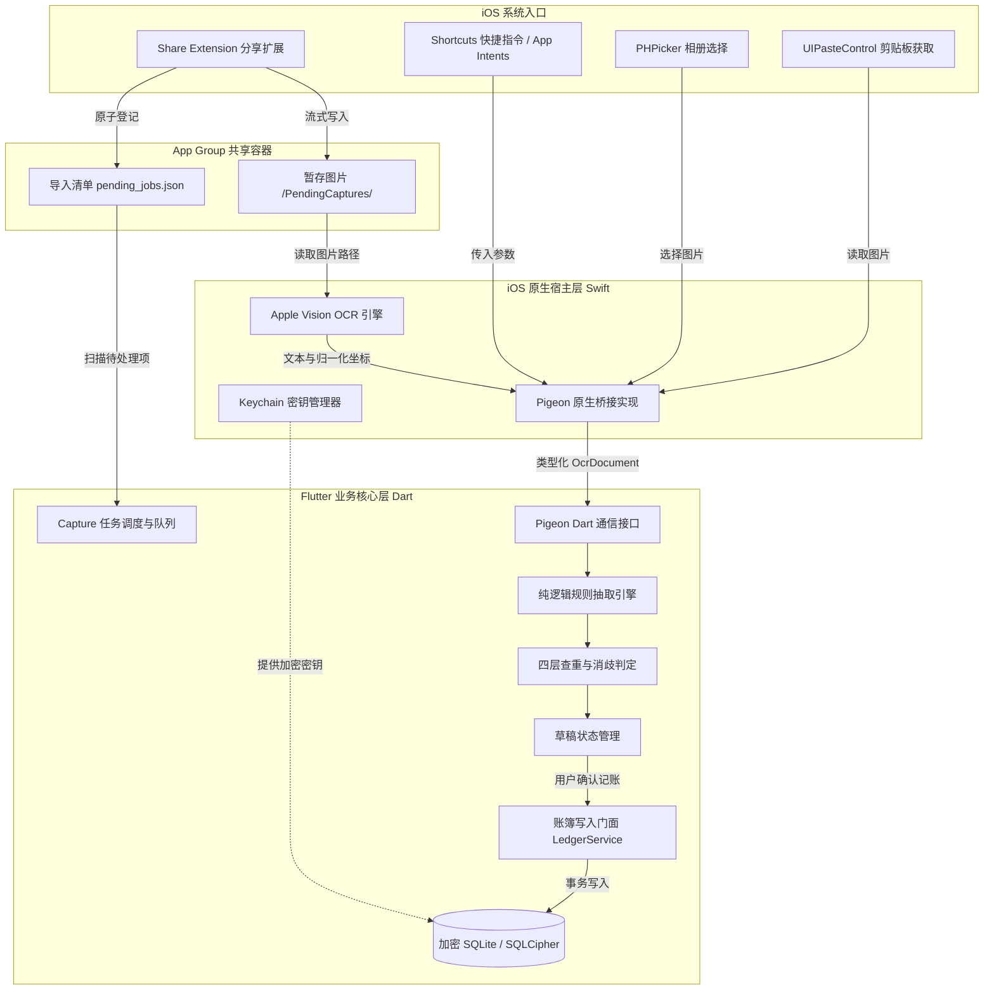

# SingWallet iOS 个人记账 App 实现方案

版本：v1.0 · 编写日期：2026-10-22 · 状态：开发前方案，尚未进行真机验证。

本文为 SingWallet 的 iOS 端工程落地方案。应用界面与记账业务采用 Flutter（与 Android 端共享），iOS 原生入口、截屏接收、Apple Vision 离线 OCR、快捷指令（Shortcuts / App Intents）及系统扩展使用 Swift。本文规划 iOS 的技术架构、系统限制、原生接入细节、跨端一致性与验收标准。

---

## 1. 推荐落地方式

iOS 端的核心体验是：**付款成功后截图 → 分享扩展（Share Extension）或快捷指令导入 SingWallet → 自动识别 → 检查草稿 → 确认入账。**

首版优先保证这条链路的绝对可靠。与 Android 不同，iOS 沙箱机制严禁任何第三方应用在后台静默录屏或截屏，没有类似 Android `MediaProjection` 的单次截屏授权 API。因此，iOS 的高频快捷体验依靠 **iOS 快捷指令（Shortcuts / App Intents）**、**轻点背面（Back Tap）** 与 **iPhone 操作按钮（Action Button）** 联动，形成极简导入通道。

必须区分三件事：

1. **获取信息**：由用户通过系统分享扩展、快捷指令自动化、相册选取器，或主动允许读取剪贴板图片获取截图。
2. **理解信息**：系统内置 Apple Vision Framework 离线 OCR 读取文字与位置，Dart 规则引擎提取金额、商户等核心字段；可选 AI 辅助语义理解。
3. **记入账本**：展示识别依据与置信度，用户确认后产生正式账目，严禁未经确认自动入账。

### 1.1 首版范围

| 首版提供 | 后续增强 | 暂不纳入 |
| --- | --- | --- |
| 微信、支付宝常见支付结果截图导入 | 交互式桌面小组件（Interactive Widgets） | 静默后台监听支付或自动截屏 |
| 系统分享扩展（Share Extension）导入 | iOS 18 控制中心小组件（Control Center Controls） | 读取微信/支付宝沙箱数据或调用私有 API |
| 快捷指令（Shortcuts）与 App Intents 导入 | 用户主动启用的云端 AI 语义补全 | 模拟点击支付 App 或自动化付款 |
| 轻点背面 / 操作按钮一键导入 | 账单文件批量导入（微信/支付宝对账单 CSV） | 多人共享账本、团队报销审批 |
| PHPicker 系统图片选取、手工记账 | 商家模板云端同步与规则库订阅 | 自动拆分混合支付与一单多分类 |
| 离线 Apple Vision Framework 中文识别 | 多币种汇率自动换算 | 自动读取银行账户完整余额 |
| 草稿确认、查重、编辑、删除与暂存 | iCloud Drive 加密同步 | 把完整 Agent 作为基础依赖 |
| 收支、退款、自有账户转账 | Live Activities（灵动岛/实时活动记账提示） | 越狱或私有 API 行为 |
| 分类、项目、标签、账户与月度报表 | 锁屏小组件快捷直达 | 仅凭截图猜测无法求证的字段 |
| Keychain 保护的本地加密数据库（SQLCipher） | 跨端协作与端到端协同 | 自动化无障碍遍历微信页面 |
| CSV 导出与跨端加密完整备份（与 Android 互通） | watchOS 独立记账扩展 | 在 Share Extension 内启动重型引擎 |

首版仅支持人民币（CNY），采用本地单用户、单账本，不要求注册账号或联网。退款与转账允许手工录入；截图能识别时生成对应草稿，无法识别时引导用户手动修正。

---

## 2. iOS 入口与能力边界

### 2.1 各种入口的选择

| 入口 | 用户操作 | 能力与限制 | 优先级 |
| --- | --- | --- | --- |
| 系统分享扩展 (Share Extension) | 截图后在系统分享面板选择 SingWallet | 最自然的系统级分享通道；受限于 Extension 内存限制，仅做轻量图片暂存，由主 App 处理 | P0，首版主入口 |
| 快捷指令 / App Intents | 截屏后触发「导入最新截图记账」，支持绑定轻点背面或 Action Button | 直接前台唤醒 SingWallet 并传入图片，免去分享面板点击；体验最流畅 | P0，高频核心入口 |
| App 内选图 (PHPicker) | 打开 App，点击选图导入 | 使用 `PHPickerViewController`，无需用户授予全量相册读权限，隐私合规度高 | P0，稳定基础入口 |
| 剪贴板快速导入 | 截图后点击「拷贝并删除」，进入 App 点击粘贴记账 | 适配不愿让截图占用相册空间的用户；iOS 16+ 遵循剪贴板授权机制 | P1，补充入口 |
| 桌面快捷操作 (Quick Actions) | 长按桌面 App 图标选择「记一笔」或「识别截图」 | `UIApplicationShortcutItem`，低成本直接唤起特定流程 | P0，低成本入口 |
| 控制中心小组件 (Control Widget) | iOS 18 控制中心下拉点击 SingWallet 控件 | 仅限 iOS 18+；直接唤醒 App 进入记账模式 | P1，版本特性 |
| 后台自动截屏 | 期望支付成功瞬间后台自动截取并记账 | **iOS 系统沙箱绝对禁止**；不存在第三方应用全局录屏/截屏授权 API | 永久不可行 |
| 悬浮窗 / 辅助触控覆盖 | 在支付 App 上方浮动一个记账按钮 | iOS 不允许第三方应用在其他应用上方绘制系统级悬浮窗 | 平台不支持 |

### 2.2 必须遵守的 iOS 系统限制

1. **应用沙箱隔离与 App Groups 约束**：
   - 主 App 与 Share Extension 运行在独立的进程和沙箱中。二者无法直接访问对方的 Documents 目录。
   - 必须启用 **App Groups**（如 `group.com.singwallet.app`），将截图暂存和导入清单保存在共享容器目录中。
2. **App Extension 严苛的内存限制 (Jetsam Limits)**：
   - iOS 赋予 Extension 进程的内存上限极度严格（通常仅 **60 MB ~ 120 MB**，不同机型略有差异）。
   - 若在 Share Extension 中初始化 Flutter Engine 或加载高分辨率大图执行 OCR，必将触发系统 Jetsam 机制而被直接 Kill（Crash 表现为 `EXC_RESOURCE RESOURCE_TYPE_MEMORY`），用户体验极差。
   - **核心架构决策**：**Share Extension 仅作为极轻量的中转存盘工具！** 负责快速把原始图片写入 App Group 共享目录并持久化清单，绝不在 Extension 内部启动重型 Flutter 引擎或运行 Vision OCR。处理完毕后引导用户进入主 App，或待主 App 回到前台时批量读取完成解析。
3. **后台截屏能力的彻底缺席**：
   - iOS 平台不存在类似 Android `MediaProjection` 的单次录屏授权机制；`ReplayKit` 仅用于屏幕直播与录制，必须显示系统广播浮层，且无法单帧静默捕获返回给宿主。
   - 绝不承诺「无需截图，下拉即记」，必须在产品说明中清楚告知：iOS 依赖系统截图后的主动分享或快捷指令。
4. **相册隐私与 PHPicker**：
   - 优先采用 iOS 14+ 提供的 `PHPickerViewController`。该组件由系统独立进程渲染，用户选择的图片直接回传给应用，**完全不需要向用户申请相册全量读取权限（`NSPhotoLibraryUsageDescription`）**，避免给用户造成心理负担及 App Store 审核阻碍。
5. **剪贴板访问合规（iOS 14+ / iOS 16+）**：
   - iOS 14 起读取剪贴板会触发系统顶部横幅通知；iOS 16 起跨应用读取剪贴板若非用户主动触发会弹出授权弹窗。
   - SingWallet 不在每次启动时静默轮询剪贴板，仅在用户点击「从剪贴板导入」或使用系统级 `UIPasteControl` 按钮时读取。
6. **iOS 隐私清单（PrivacyInfo.xcprivacy）**：
   - 苹果自 2024 年春季起强制要求上架应用包含隐私清单。必须规范声明使用的 Required Reason APIs（如文件时间戳访问 `FileTimestamp`、系统启动时间、UserDefaults 等）的原因，不得遗漏。

---

## 3. 用户流程与页面

### 3.1 首次使用

1. **本地账本与安全初始化**：
   - 首次启动在本地生成加密账本密钥，使用 iOS Keychain 硬件级保护（`kSecAttrAccessibleAfterFirstUnlockThisDeviceOnly`）。
   - 设置账本默认币种为人民币（CNY），账本默认时区跟随系统（国内用户为 `Asia/Shanghai`）。
2. **预置核心分类与账户结构**：
   - 自动生成基础生活分类（餐饮、交通、购物、日用、娱乐、医疗、转账等），账户可留空或后续创建。
3. **系统联动引导与教程**：
   - 展示图文与动图引导：
     - 路径 A（标准）：付款后截屏 → 点击左下角截屏缩略图的「分享」→ 选择「SingWallet」。
     - 路径 B（极速）：通过「快捷指令」App 添加 SingWallet 提供的快捷动作，并引导用户配置 iPhone「设置 → 辅助功能 → 触控 → 轻点背面」为该动作，或配置 Action Button。
4. **隐私与本地存储承诺**：
   - 明确告知用户：所有截图识别均在 iPhone 本地使用 Apple Neural Engine 离线完成；入账后临时截图自动清理；无后台监控；默认无任何数据上传。

### 3.2 支付后记账流转

```text
┌──────────────────────────────────────────────────────────────┐
│                    微信 / 支付宝 付款完成页                    │
└──────────────────────────────┬───────────────────────────────┘
                               │ 用户触发截图 (电源键+音量上键)
                               ▼
┌──────────────────────────────────────────────────────────────┐
│ 方式 1：系统截屏分享                     方式 2：快捷指令自动化 │
│ 点击截屏分享 -> 选择 SingWallet          轻点背面两下 / Action Button│
└──────────────┬───────────────────────────────┬───────────────┘
               │                               │
               │ (轻量存储图片至 App Group)      │ (获取最新截屏直接前台唤起)
               ▼                               │
┌──────────────────────────────────────────────┐│
│ SingWallet Share Extension (Swift 原生轻量)   ││
│ 1. 验证图片有效性                             ││
│ 2. 计算 SHA-256 并生成 captureId             ││
│ 3. 写入 App Group 共享目录                    ││
│ 4. 持久化待处理导入清单                       ││
│ 5. 提示完成并关闭                             ││
└──────────────────────┬───────────────────────┘│
                       │                        │
                       │ 用户点击打开主 App      │ 直接拉起主 App
                       ▼                        ▼
┌──────────────────────────────────────────────────────────────┐
│ SingWallet 主 App (Flutter + Swift Vision Native Plugin)      │
│ 1. 扫描 App Group 待处理清单与参数                            │
│ 2. 原生调用 Apple Vision Framework (VNRecognizeTextRequest)  │
│ 3. 毫秒级提取文本行与归一化矩形坐标                          │
│ 4. Dart 纯逻辑规则引擎提取金额、商户、时间、渠道              │
│ 5. 运行查重引擎，生成结构化草稿                              │
└──────────────────────────────┬───────────────────────────────┘
                               │
                               ▼
┌──────────────────────────────────────────────────────────────┐
│ 确认页展示                                                   │
│ - 核心金额放大显示（关联原图对应切片证据）                   │
│ - 商户、交易日期、收支分类、支付渠道、账户                   │
│ - 缺失或存疑字段醒目标注（如「未识别交易日期」）             │
└──────────────────────────────┬───────────────────────────────┘
                               │ 用户核对并点击「确认记账」
                               ▼
┌──────────────────────────────────────────────────────────────┐
│ 正式入账：事务写入加密 SQLCipher 账本，安全清理 App Group 临时图│
└──────────────────────────────────────────────────────────────┘
```

### 3.3 主要页面交互与 iOS HIG 适配

| 页面 | 核心交互与 iOS 特性 |
| --- | --- |
| 首页 (Dashboard) | 顶部适配 iOS 动态岛（Dynamic Island）与安全区域；展示本月消费、退款、净支出；支持下拉刷新账目；悬浮「记一笔」按钮与快捷选图 |
| 识别确认页 (Draft Review) | 遵循 iOS 模态展示（Sheet 风格）；金额大字体显示，点击可放大查看截图提取依据区域；歧义字段通过 CupertinoActionSheet 选择；支持侧滑返回放弃草稿 |
| 待处理队列 (Pending Captures) | 集中展示未完成确认的草稿、无法识别的截图及疑似重复项；支持左滑删除、批量重试或直接转为手工记账 |
| 账目列表 (Transactions) | 支持按月吸顶分组（Pinned Header）；搜索栏使用 iOS 原生风格 UISearchBar 交互；账目项支持左滑快捷删除、右滑快捷复制 |
| 统计与报表 (Analytics) | 分类饼图、月度走势柱状图；明确消费、退款计算口径；支持触觉反馈（UIImpactFeedbackGenerator） |
| 设置与管理 (Settings) | 分类管理、账户列表、商户规则表、快捷指令安装向导、Face ID / Touch ID 安全锁、CSV 导出与加密备份 |

---

## 4. 技术架构与选型

### 4.1 技术选型

| 层级 | 方案选型 | 理由与决策依据 |
| --- | --- | --- |
| UI 与业务逻辑 | Flutter / Dart，Riverpod 状态管理 | 跨端代码复用率预计达 85% 以上，与 Android 端共享规则引擎、账簿事务与报表计算 |
| iOS 原生能力层 | Swift 5.9+、App Intents、Share Extension | 适配 iOS 最新生命周期规范，原生处理扩展交互、文件 I/O 与系统通道 |
| 跨层通信 | Pigeon 强类型代码生成 | 自动生成 Dart 与 Swift 双向类型化接口，杜绝字符拼写错误，明确异常类型 |
| 离线中文 OCR | Apple Vision Framework (`VNRecognizeTextRequest`) | **核心决策**：iOS 16+ 原生内置高精度中英文识别，由 Apple Neural Engine 硬件加速，**0 KB 额外包体积**（相比 Android ML Kit 随包需增加 20-30MB），首版无网可用 |
| 数据持久化 | SQLite + SQLCipher (通过 Flutter FFI 或 sqflite_sqlcipher) | 与 Android 保持 100% 结构一致的本地加密数据库，支持统一标准的备份与恢复 |
| 密钥安全存储 | iOS Keychain Services | 硬件 Secure Enclave 保护数据库主密钥；配合 Access Group 支持主 App 与 Extension 共享安全凭证 |
| 进程间共享 | App Groups 容器目录 (`group.com.singwallet.app`) | 主 App 与 Share Extension 之间交换图片与导入清单的标准官方机制 |
| 后台任务维护 | BGTaskScheduler | 注册后台清理任务，夜间或空闲时对过期未确认的临时截图做补偿清理 |
| 可选云端 AI | HTTPS API + 统一 JSON Schema 协议 | 仅供用户显式启用；首版完全脱机运行，不依赖任何云端组件 |

### 4.2 模块与数据流



### 4.3 Swift 与 Flutter Pigeon 接口规范

Pigeon 协议统一管理原生与 Flutter 通信，禁止在通道中传递大尺寸图片字节：

```dart
// pigeons/native_bridge.dart 统一规范契约

enum ImageSourceKind {
  systemShare,       // 系统分享 (iOS Share Extension)
  photoPicker,       // 应用内相册选择 (PHPicker)
  shortcutsAction,   // 快捷指令 / App Intents / 轻点背面 / Action Button
  clipboard,         // 剪贴板提取
  quickSettingsTile, // Android 磁贴 (iOS 不支持，保留枚举对齐)
}

class CaptureResult {
  final String captureId;
  final String localFilePath;
  final int imageWidth;
  final int imageHeight;
  final String contentHash; // 图片 SHA-256
  final ImageSourceKind sourceKind;
}

class OcrBoundingBox {
  final double left;   // 归一化坐标 0.0 - 1.0 (已由 Swift 转换为左上角原点)
  final double top;
  final double width;
  final double height;
}

class OcrTextLine {
  final String text;
  final OcrBoundingBox boundingBox;
  final double? confidence; // 0.0 - 1.0
}

class OcrDocument {
  final String captureId;
  final List<OcrTextLine> lines;
  final String engineIdentifier; // 如 "AppleVision_iOS_17"
  final int processTimeMs;
}

@HostApi()
abstract class NativeCaptureHostApi {
  // 从相册安全选择一张图片 (PHPicker)
  @async
  CaptureResult? pickSingleImage();

  // 扫描 App Group 待处理队列（获取 Share Extension 存入的任务）
  List<CaptureResult> fetchPendingExternalCaptures();

  // 原生调用 Apple Vision 进行高精度 OCR
  @async
  OcrDocument recognizeCapture(String captureId);

  // 清除 App Group 或私有沙箱中的单张暂存图
  bool deleteCaptureImage(String captureId);

  // 从剪贴板读取图片（由用户明确触发）
  CaptureResult? readImageFromClipboard();

  // 单次屏幕采集 (iOS 返回 null，由 Android 实现)
  @async
  CaptureResult? startOneShotScreenCapture();

  // 从 iOS Keychain 获取或初始化 256 位数据库加密主密钥
  @async
  Uint8List getOrCreateDatabaseKey();
}

@FlutterApi()
abstract class NativeCaptureFlutterApi {
  // 当应用处于运行状态时，原生宿主接收到外部新分享或快捷指令导入时的实时回调通知
  void onExternalCaptureReceived(CaptureResult capture);
}
```

---

## 5. iOS 原生接入细节

### 5.1 Share Extension 轻量化架构与防 OOM

为确保在 **120 MB 内存上限** 下绝对安全，Share Extension 采取「零解码、纯中转」的流式持久化策略：

1. **Info.plist 精确过滤规则**：
   通过 `NSExtensionActivationRule` 限制只接收单张图片输入，避免不必要的进程唤醒：
   ```xml
   <key>NSExtensionActivationRule</key>
   <string>SUBQUERY (
       extensionItems,
       $extensionItem,
       SUBQUERY (
           $extensionItem.attachments,
           $attachment,
           ANY $attachment.registeredTypeIdentifiers UTI-CONFORMS-TO "public.image"
       ).@count == 1
   ).@count == 1</string>
   ```
2. **零解码直接落盘**：
   - 不调用 `UIImage(data:)` 将全图解码为未压缩位图（避免一张 4K 截图瞬时占用数十兆内存）。
   - 直接使用 `NSItemProvider.loadFileRepresentation(forTypeIdentifier: "public.image")`，获得系统级临时文件 URL。
   - 使用 `FileHandle` 或流式读取计算原始文件 SHA-256，生成唯一 `captureId`（例如 `cap_sha256前16位_时间戳`）。
   - 将文件复制到 App Group 共享目录：`containerURL/PendingCaptures/{captureId}.jpg`。
3. **原子登记清单与跨进程同步**：
   - 在 App Group 目录下维护 `pending_manifest.json`，使用 `NSFileCoordinator` 保证写入互斥，记录 `captureId`、`filename`、`created_at`、`source_kind = "share_extension"`。
4. **交互完结与主 App 引导**：
   - iOS 官方 Share Extension 并不支持直接调用 `UIApplication.shared.open(url)` 强行拉起主应用。
   - 正确做法：Extension UI 展现极简原生反馈（如绿色对勾「已导入 SingWallet」），提供两个按钮：**「完成」**（稍后处理）与 **「立即打开记账」**（利用私有响应者链安全唤起 URL Scheme `singwallet://open-draft?id=captureId`；若审核受限则提示用户打开 App 即可看到草稿）。
   - 主 App 每次启动或从后台进入前台时（`sceneDidBecomeActive`），自动执行 `fetchPendingExternalCaptures()` 导入队列。

### 5.2 快捷指令 (Shortcuts) 与 App Intents 集成

iOS 16+ 引入了全新的 `AppIntents` 框架，为 SingWallet 打造原生自动化体验：

1. **定义 AppIntent 动作**：
   ```swift
   import AppIntents

   struct ImportLatestScreenshotIntent: AppIntent {
       static var title: LocalizedStringResource = "导入最新截图记账"
       static var description = IntentDescription("自动获取相册中的最新一张截屏，并在 SingWallet 中快速记账")
       static var openAppWhenRun: Bool = true // 关键：运行时直接把 App 唤醒到前台

       @MainActor
       func perform() async throws -> some IntentResult {
           // 1. 获取最新一张截屏资产
           guard let asset = PHAsset.fetchAssets(with: .image, options: latestScreenshotOptions()).firstObject else {
               throw IntentError.noScreenshotFound
           }
           // 2. 导出图片到 App Group 暂存区并获取 captureId
           let captureId = try await ExportManager.shared.exportAsset(asset)
           // 3. 通知主 App 路由至该草稿
           AppState.shared.pendingCaptureIdFromShortcut = captureId
           return .result()
       }
   }
   ```
2. **系统硬件与手势联动**：
   - **轻点背面（Back Tap）**：引导用户在系统「设置 → 辅助功能 → 触控 → 轻点背面」中，将「轻点两下」或「轻点三下」绑定到 SingWallet 的「导入最新截图记账」快捷指令。
   - **操作按钮（Action Button）**：支持 iPhone 15 Pro / 16 系列用户直接将侧边 Action Button 设为该快捷动作，付款完成后按一下侧键，即刻完成截图导入并拉起确认页。

### 5.3 Apple Vision OCR 框架适配与坐标系对齐

Apple Vision Framework 的 `VNRecognizeTextRequest` 是 iOS 平台最出色的离线文字识别方案：

1. **引擎配置**：
   - 识别语言设置为 `["zh-Hans", "en-US"]`。
   - 识别级别选用 `.accurate`，启用语言修正 `usesLanguageCorrection = true`。
   - 硬件要求：iPhone A12 芯片及以上设备全面支持 Neural Engine 硬件加速，单张图片识别耗时普遍小于 300ms。
2. **坐标系转换（关键细节）**：
   - **Vision 坐标系**：以图像**左下角**为原点 `(0, 0)`，X 轴向右递增 `[0, 1]`，Y 轴**向上**递增 `[0, 1]`。
   - **Flutter / UI 坐标系**：以图像**左上角**为原点 `(0, 0)`，X 轴向右递增 `[0, 1]`，Y 轴**向下**递增 `[0, 1]`。
   - Swift 桥接层必须做标准化坐标映射，否则 Flutter 端展示的高亮切片位置将上下颠倒：
   ```swift
   let visionBox = observation.boundingBox
   // 转换为以左上角为原点的归一化矩形
   let flutterLeft = visionBox.origin.x
   let flutterTop = 1.0 - visionBox.origin.y - visionBox.size.height
   let flutterWidth = visionBox.size.width
   let flutterHeight = visionBox.size.height
   ```
3. **文本块重组**：
   - 将相邻且垂直间距极小的单字片段按行合并为 `OcrTextLine`，保留每行的置信度与坐标包围盒，供 Dart 规则引擎做空间相对位置判定。

### 5.4 App 内选图：PHPickerViewController 零权限方案

为彻底杜绝相册权限申请对用户的打扰：

- 首选 `PHPickerViewController`（配置 `filter = .images`，`selectionLimit = 1`）。
- 优势：该选择器在独立进程运行，仅将用户单次点选的照片权限临时授予应用，**无需在 Info.plist 中声明 `NSPhotoLibraryUsageDescription` 即可运行**。
- 若用户运行在 iOS 13 兼容环境，才降级使用传统 UIImagePickerController 并按需声明权限。

### 5.5 剪贴板检测与 UIPasteControl

部分用户习惯在截图后选择「拷贝并删除」，以保持系统相册整洁：

- 界面提供专用的「粘贴剪贴板截图」按钮。
- iOS 16+ 引入 `UIPasteControl` 系统控件，用户点击该控件直接读取剪贴板中的图片数据，**不触发 iOS 16 的系统级授权横幅或弹窗**。
- 若剪贴板内不是图片格式，明确给出气泡提示「未在剪贴板中发现图片」，不进行后续识别。

### 5.6 Keychain 与 App Group 权限配置

- **Keychain 访问组（Keychain Access Groups）**：
  配置 `$(AppIdentifierPrefix)group.com.singwallet.app`，使主 App 与扩展能够使用同一套主密钥加解密共享凭据。
- **文件保护等级（File Protection）**：
  App Group 中的图片文件及临时数据，统一设置文件属性：
  `NSFileProtectionKey = FileProtectionType.completeUntilFirstUserAuthentication`。
  确保手机重启后用户只要解锁过一次，扩展或后台维护进程即可正常读写，兼顾锁屏安全与后台运行可用性。

### 5.7 iOS 隐私清单（PrivacyInfo.xcprivacy）声明

上线 App Store 必须附带规范的 `PrivacyInfo.xcprivacy` 文件，声明以下 API 使用理由：

1. `NSPrivacyAccessedAPITypeFileTimestamp`：用于检查临时截图文件的创建时间与到期清理策略。
2. `NSPrivacyAccessedAPITypeUserDefaults`：用于存储本地偏好设置（如默认时区、教程是否已展示）。
3. 声明数据类型采集：明确标注应用不收集个人身份信息（Tracking = false），账目仅保存在设备本地。

---

## 6. 识别引擎：iOS 平台特征适配

识别流水线总体复用 Dart 纯逻辑引擎，但需针对 iOS 端的界面渲染差异做专门适配：

```text
Apple Vision OCR 原始输出 (文本 + 归一化矩形)
    ↓
1. iOS 界面特征清洗与区域裁剪
    - 动态岛 / 刘海区 / 顶部状态栏文字剔除 (时间、电量、WiFi、5G 标签)
    - 底部 Home Indicator 区域剔除
    ↓
2. 支付平台与状态判别
    - 微信支付 / 支付宝凭证模板匹配
    - 支付状态（成功 / 处理中 / 退款 / 失败）
    ↓
3. 核心字段候选提取 (规则 + 空间相对布局)
    - 实付金额（金额主候选 + 标签邻近原则）
    - 商户名称（商户抬头与行首标签解析）
    - 交易时间（正规化提取年月日时分秒）
    - 支付渠道与卡号尾号识别
    ↓
4. 歧义消歧与可信度评级
    ↓
生成结构化 DraftDraftEntity
```

### 6.1 顶部状态栏与动态岛干扰消除

iOS 截图顶部通常带有系统状态栏（时间如 `09:41`、运营商、电池电量等）或灵动岛黑区：

- **坐标过滤规则**：对屏幕顶部垂直比例 `top < 0.06`（动态岛机型为 `top < 0.075`）区域内的文本，一律打上「系统状态栏」标记，禁止将其中的数字误识别为交易时间或金额。
- 对底部 `top > 0.95` 的 Home 条区域进行类似边界裁剪。

### 6.2 字体与排版特征适配

- iOS 微信与支付宝在渲染金额时采用定制字体或系统 `SF Pro` / `PingFang SC`：
  - Vision OCR 对 `¥`、`￥`、`元` 以及半角小数点 `.` 识别率极高，但需注意防范将 `0` 误识别为大写字母 `O` 或反之（结合金额纯数字正则强制校验）。
  - 对「实付金额」「付款金额」「扣款」后随大号字体的典型排版，利用垂直包围盒高度进行字号加权，优先提取实付金额。

### 6.3 金额与状态规则（与 Android 保持绝对一致）

- 首版仅处理人民币（分存储）。
- 绝不把字号最大的数字直接武断作为实付（可能是优惠后总额或账户余额）。
- 出现「待付款」「支付失败」时，不得生成可直接确认的支出账目，必须标红提示状态异常。
- 零元交易不可直接记为正常支出，提示用户手动核实。

---

## 7. 分类、分组与用户习惯

完全复用已设计的纯 Dart 分类引擎：

1. **三维独立正交体系**：
   - **主分类**（单一）：餐饮、交通、日常开销等。
   - **项目**（可选单一）：如「2026年日本旅行」「新房装修」。
   - **标签**（可选多个）：如「朋友聚餐」「可报销」「夜宵」。
2. **规则匹配优先级**：
   **本次手动调整 > 用户自定义商户规则 > 历史相同商户映射 > 内置关键词库 > 可选 AI 建议 > 待分类**。
3. 用户在确认页修改分类后，提供「以后此商户均归为此类」快捷勾选，修改后仅对未来新增账目生效，不篡改历史流水。

---

## 8. 数据模型与跨平台互通

### 8.1 实体与数据库结构

iOS 与 Android 端采用完全相同的 SQLite 建表 DDL。所有时间戳统一采用 UTC 存储，金额使用整数分（`amount_minor`），记账日以 `occurred_on`（`YYYY-MM-DD`）为核心口径。

核心表结构概要：

- `capture_jobs`：记录导入任务流水，存储 `captureId`、`content_hash`、`source_kind`（`share_extension`、`shortcuts`、`picker`、`clipboard`）。
- `drafts`：记录草稿字段、抽取证据坐标及校验冲突。
- `transactions`：正式账目主表。
- `transaction_metadata`：原价、优惠、订单号、支付状态等扩展字段。
- `accounts`、`categories`、`projects`、`tags`、`transaction_tags`：主数据及关联表。
- `confirmed_identifiers`：交易唯一索引表，用于硬防重。

### 8.2 跨平台加密备份格式规范 (SingWallet Backup Format v1)

为支持用户在 **Android ↔ iPhone** 之间无缝换机，两端必须严格遵循同一备份解密协议：

1. **文件扩展名**：`.swbk`（SingWallet Backup）。
2. **加密封包结构**：
   - **Header (固定 32 字节)**：Magic Number (`SWBK`, 4 字节) + 版本号 (`0x0001`, 2 字节) + KDF 算法标识 + 16 字节随机 Salt + 12 字节 AES-GCM IV/Nonce。
   - **Ciphertext Payload**：用户口令经 **PBKDF2-HMAC-SHA256**（100,000 次迭代）派生 256 位密钥，使用 **AES-256-GCM** 认证加密。
   - **Payload 内容**：包含版本清单 `manifest.json`、全量交易数据、分类账户配置及商户规则的压缩包。
3. **安全约束**：备份默认不包含大尺寸截图原件，确保备份文件轻量且易于跨设备 AirDrop 传输。

---

## 9. 任务状态、可靠性与失败降级

任务状态机在两端保持完全统一：

```text
[IMPORTED] ──► [RECOGNIZING] ──► [NEEDS_REVIEW] ──► [COMMITTED]
                     │
                     └──► [FAILED] ──► (引导重试或手工补全)
```

- **中断自愈**：主 App 启动时扫描未完成状态的 `capture_jobs`。若发现上一次在 `RECOGNIZING` 阶段由于系统杀死进程而中断，自动将其置回可重试状态。
- **App Group 孤儿文件防范**：若用户在 Share Extension 存入了图片，但后续再未打开主 App，后台维护任务在 7 天后对超期未引用的文件执行自动清理，防止垃圾堆积。

---

## 10. 隐私、备份与数据安全

### 10.1 iOS 截图生命周期与系统排除

- **临时图片清理**：确认入账或放弃草稿后，App 立即异步删除 App Group 容器中的原始图片。
- **排除系统云备份**：
  对 App Group 容器内的临时截图目录设置 iOS 排除备份标志，避免敏感截图通过 iCloud 同步外泄：
  ```swift
  var values = URLResourceValues()
  values.isExcludedFromBackup = true
  try tempCapturesDirectoryURL.setResourceValues(values)
  ```
- **相册原件说明**：用户通过系统截图留存在系统相册里的原图，受 iOS 沙箱与权限控制，SingWallet 既无法也不应私自删除。App 内设置页明确向用户说明此点。

### 10.2 CSV 导出与安全防护

- 导出 CSV 供用户自行备份或查看时，对商户、备注等文本字段进行 **公式注入防护**：若单元格以 `=`, `+`, `-`, `@`, `\t`, `\r` 开头，自动在前面追加单引号 `'`，防止 Excel / Numbers 自动执行恶意宏。

---

## 11. 建议 iOS 工程结构

后续正式创建工程时，iOS 相关代码与原生扩展的建议目录结构如下：

```text
singwallet/
├─ README.md
├─ docs/
│  ├─ Android实现方案.md
│  ├─ iOS实现方案.md                 # 本方案
│  └─ 跨平台架构与数据规范.md
├─ pigeons/
│  └─ native_bridge.dart            # Pigeon 接口契约
├─ lib/                             # Flutter 业务代码 (跨端共享)
│  ├─ app/
│  ├─ core/
│  ├─ features/
│  │  ├─ capture/
│  │  ├─ recognition/
│  │  ├─ drafts/
│  │  └─ ledger/
│  └─ data/
└─ ios/                             # iOS 原生工程
   ├─ Runner/                       # 主 App 宿主
   │  ├─ AppDelegate.swift
   │  ├─ Info.plist
   │  ├─ PrivacyInfo.xcprivacy      # 苹果隐私清单
   │  └─ Plugins/
   │     ├─ NativeBridgePlugin.swift# Pigeon 宿主实现
   │     ├─ VisionOcrEngine.swift   # Apple Vision OCR 封装
   │     └─ KeychainHelper.swift    # 密钥存取
   ├─ SingWalletShare/              # Share Extension 扩展 Target
   │  ├─ ShareViewController.swift  # 极轻量流式中转保存
   │  └─ Info.plist                 # 包含精确激活规则
   ├─ SingWalletIntents/            # App Intents 扩展 Target
   │  └─ ImportLatestScreenshot.swift
   └─ Shared/                       # 主 App 与 Extension 共享代码
      ├─ AppGroupManager.swift      # 共享容器路径与文件协同
      └─ ManifestEntity.swift       # 导入清单模型
```

---

## 12. 开发顺序与交付物

按 1 名 Flutter 开发 + 1 名具备 iOS 原生（Swift / Vision / Extension）能力的工程师配合：

| 阶段 | 周期 | 核心交付与验收目标 |
| --- | --- | --- |
| iOS-M0 原生预研与 Vision 验证 | 第 1 周 | 验证 Apple Vision 对 50 张中英文支付截图的识别效果；验证 App Group 读写互斥；测试 Share Extension 内存占用（确保 < 40MB）；打通 Pigeon 通道 |
| iOS-M1 核心导入闭环 | 第 2 周 | Share Extension 截图暂存 → 主 App 唤醒 → Vision OCR → 生成草稿 → 确认入账链路跑通；打通 PHPicker 选图 |
| iOS-M2 快捷指令与手势联动 | 第 3 周 | 实现 App Intents；真机实测「轻点背面」与 Action Button 一键导入；联调剪贴板安全粘贴 |
| iOS-M3 跨端数据互通与安全 | 第 4 周 | 验证 Keychain 密钥保护；实现与 Android 完全互通的 `.swbk` 加密备份导入与导出；实现过期暂存图清理 |
| iOS-M4 HIG 调优与商店合规 | 第 5 周 | 适配动态岛与暗黑模式；编写完整的 `PrivacyInfo.xcprivacy`；完成 200 张典型与困难样本验收测试；准备 App Store 提审材料 |

---

## 13. 验收标准与测试重点

### 13.1 核心性能与稳定性门槛

| 指标项 | 验收目标 | 验证方法 |
| --- | --- | --- |
| Share Extension 峰值内存 | **≤ 40 MB** (警戒线 80MB) | Xcode Instruments (Allocations / Leaks) 监控大图导入瞬时峰值 |
| Apple Vision OCR 识别耗时 | iPhone A14 芯片及以上设备 **P95 ≤ 500 ms** | 记录自图片解码完毕至 `OcrDocument` 生成的原生端耗时 |
| 普通截图金额精确命中率 | **≥ 98%** | 200 张微信、支付宝真实样本集实测 |
| 可见商户名称正确提取率 | **≥ 95%** | 针对有明确商户抬头的截图样本 |
| 跨平台备份恢复一致性 | 100% 互通 | Android 导出的加密备份在 iOS 完美恢复，反之亦然 |
| 进程终止可恢复性 | 0 坏账、0 重复 | 在 OCR 识别中、草稿保存中强杀 App，重启后状态正确恢复 |

### 13.2 iOS 专属必测边界用例

1. **大尺寸与长截图处理**：针对 iPhone 拼接的长截图（高度 > 8000 像素），验证内存是否平稳，是否能准确定位实付金额。
2. **HEIC 与 ProRAW 格式**：iPhone 相册可能存在 HEIC 或 RAW 格式图片，验证格式转换与 Vision 输入管道兼容性。
3. **动态岛与刘海屏遮挡**：覆盖 iPhone 14 Pro ~ 16 全系列机型，确认顶部状态栏与灵动岛不会对金额识别产生干扰。
4. **暗黑模式（Dark Mode）**：验证微信与支付宝在 iOS 深色模式下的截图对比度与 OCR 召回率。
5. **快捷指令异常场景**：相册中最新一张照片并非支付截图（如生活自拍）时，识别引擎应友好识别为「未发现有效支付信息」，保留草稿并允许用户手动填写或一键作废。
6. **App Group 读写并发竞争**：用户在系统分享面板连续多次快速分享多张截图，验证文件写入互斥与清单追加无死锁、无损坏。

---

## 14. 官方资料与核查边界

1. [Apple Developer: Sharing Data with App Extensions (App Groups)](https://developer.apple.com/documentation/xcode/sharing-data-with-your-container-app)
2. [Apple Developer: Vision Framework - Recognizing Text in Images](https://developer.apple.com/documentation/vision/recognizing-text-in-images)
3. [Apple Developer: App Intents Framework](https://developer.apple.com/documentation/appintents)
4. [Apple Developer: Selecting Photos and Videos with PHPicker](https://developer.apple.com/documentation/photokit/selecting_photos_and_videos_with_phpicker)
5. [Apple Developer: UIPasteControl](https://developer.apple.com/documentation/uikit/uipastecontrol)
6. [Apple Developer: Describing data use in privacy manifests](https://developer.apple.com/documentation/bundleresources/privacy_manifest_files)
7. [Apple Developer: Keychain Services](https://developer.apple.com/documentation/security/keychain_services)
8. [Apple HIG: Human Interface Guidelines - Share Extensions](https://developer.apple.com/design/human-interface-guidelines/share-extensions)
