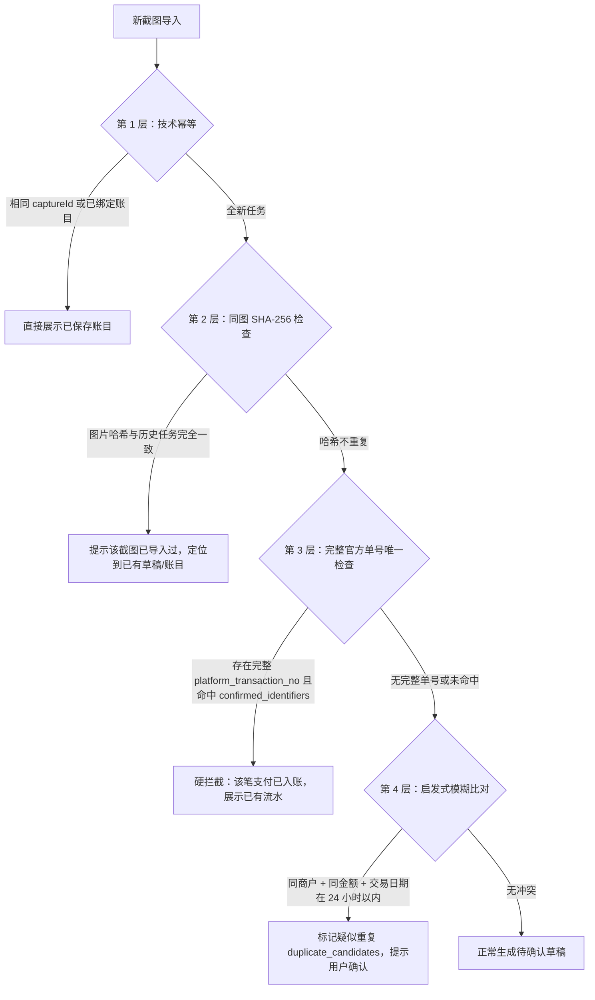

# SingWallet 跨平台架构与数据规范

版本：v1.0 · 编写日期：2026-10-22 · 状态：规范定稿，作为 Android 与 iOS 双端实现的权威技术契约。

---

## 1. 跨平台设计原则与职责边界

SingWallet 采用 **Flutter (Dart) 承载核心业务 + 平台原生（Kotlin / Swift）承载系统级能力** 的混合架构。核心目标是在保证 iOS 与 Android 原生体验与安全性的前提下，实现业务逻辑、解析规则、账务口径与数据格式的 100% 统一与互通。

```text
┌──────────────────────────────────────────────────────────────┐
│                    Flutter / Dart 业务核心层                  │
│  UI 交互 (Riverpod) │ 规则引擎 │ 账簿管理 │ 去重状态机 │ 加密导出 │
└──────────────────────────────┬───────────────────────────────┘
                               │ Pigeon 强类型通信契约
                               ▼
┌──────────────────────────────┴───────────────────────────────┐
│                      原生适配层 (Native Hosts)                │
├──────────────────────────────┬───────────────────────────────┤
│       Android (Kotlin)       │           iOS (Swift)         │
│ - 系统分享 (ACTION_SEND)     │ - 分享扩展 (Share Extension)  │
│ - 快捷磁贴 (TileService P1)  │ - 快捷指令 (App Intents P0)   │
│ - ML Kit Text Recognition v2 │ - Apple Vision Framework OCR  │
│ - Android Keystore 密钥管理  │ - iOS Keychain 硬件级保护     │
│ - WorkManager 后台补偿清理   │ - BGTaskScheduler 后台维护    │
└──────────────────────────────┴───────────────────────────────┘
```

### 职责切分准则：

1. **绝对下沉到 Flutter 层的模块**：
   - 账目计算、退款冲抵、月度报表统计逻辑；
   - 规则引擎匹配、关键词提取、商户归一化算法；
   - 四层防重判定、草稿校验与冲突标记；
   - SQLite 数据库读写（通过 SQLCipher FFI）、数据迁移、备份加密与解密。
2. **严格收敛在原生宿主层的模块**：
   - 系统分享意图接收、照片选择器（Photo Picker）调用；
   - 本地 OCR 核心引擎驱动（ML Kit / Apple Vision）；
   - 设备硬件安全存储（Keystore / Keychain）的主密钥生成与存取；
   - 系统特定扩展（Android TileService、iOS Share Extension、iOS App Intents）。

---

## 2. Pigeon 跨平台接口规范

跨端通信必须使用 Pigeon 生成类型化代码，严禁使用非类型化的 `MethodChannel` 字符串协议。协议文件放置于 `pigeons/native_bridge.dart`。

### 2.1 协议定义 (Pigeon IDL)

```dart
// pigeons/native_bridge.dart
import 'package:pigeon/pigeon.dart';

@ConfigurePigeon(PigeonOptions(
  dartOut: 'lib/core/native/native_bridge.g.dart',
  dartTestOut: 'test/core/native/native_bridge_test.g.dart',
  kotlinOut: 'android/app/src/main/kotlin/com/singwallet/app/bridge/NativeBridge.g.kt',
  kotlinOptions: KotlinOptions(package: 'com.singwallet.app.bridge'),
  swiftOut: 'ios/Runner/Plugins/NativeBridge.g.swift',
  swiftOptions: SwiftOptions(),
))

enum ImageSourceKind {
  systemShare,       // 系统分享 (Android Send Intent / iOS Share Extension)
  photoPicker,       // 应用内相册选择 (Photo Picker)
  shortcutsAction,   // 快捷指令 / 桌面快捷方式 / 动作按钮
  clipboard,         // 剪贴板提取
  quickSettingsTile, // 快捷设置磁贴采集 (Android P1)
}

class CaptureResult {
  final String captureId;
  final String localFilePath;
  final int imageWidth;
  final int imageHeight;
  final String contentHash; // 图片 SHA-256
  final ImageSourceKind sourceKind;
}

class OcrBoundingBox {
  // 必须统一映射为归一化坐标 [0.0, 1.0]，原点位于图片【左上角】
  final double left;
  final double top;
  final double width;
  final double height;
}

class OcrTextLine {
  final String text;
  final OcrBoundingBox boundingBox;
  final double? confidence; // 0.0 - 1.0，引擎未提供时为空
}

class OcrDocument {
  final String captureId;
  final List<OcrTextLine> lines;
  final String engineIdentifier; // 如 "MLKit_Android_v2" 或 "AppleVision_iOS_17"
  final int processTimeMs;
}

@HostApi()
abstract class NativeCaptureHostApi {
  // 打开系统图片选择器，选取单张图片
  @async
  CaptureResult? pickSingleImage();

  // 扫描系统扩展存入的待处理导入任务 (针对 iOS App Group 或 Android 离线清单)
  List<CaptureResult> fetchPendingExternalCaptures();

  // 调用原生平台最高效的离线 OCR 引擎进行识别
  @async
  OcrDocument recognizeCapture(String captureId);

  // 清除 App 私有暂存目录下的图片原件
  bool deleteCaptureImage(String captureId);

  // 从剪贴板读取单张图片（由用户显式触发）
  CaptureResult? readImageFromClipboard();

  // Android P1: 触发单次屏幕采集并截取一帧；在 iOS 端调用返回 null 或抛出 UNSUPPORTED
  @async
  CaptureResult? startOneShotScreenCapture();

  // 从安全硬件 (Keystore / Keychain) 异步获取或初始化 256 位数据库加密主密钥
  @async
  Uint8List getOrCreateDatabaseKey();
}

@FlutterApi()
abstract class NativeCaptureFlutterApi {
  // 当应用处于运行状态时，原生宿主接收到外部新分享或快捷指令导入时的实时回调通知
  void onExternalCaptureReceived(CaptureResult capture);
}
```

---

## 3. SQLite 数据库建表 DDL 与索引规范

Android 与 iOS 端采用完全相同的 SQLite 架构，配合 SQLCipher 进行整库 AES-256 加密。表名全部采用小写下划线命名。

```sql
-- ============================================================================
-- 1. 导入任务流水表
-- ============================================================================
CREATE TABLE IF NOT EXISTS capture_jobs (
    id TEXT PRIMARY KEY NOT NULL,                -- 任务 UUID
    content_hash TEXT NOT NULL,                 -- 图片 SHA-256 哈希
    source_kind TEXT NOT NULL,                  -- share_extension, photo_picker, shortcuts, etc.
    imported_at TEXT NOT NULL,                  -- 导入 UTC ISO-8601 时间戳
    private_image_ref TEXT NOT NULL,            -- 私有存储相对路径
    state TEXT NOT NULL,                        -- IMPORTED, RECOGNIZING, NEEDS_REVIEW, COMMITTED, FAILED, DISCARDED
    attempt_count INTEGER NOT NULL DEFAULT 0,   -- 重试次数
    parser_version INTEGER NOT NULL DEFAULT 1,  -- 规则抽取解析器版本
    created_at TEXT NOT NULL,
    updated_at TEXT NOT NULL
);
CREATE INDEX IF NOT EXISTS idx_capture_jobs_hash ON capture_jobs(content_hash);
CREATE INDEX IF NOT EXISTS idx_capture_jobs_state ON capture_jobs(state);

-- ============================================================================
-- 2. 识别草稿表
-- ============================================================================
CREATE TABLE IF NOT EXISTS drafts (
    id TEXT PRIMARY KEY NOT NULL,                -- 草稿 UUID
    capture_id TEXT NOT NULL UNIQUE,            -- 关联的任务 ID (一对一)
    candidate_fields TEXT NOT NULL,             -- JSON 字符串：包含候选金额、商户、时间、渠道等
    field_evidence TEXT NOT NULL,               -- JSON 字符串：字段对应的 OCR 文本行与坐标依据
    validation_issues TEXT NOT NULL,            -- JSON 数组：校验异常列表（如 ["MISSING_DATE", "MULTIPLE_AMOUNTS"]）
    duplicate_candidates TEXT NOT NULL,         -- JSON 数组：疑似重复的交易 ID 列表
    saved_transaction_id TEXT,                  -- 若已保存，指向正式交易 ID
    created_at TEXT NOT NULL,
    updated_at TEXT NOT NULL,
    FOREIGN KEY(capture_id) REFERENCES capture_jobs(id) ON DELETE CASCADE
);
CREATE INDEX IF NOT EXISTS idx_drafts_saved_tx ON drafts(saved_transaction_id);

-- ============================================================================
-- 3. 资金账户表
-- ============================================================================
CREATE TABLE IF NOT EXISTS accounts (
    id TEXT PRIMARY KEY NOT NULL,
    name TEXT NOT NULL,                         -- 账户名称，如「招商银行储蓄卡」
    kind TEXT NOT NULL,                         -- cash, debit_card, credit_card, e_wallet, other
    card_last4 TEXT,                            -- 卡号后四位，仅用于用户辨识
    archived_at TEXT,                           -- 软归档时间，空表示正常使用
    created_at TEXT NOT NULL,
    updated_at TEXT NOT NULL
);

-- ============================================================================
-- 4. 交易分类表
-- ============================================================================
CREATE TABLE IF NOT EXISTS categories (
    id TEXT PRIMARY KEY NOT NULL,
    name TEXT NOT NULL,                         -- 分类名称，如「餐饮美食」
    parent_id TEXT,                             -- 一级分类为空，二级分类指向父级
    applicable_type TEXT NOT NULL,              -- expense (支出), income (收入), both
    icon_key TEXT,                              -- 预置图标标识符
    sort_order INTEGER NOT NULL DEFAULT 0,
    archived_at TEXT,
    created_at TEXT NOT NULL,
    updated_at TEXT NOT NULL,
    FOREIGN KEY(parent_id) REFERENCES categories(id) ON DELETE SET NULL
);

-- ============================================================================
-- 5. 项目表 (Project)
-- ============================================================================
CREATE TABLE IF NOT EXISTS projects (
    id TEXT PRIMARY KEY NOT NULL,
    name TEXT NOT NULL,                         -- 项目名称，如「2026云南旅行」、「新房装修」
    archived_at TEXT,
    created_at TEXT NOT NULL,
    updated_at TEXT NOT NULL
);

-- ============================================================================
-- 6. 标签表 (Tag)
-- ============================================================================
CREATE TABLE IF NOT EXISTS tags (
    id TEXT PRIMARY KEY NOT NULL,
    name TEXT NOT NULL,                         -- 标签名称，如「工作日午餐」、「可报销」
    archived_at TEXT,
    created_at TEXT NOT NULL,
    updated_at TEXT NOT NULL
);

-- ============================================================================
-- 7. 正式账目流水主表
-- ============================================================================
CREATE TABLE IF NOT EXISTS transactions (
    id TEXT PRIMARY KEY NOT NULL,
    origin_draft_id TEXT UNIQUE,                -- 来源草稿 ID，硬防重约束
    type TEXT NOT NULL,                         -- expense (支出), income (收入), refund (退款), transfer (内部转账)
    amount_minor INTEGER NOT NULL,              -- 金额（分），必须严格 > 0
    currency TEXT NOT NULL DEFAULT 'CNY',       -- 币种代码
    merchant_raw TEXT NOT NULL,                 -- 原始商户/收款方名称
    merchant_normalized TEXT,                   -- 归一化规范商户名
    occurred_on TEXT NOT NULL,                  -- 发生日期 (YYYY-MM-DD)，账簿归属口径
    occurred_at TEXT,                           -- UTC 精确时间戳 (ISO-8601)，可为空
    event_timezone TEXT NOT NULL DEFAULT 'Asia/Shanghai',
    event_time_source TEXT NOT NULL,            -- ocr_extracted, suggested_today, user_selected
    event_time_precision TEXT NOT NULL,         -- second, minute, day
    payment_channel TEXT NOT NULL,              -- wechat, alipay, unionpay, cash, other
    account_id TEXT,                            -- 资金流出/流入账户
    transfer_to_account_id TEXT,                -- 内部转账目标账户（仅 transfer 类型有效）
    category_id TEXT,                           -- 关联主分类 ID
    project_id TEXT,                            -- 关联项目 ID
    note TEXT,                                  -- 备注
    created_at TEXT NOT NULL,
    updated_at TEXT NOT NULL,
    deleted_at TEXT,                            -- 回收站删除时间，非空表示在回收站
    CHECK (amount_minor > 0),
    FOREIGN KEY(origin_draft_id) REFERENCES drafts(id) ON DELETE SET NULL,
    FOREIGN KEY(account_id) REFERENCES accounts(id) ON DELETE SET NULL,
    FOREIGN KEY(transfer_to_account_id) REFERENCES accounts(id) ON DELETE SET NULL,
    FOREIGN KEY(category_id) REFERENCES categories(id) ON DELETE RESTRICT,
    FOREIGN KEY(project_id) REFERENCES projects(id) ON DELETE SET NULL
);
CREATE INDEX IF NOT EXISTS idx_tx_occurred_on ON transactions(occurred_on);
CREATE INDEX IF NOT EXISTS idx_tx_category ON transactions(category_id);
CREATE INDEX IF NOT EXISTS idx_tx_deleted_at ON transactions(deleted_at);
CREATE INDEX IF NOT EXISTS idx_tx_project ON transactions(project_id);
CREATE INDEX IF NOT EXISTS idx_tx_account ON transactions(account_id);

-- ============================================================================
-- 8. 账目扩展元数据表
-- ============================================================================
CREATE TABLE IF NOT EXISTS transaction_metadata (
    transaction_id TEXT PRIMARY KEY NOT NULL,
    original_amount_minor INTEGER,              -- 原价（分）
    discount_minor INTEGER,                     -- 优惠减免金额（分）
    fee_minor INTEGER,                          -- 服务费/手续费（分）
    payment_status TEXT NOT NULL DEFAULT 'SUCCESS', -- SUCCESS, REFUNDED, PARTIAL_REFUNDED
    platform_transaction_no TEXT,               -- 微信支付/支付宝官方完整交易单号
    merchant_order_no TEXT,                     -- 商家内部订单号
    identifier_completeness TEXT NOT NULL DEFAULT 'NONE', -- NONE (无单号), COMPLETE (完整), MASKED (打码), TRUNCATED (截断), UNRELIABLE (不可信)
    payment_method_label TEXT,                  -- 支付方式文字，如「零钱」、「招商银行储蓄卡(1234)」
    FOREIGN KEY(transaction_id) REFERENCES transactions(id) ON DELETE CASCADE
);

-- ============================================================================
-- 9. 交易-标签多对多关联表
-- ============================================================================
CREATE TABLE IF NOT EXISTS transaction_tags (
    transaction_id TEXT NOT NULL,
    tag_id TEXT NOT NULL,
    PRIMARY KEY (transaction_id, tag_id),
    FOREIGN KEY(transaction_id) REFERENCES transactions(id) ON DELETE CASCADE,
    FOREIGN KEY(tag_id) REFERENCES tags(id) ON DELETE CASCADE
);
CREATE INDEX IF NOT EXISTS idx_transaction_tags_tag ON transaction_tags(tag_id);

-- ============================================================================
-- 10. 退款关联关系表
-- ============================================================================
CREATE TABLE IF NOT EXISTS refund_links (
    refund_transaction_id TEXT PRIMARY KEY NOT NULL, -- 退款账目 ID
    original_expense_id TEXT NOT NULL,               -- 原消费支出账目 ID
    created_at TEXT NOT NULL,
    FOREIGN KEY(refund_transaction_id) REFERENCES transactions(id) ON DELETE CASCADE,
    FOREIGN KEY(original_expense_id) REFERENCES transactions(id) ON DELETE CASCADE -- 原消费彻底删除时自动解除关联，退款账目本身保留
);
CREATE INDEX IF NOT EXISTS idx_refund_original ON refund_links(original_expense_id);

-- ============================================================================
-- 11. 商户分类规则表
-- ============================================================================
CREATE TABLE IF NOT EXISTS classification_rules (
    id TEXT PRIMARY KEY NOT NULL,
    priority INTEGER NOT NULL DEFAULT 100,      -- 数值越大优先级越高
    merchant_pattern TEXT NOT NULL,             -- 商户名匹配模式（支持通配符或正则表达式）
    payment_channel TEXT,                       -- 可选限定渠道 (wechat/alipay)
    category_id TEXT NOT NULL,                  -- 匹配后赋予的分类 ID
    project_id TEXT,                            -- 可选关联项目 ID
    enabled INTEGER NOT NULL DEFAULT 1,         -- 1=启用, 0=停用
    version INTEGER NOT NULL DEFAULT 1,
    created_at TEXT NOT NULL,
    updated_at TEXT NOT NULL,
    FOREIGN KEY(category_id) REFERENCES categories(id) ON DELETE CASCADE,
    FOREIGN KEY(project_id) REFERENCES projects(id) ON DELETE SET NULL
);

-- ============================================================================
-- 12. 强唯一性交易标识索引表 (用于硬去重)
-- ============================================================================
CREATE TABLE IF NOT EXISTS confirmed_identifiers (
    namespace TEXT NOT NULL,                    -- 平台标识，如 "wechat_pay", "alipay"
    identifier_type TEXT NOT NULL,              -- 编号类型，如 "platform_transaction_no"
    complete_value TEXT NOT NULL,               -- 完整编号（严禁记录打码截断值）
    stable_event_kind TEXT NOT NULL,            -- "payment" 或 "refund"
    transaction_id TEXT NOT NULL,               -- 对应的正式账目 ID
    PRIMARY KEY (namespace, identifier_type, complete_value, stable_event_kind),
    FOREIGN KEY(transaction_id) REFERENCES transactions(id) ON DELETE CASCADE
);
CREATE INDEX IF NOT EXISTS idx_confirmed_identifiers_tx ON confirmed_identifiers(transaction_id);
```

---

## 4. 账务口径与去重防重算法

### 4.1 核心账务统计口径

1. **整数金额存储原则**：
   - 所有货币金额强制使用 `INTEGER` 类型以最小货币单位（人民币为「分」）存储。
   - 禁止在业务计算与持久化中使用浮点数（Float / Double），彻底杜绝精度舍入误差。
2. **发生日归属口径 (`occurred_on`)**：
   - 月度统计报表严格以 `occurred_on`（发生日期）为准，不受导入时间（`imported_at`）影响。
   - **本月总支出** = `SUM(amount_minor)` WHERE `type = 'expense'` AND `deleted_at IS NULL`
   - **本月总退款** = `SUM(amount_minor)` WHERE `type = 'refund'` AND `deleted_at IS NULL`
   - **本月净支出** = 本月总支出 − 本月总退款
   - **内部转账 (`transfer`)**：不计入总支出、不计入总收入，仅在资金账户间发生转移。
3. **退款跨月冲抵原则**：
   - 退款记录独立产生在退款实际发生的月份，不回写或重算原消费发生月的历史报表。例如 9 月消费 100 元，10 月退款 30 元：9 月支出仍为 100 元，10 月退款为 30 元，10 月净支出相应冲减 30 元。

### 4.2 四层去重防重判定流程



- **同店连续支付场景**：用户在同一店铺连续支付两笔相同金额，若识别到不同的订单号，系统正常入账；若无订单号但用户核实确为两笔，用户点击「确认这是另一笔交易」即可解除警告入账。

---

## 5. 跨平台加密备份格式规范 (SWBK v1)

为确保用户在更换手机时（如 Android 换至 iPhone，或 iPhone 换至 Android）数据能够 100% 无损迁移，SingWallet 制定公开且统一的 `.swbk` 容器标准。

### 5.1 二进制容器结构与字节序

容器总长度固定为 `46 字节 Header + N 字节密文 + 16 字节认证标签`（即 `N + 62` 字节）。所有数值型字段强制采用**大端序（Big-Endian / Network Byte Order）**。

| 偏移区间 | 字段名称 | 字节数 | 数据类型 | 说明与示例值 |
| --- | --- | --- | --- | --- |
| `0x00 - 0x03` | Magic Number | 4 | ASCII 字符 | 固定为 ASCII `SWBK`（`0x53 0x57 0x42 0x4B`） |
| `0x04 - 0x05` | Version | 2 | uint16 (大端) | 格式版本号，当前定为 `0x0001` (v1) |
| `0x06 - 0x09` | KDF Iterations | 4 | uint32 (大端) | PBKDF2 迭代次数，默认 `100,000`（`0x000186A0`） |
| `0x0A - 0x19` | KDF Salt | 16 | 二进制字节 | 随机生成的 16 字节 Salt |
| `0x1A - 0x25` | AES-GCM IV | 12 | 二进制字节 | 随机生成的 12 字节 Nonce/IV |
| `0x26 - 0x2D` | Payload Length | 8 | uint64 (大端) | 密文数据长度 $N$（不含 Tag） |
| `0x2E - (0x2E+N-1)` | Ciphertext Data | $N$ | 二进制字节 | AES-256-GCM 加密后的 UTF-8 JSON 字节流 |
| `(0x2E+N) - (0x2E+N+15)` | Auth Tag | 16 | 二进制字节 | AES-256-GCM 计算生成的 16 字节认证标签（Authentication Tag） |

```text
+-------------------+------------------+-------------------+
| Magic Number      | Version          | KDF Iterations    |
| 'SWBK' (4 Bytes)  | 0x0001 (2 Bytes) | uint32 (4 Bytes)  |
+-------------------+------------------+-------------------+
| KDF Salt (16 Bytes)                  | AES-GCM IV (12 B) |
+--------------------------------------+-------------------+
| Ciphertext Payload Length (uint64, 8 Bytes)              |
+----------------------------------------------------------+
| Ciphertext Data (Encrypted JSON Payload, N Bytes)        |
+----------------------------------------------------------+
| AES-GCM Authentication Tag (16 Bytes)                    |
+----------------------------------------------------------+
```

### 5.2 密码学算法标准

1. **密钥派生 (KDF)**：
   - 算法：`PBKDF2-HMAC-SHA256`
   - 迭代次数：默认 `100,000` 次（在移动端冷启动解密耗时约 80-150ms，具备优良的抗暴力破解强度）。
   - Salt：密码学安全随机生成的 16 字节。
2. **认证加密 (AEAD)**：
   - 算法：`AES-256-GCM`。
   - 附加认证数据 (AAD)：固定使用 Magic Number 与 Version（6 字节），防止版本伪造。
3. **明文 Payload JSON 结构**：
   ```json
   {
     "manifest": {
       "version": "1.0",
       "exported_at": "2026-10-22T08:30:00Z",
       "platform": "Android",
       "app_version": "1.0.0",
       "entity_counts": {
         "transactions": 158,
         "categories": 24,
         "accounts": 5,
         "rules": 12
       }
     },
     "categories": [ ... ],
     "accounts": [ ... ],
     "projects": [ ... ],
     "tags": [ ... ],
     "transactions": [ ... ],
     "transaction_metadata": [ ... ],
     "transaction_tags": [ ... ],
     "refund_links": [ ... ],
     "classification_rules": [ ... ],
     "confirmed_identifiers": [ ... ]
   }
   ```

---

## 6. CSV 导出与注入防护规范

用户导出明细为 CSV 时，必须防范 CSV 公式注入漏洞（CSV Injection / Formula Injection）：

1. **转义规则**：
   - 遍历所有文本字段（`merchant_raw`、`merchant_normalized`、`note`、`category_name` 等）。
   - 若字符串以 `=`, `+`, `-`, `@`, `\t` (Tab), `\r` (回车) 等字符开头，**强制在最左侧添加一个单引号 `'`**，确保 Microsoft Excel、Apple Numbers、WPS 打开时将其解析为纯文本，而非执行公式或宏指令。
2. **通用转义**：
   - 包含英文逗号 `,`、双引号 `"`、换行符 `\n` 的文本，外层包裹英文双引号，内部双引号转义为两个双引号 `""`。
3. **编码格式**：
   - 输出统一采用带 BOM 的 UTF-8 编码（`UTF-8 with BOM`），确保 Windows Excel 与 macOS 均能正确识别中文字符而不乱码。
